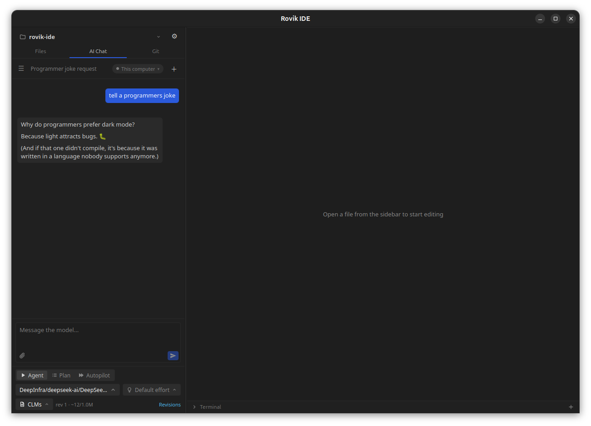

# Rovik IDE

A lightweight desktop code editor with a built-in AI coding agent.

Open a project folder, edit files, run commands in the terminal, use Git,
and chat with an AI agent that can read, change and test your code. It
runs on Linux, macOS and Windows and uses much less memory than
Electron-based editors.

Website and downloads: [rovik-ide.dev](https://rovik-ide.dev).



- [Features](#features)
- [Installing and running](#installing-and-running)
- [Getting started](#getting-started)
- [Cloud hosts](#cloud-hosts)
- [For developers](#for-developers)
- [How some parts work](#how-some-parts-work)

---

## Features

**Editor**

- Monaco editor (the editor used in VS Code) with syntax highlighting,
  themes and tabs.
- Markdown files have a rendered preview, as GitHub shows them: beside the
  source (Ctrl+K V), instead of it (Ctrl+Shift+V), or switched with the
  buttons at the end of the tab strip. It scrolls with the editor, opens
  links (project files in a tab), shows the project's images, colors code
  like the editor, and its task boxes can be ticked. While typing, lists
  continue on Enter, and Ctrl+B / Ctrl+I make text bold or italic.
- IntelliSense for JavaScript/TypeScript that understands the whole
  project, not only open files. Ctrl+click jumps to a definition in another
  file. Files the agent, git or another program creates or changes are
  picked up as they change, without reopening anything. Rust gets help from
  rust-analyzer when it's installed.
- A file tree that stays fast on very large projects and refreshes when
  files change on disk.
- Browser tabs: a page a dev server on a cloud host opens shows in a tab
  of the editor, hot reload and all, with an address bar for any http or
  https page (see [Servers and pages on a cloud
  host](#servers-and-pages-on-a-cloud-host)).
- Project-wide text search powered by ripgrep's engine.
- Several windows, each with a project of its own: **New window** in the
  project menu opens another, and `rovik-ide <folder>` opens a folder in a
  window of its own. A project is open in one window at a time (a copy
  sharing its chats too): opening it again brings that window to the front
  (see [Several windows](#several-windows)).
- A built-in terminal that uses your own shell, on this computer or on a
  connected [cloud host](#a-terminal-on-a-cloud-host). Each project has
  its own terminals: switching to another project, its terminals are shown,
  and the ones left keep running until you come back. Closing a terminal,
  or quitting Rovik, ends what still runs in it, a job started with `nohup`
  or `disown`ed included: as in any terminal it's hung up on first, then
  what's left is asked to stop, and what's still running two seconds later
  is killed. On macOS and Linux a program that started a session of its own
  (`setsid`, tmux's server) keeps running; on Windows everything started
  from the terminal ends, a window it opened too (an editor or a browser
  that wasn't open yet). On a cloud host the shell is hung up on, as when
  an ssh connection closes. Bash up to 5.3, and
  5.4 in development, garbles a command line taller than the terminal;
  with bash 5.1 to 5.4, on this computer, a cloud host or in WSL, a paste
  that would make one stays on one row that scrolls sideways, and wraps
  again once you've deleted enough for it to fit.
  `set horizontal-scroll-mode on` in `~/.inputrc` keeps every long line on
  one row.
- A Git panel: commit, branches, stash, history, pull and push, and a
  rebase onto any local or remote branch, found by searching. Merge
  conflicts are resolved in a side-by-side conflict resolver: the
  conflicts git wrote in the file, each settled with one side, both,
  lines ticked from either side, or an edit by hand. The repository's
  [Git hooks](#git-hooks) run as they do with git: a failing pre-commit
  or pre-push stops the commit or push and shows what it printed.
  A project that is a folder of a larger repository (a monorepo's
  package, a home folder kept in git) lists, commits and discards only
  the changes in its own folder; Discard all sends new files, staged or
  not, to the trash.

**AI agent**

- Works with any OpenAI-compatible provider: OpenAI, Anthropic, Google,
  OpenRouter, Fireworks, or a local model in Ollama or LM Studio. You add
  your own API key. Anthropic's API is spoken natively, so Claude models
  get their reasoning effort, PDFs and prompt caching (see
  [Anthropic's API](#anthropics-api)).
- Two modes:
  - **Agent** does the work: reads code, edits files, runs commands and
    checks the result.
  - **Plan** only looks around, asks you questions and writes a plan. When
    you approve it, Agent mode carries it out.
- **Steer it while it works.** In Agent mode, a message you send while the
  agent works is read at its next step, as part of the same request: "use
  the existing HTTP client", "the tests are in `tests/unit`". Nothing it's
  doing is cut short. Until it's read, the message waits at the end of the
  chat, saying what it waits for (an approval, subagents, the checks), and
  ✕ takes it back into the input. A message the agent stopped before
  reading comes back into the input. See [Steering](#steering).
- **You stay in control.** You choose which commands the agent may run and
  which actions need your approval. Proposed file edits show as a diff in
  the editor, and you can accept or reject each change separately. You can
  also let a second "reviewer" AI model approve routine actions.
- **Credentials stay yours.** The agent can't read or change the files that
  hold credentials (`.env` files, private keys, cloud and package registry
  logins, Terraform state), with its tools or its commands, and it's told
  why, so it asks you for what it needs. **Settings → Restricted files**
  lists them, each with a Read and a Write box you can untick, and takes
  any other file or folder you add. See [Restricted files](#restricted-files).
- **Automatic checks.** When the agent finishes, the IDE runs the project
  checks you turned on: its type check, lint, tests or build. They're found
  in the project's files, and each is off until you tick it in Settings →
  Project checks. If anything fails, the agent is sent back to fix it.
  It's told when a fix made no progress, a fix that breaks
  something that passed before is rolled back, and tests weakened to pass
  (skipped, deleted, fewer assertions) are flagged for you instead of
  counting as verified. A check that fails runs once more on the code
  before the change (in an isolated chat): what fails there too, such as
  the type errors many React Native apps have, isn't the agent's to fix and
  doesn't hold its change back. A test script that runs Jest in watch
  mode is run once.
- **Dev servers keep running.** The agent starts a server or watcher it
  means to keep (`npm run dev`, `tsc --watch`) in the background, not with
  `&`, which ends with its command: it goes on as soon as the command has
  started, with what it printed first, reads what it prints later when it
  needs to, and stops it when it's done. The chat
  shows **Background tasks: 2** under its title, which opens into each
  task, how long it has run, and a Stop for it; the agent hears it was
  stopped. A chat keeps at most 4 running, and they stop when the chat is
  deleted or moved to another computer, its changes are discarded, or
  Rovik quits. In an isolated chat they run in the chat's view, which goes
  once its changes land: the changes wait while one runs, and **Land**
  stops it.
- **Several chats at once, safely.** Each chat works on its own private
  copy of your changes, so two chats (or a chat and you) never overwrite
  each other. When a chat finishes, its changes are merged into the
  project. Conflicts are shown to you, and a landing can be undone.
- **A branch for each new chat.** When you send a new chat's first message
  while the project is on its main branch (the remote's default branch;
  without one, `init.defaultBranch`, `main` or `master`), the agent waits
  while you're asked whether to create a branch for the chat's work and
  switch to it. Its name is made up for it, and you can change it:
  `rovik-`, an adjective, a programmer's last name and 8 random letters
  and digits, such as `rovik-kind-torvalds-x7k2m9qa`. Your uncommitted
  changes come along. **Don't ask again** turns the question
  off; Settings → Agent runs turns it back on.
- **Long tasks stay on track.** Older history is trimmed automatically, or
  the agent can manage its own context (see
  [Context management](#context-management)).
- **Subagents (optional, off by default).** The agent can send scouts:
  read-only helpers that explore one question about the code in a fresh
  context and hand back a short report, so long explorations don't fill
  the agent's own context. A change reviewer can read each finished
  change with fresh eyes before the checks run; the agent fixes or
  answers what it finds. When a check fails with a long output, or fails
  again, a triage helper reads all of it and tells the agent the root
  cause, instead of the agent getting pages of compiler output. In Plan
  mode, a plan reviewer checks each plan against the code before it's
  saved. When the agent implements a long plan, step workers can carry it
  out one step at a time, each writing only its step's files; in an
  isolated chat, steps the plan groups can run side by side, each in its
  own copy, then merged and checked once. If those checks fail, each
  failure's cause goes back to the worker whose files it's in, the agent
  fixes the rest, and the checks run once more; if it still fails, you
  can redo the group one step at a time. A test writer can write tests
  from the request and the plan without reading the new code. Turn them
  on, and pick their models, in Settings → Subagents.
- **Autopilot (optional).** A chat in Autopilot mode carries out a whole
  task from one message without asking: it plans, reviews, implements,
  checks and delivers, and writes down what it couldn't decide. How
  thorough it is, when a task stops, and the commands it may never run are
  set in Settings → Autopilot.
- The agent follows your project's own instructions in `AGENTS.md`,
  `CLAUDE.md` and similar files.
- The agent can search the web and read pages, in a headless Chrome for
  Testing that Rovik downloads into its data folder when it first starts.
- Attach images, PDFs and text files to a message: paste them (Ctrl+V, or
  Paste in the message box's right-click menu) or pick them with the
  paperclip button. Only formats models can read are taken (see
  [Attachments](#attachments)), and only those the chosen model is set up
  for: images need Vision, PDFs need PDF, in Settings → Model providers.
  Images are sent as PNGs at most 768 pixels a side. A message copied from
  the chat or the message box pastes back with its attachments.
- Chats are saved and searchable, and they keep running in the background
  when you switch to another chat.

---

## Installing and running

### Downloads

Download the latest release from [rovik-ide.dev](https://rovik-ide.dev) or
the [GitHub releases](https://github.com/piliugin-anton/rovik-ide/releases):

| System  | Packages                                                                                |
| ------- | --------------------------------------------------------------------------------------- |
| Linux   | AppImage (any distribution), `.deb` (Debian, Ubuntu), `.rpm` (Fedora, openSUSE), 64-bit |
| macOS   | `.dmg` for Apple silicon and for Intel                                                  |
| Windows | Installer (`.exe`) or MSI package (`.msi`)                                              |

Opening it for the first time:

- **macOS:** the app isn't notarized yet. If macOS says it's damaged or
  can't be opened, move it to Applications and run
  `xattr -dr com.apple.quarantine "/Applications/Rovik IDE.app"`.
- **Windows:** SmartScreen may warn that the publisher is unknown: choose
  **More info**, then **Run anyway**.
- **Linux:** make the AppImage executable, then run it:
  `chmod +x Rovik.IDE_*.AppImage`.

Once installed, Rovik [updates itself](#updates).

### Building from source

You need [Rust](https://rustup.rs) and [Node.js](https://nodejs.org) 22
(or 20.19 and newer), plus your system's build tools, as below.

#### Linux

Run these from the project folder:

```bash
./setup.sh   # once: installs system packages, Rust and npm dependencies
./dev.sh     # starts the app
./build.sh   # builds an installable package (AppImage, .deb, …)
```

`setup.sh` supports apt, dnf and pacman. It asks for `sudo` to install
system packages, installs Rust through rustup if yours is missing or too
old, and runs `npm install`. You can run it again safely.

Built packages end up in `src-tauri/target/release/bundle/`.

#### macOS

1. Install the Xcode Command Line Tools: `xcode-select --install`
2. Install [Rust](https://rustup.rs) and [Node.js](https://nodejs.org) 22
   (or 20.19 and newer).
3. From the project folder:

   ```bash
   npm install
   npm run tauri dev      # start the app
   npm run tauri build    # build an installable package
   ```

#### Windows

1. Install
   [Visual Studio Build Tools](https://visualstudio.microsoft.com/visual-cpp-build-tools/)
   with the **Desktop development with C++** workload.
2. Install [Rust](https://rustup.rs) with the default
   `x86_64-pc-windows-msvc` toolchain (MinGW isn't supported).
3. Install [Node.js](https://nodejs.org) 22 (or 20.19 and newer).
4. From the project folder, run the same `npm` commands as on macOS.

WebView2 is already part of Windows 10 and 11.

More details on prerequisites:
[Tauri prerequisites](https://v2.tauri.app/start/prerequisites/).

### Optional: virtual files driver

Some features work best with a virtual-file driver: FUSE on Linux, macFUSE
on macOS. On Windows there's none to install: the agent works in WSL
(Settings → This computer → WSL), which has FUSE. The app runs without one. When it's missing,
the app offers to install it for you; you can also do it later in
**Settings → Virtual files**. The driver is required for the agent's
self-managed context (CLM mode), and it makes the agent's shell commands
faster in isolated chats.

### Updates

Rovik installed from a release (the AppImage, `.deb` or `.rpm`, the macOS
disk image, the Windows installer or MSI package) updates itself. Every 30
minutes it looks at the latest release on GitHub, and when there's a newer
version, a notification offers it. **Update** downloads it, checks it
against Rovik's release key, installs it and restarts Rovik, which opens
your project again. Before the restart, Rovik asks about chats still at
work (they stop, and you can continue them afterwards) and about tabs with
unsaved changes. A `.deb` or `.rpm` update asks for an administrator's
password. On Windows the installer closes every Rovik window and starts
Rovik again once it's done; on Linux and macOS, Rovik's other windows keep
the version they started with and offer a restart.

**Settings → Updates** shows the version, has **Check now**, and turns the
looks off (they're on by default). They go the way **Settings → Network**
sends downloads. A build of your own isn't replaced: a new release is
offered for download instead, and a development build (`npm run tauri
dev`) looks only when you click **Check now**.

Cloud hosts run a Rovik of their own, which the app's update leaves as it
was. Once Rovik runs a new version, it offers once to bring your hosts to
it: **Update hosts** upgrades the hosts where you're one of Rovik's
administrators, for everyone on each (their runs pause while Rovik restarts
there, then go on), and for the others it says whom to ask. WSL on Windows
is brought to the app's version by itself.

---

## Getting started

1. **Open a project:** choose a folder. It appears in the file tree.
2. **Add a model:** open **Settings → Model providers**, paste the
   provider's base URL and your API key, and choose the models you want.
3. **Review permissions:** in **Settings → Permissions & approval**, choose
   which commands the agent may run and what needs your approval. By
   default the agent may only run a short list of safe commands (`ls`,
   `cat`, `cargo clippy`, …), and it edits files without asking. Turn
   approvals on here if you want to review its edits and commands first.
4. **Chat:** open the AI Chat tab, pick a model and a mode (Agent, Plan or
   Autopilot), and describe what you want. In Agent mode you can keep
   sending it messages while it works.
5. **Check the result:** files the chat changed are listed above the
   message box. Open one to compare it with the project version, then
   **Land** the changes or **Discard** them.

Every setting applies as soon as you change it, and the Settings menu
shows each page's state: what's set, and whether it has an effect on this
computer right now. The pages:

| Page                   | What it affects                                                                                                             |
| ---------------------- | --------------------------------------------------------------------------------------------------------------------------- |
| Editor                 | How code looks and is formatted in the editor: theme, font, indentation, wrapping, formatters                               |
| Model providers        | The models chats can use, with your API keys; the AI reviewer and the subagents pick theirs here too                        |
| Connectors             | Coding harnesses (Claude Code, Codex) installed where a chat runs, used in place of a model (see [Connectors](#connectors)) |
| Permissions & approval | What the agent may run and change in every chat, and what waits for your approval, or an AI reviewer's, first               |
| Agent runs             | While the agent works and when it finishes: pauses, its checklist, the checks on its changes, conflicts between chats       |
| Subagents              | The helpers the agent can send, their models and limits                                                                     |
| Autopilot              | Chats that carry out a whole task without asking: effort, budget, the commands they never run                               |
| Project checks         | The type-check / lint / test / build commands of the open project, as detected (each off until you tick it) or fixed        |
| Restricted files       | The open project's files the agent may not read or change: `.env` files, keys and logins found by name, and any you add     |
| Heavy commands         | How many builds and tests run at once on this computer, so it stays responsive                                              |
| Virtual files          | Linux and macOS: the driver that isolates chats and lets the agent manage its own context, and its troubleshooting          |
| WSL                    | Windows: the WSL distribution the agent's commands run in, sandboxed (Rovik's Linux side on this computer)                  |
| Network                | How Rovik connects to model providers, download servers and cloud hosts: connection timeouts and the proxy                  |
| Cloud hosts            | Servers your chats can run on (see [Cloud hosts](#cloud-hosts))                                                             |
| Updates                | Rovik's version, the looks for a new one every 30 minutes, and installing it (see [Updates](#updates))                      |

The model, the mode (Agent, Plan or Autopilot), the reasoning effort and
the context mode are chosen per chat, above its message box. The model
picker lists the providers' models and the connectors' together, each
with its source's icon (a cloud for a provider, a plug for a connector),
with a switch to see one kind alone and a search.

### Connectors

A connector is a coding harness installed on the computer a chat runs on,
used in place of a model provider: Claude Code or Codex. **Settings →
Connectors → Add connector**. Its page groups its settings:

- **Connection**: how it signs in (the login of this computer's user; a
  token: Claude Code's long-lived one from `claude setup-token`, or a
  Codex access token; or an API key), the token or key kept in the
  keychain. **Test & refresh models** checks the program runs (with a
  request, that it's signed in) and lists its models: Claude Code's
  aliases such as `sonnet`, `opus` and `haiku`, and full names; the models
  Codex offers the account.
- **How chats use it**: as the harness itself, or as Rovik's agent on it
  (below).
- **Permissions**, with its own tools: the permission mode its runs get
  (with Claude Code, and the tools they may or may not use without asking).
- **Limits** (Claude Code): the turns and the budget one message may take.
- **Advanced**: the program, its settings folder (`CLAUDE_CONFIG_DIR`,
  `CODEX_HOME`), more arguments for every run, and Claude Code's bare mode.

The models you enable show in the chat's model picker, marked as a
connector's.

When Rovik starts, it checks each connector on this computer with a test
that makes no request, so it costs no tokens: whether its program is
installed (its version), whether it's signed in (`claude auth status`,
`codex login status`), and
whether a newer version is published. It warns about any connector a chat
can pick that isn't signed in, or whose program isn't installed, with a way
to its settings. The connector rows show what the last check found as
Settings → Connectors opens, and the page checks each again meanwhile;
**Check status** asks again. A connector's page shows the same at once and
tests again, also with no request, as it opens and when you pick another
**Computer**. The check trusts a token the program has; one that expired
or was revoked shows as the chat's error at its first message.

**Set up** (on a connector's page, or on its row when it can't run) does
the rest where its chats run, this computer or a cloud host: it tests the
connector; installs the program if it's missing, once you agree, with its
makers' own installer for your user (`claude` or `codex` in
`~/.local/bin`, no admin rights); and signs it in if it isn't (`claude
auth login`, `codex login`), showing what each step prints. Here the
browser opens to sign in; for a host, Rovik opens the sign-in page in your
browser and you paste the code it shows (Codex's page asks instead for the
code its sign-in printed there, `codex login --device-auth`, as on any
computer without a screen). A connector that signs in with a token or a
key takes it in its settings. **Sign out** signs the program out. A test
also finds out whether a newer version is published (Anthropic's release
channel, `latest`; Codex's npm package), and **Update to …** then runs
the program's own updater (`claude update`, `codex update`).
When the check as Rovik starts finds a newer version on this computer, a
notification offers it too, once per version: **Update** runs the same
updater, checks the program again and says how it went.

A chat on a connector's model hands the harness the task: the model, the
effort and the message, in the project folder. The harness keeps its own
conversation for the chat, continued on each message. **How chats use
it** picks how it works:

- **Claude Code.** It runs as itself: its own tools (Read, Edit, Bash…) in
  the project folder, its own system prompt and the CLAUDE.md it reads;
  Rovik sends no prompt. With the permission mode **Follow Rovik's permissions**
  (the default), each call it would ask about goes to **Permissions &
  approval**, as a call of the agent's own tool of the same kind would
  (`--permission-prompt-tool`): its commands are judged by the allowed and
  denied commands, its edits are reviewed in the editor change by change,
  and what needs an approval waits for yours or the AI reviewer's, shown
  on its call's line. Reads in the project and its read-only commands
  run without asking, as Claude Code's manual mode has them. With one of
  Claude Code's own modes (Accept edits, Everything, Auto, Manual, Plan)
  and its tool rules, Rovik's approval settings don't apply. In every mode,
  the project's [restricted files](#restricted-files) stay out of its reach:
  its Read and Edit tools are denied them by its own rules, and a command
  of its shell that would read or change one is refused before it runs. Its reply
  shows its work as Rovik's agent's shows, in the order it went: each
  stretch of its thinking ("Thought for 3 s", open to the text), and its
  tool calls as the lines of Rovik's tools of the same kind ("Read
  app.ts", "Edited app.ts", "Ran npm", its checklist as Rovik's), then its
  answer. In a
  chat's own copy of the project (an isolated chat, or one on a cloud
  host), git commands that change the repository (`checkout`, `switch`,
  `reset`, `commit`, `push`…) are refused in every mode, as they are to
  Rovik's agent: Claude Code is given deny rules for them, and Rovik's
  hook refuses other spellings (`git -C . push`) before they run. The
  chat's changes reach the project when they land. In the chat's **Plan**
  mode it plans in its own plan mode (`--permission-mode plan`), whatever
  its permission mode: it reads, changes nothing, and replies with its
  plan, which you carry out in Agent mode. Autopilot needs Rovik's tools:
  with Claude Code's own, the chat says so and doesn't send.
- **Rovik's agent on Claude Code.** Claude Code is the model behind
  Rovik's agent, with Rovik's system prompt in place of its own. Rovik
  serves the run's tools to it over MCP (a server on 127.0.0.1 for that
  run alone, behind a token only it has), with Claude Code's own tools
  off. Each message of Claude Code's that calls them is a reply of
  Rovik's: Rovik runs the calls under Permissions & approval, in the
  chat's copy of the project, and gives Claude Code the results while it
  waits, however long an approval takes. Rovik's checks, checklist,
  plans, Autopilot and subagents work as with any model, and such a model
  can be a subagent's too. The prompt goes in a file
  (`--system-prompt-file`) with the project's section split off, so the
  rest stays cached, and is rebuilt on every run
  (`--system-prompt-snapshot off`), so a changed setting applies to a
  chat's next message.
- **Codex.** It runs as itself, its app server (`codex app-server`) in the
  project folder: its own tools (its shell, its patches, web search…), its
  own system prompt and the AGENTS.md it reads. With **Follow Rovik's
  permissions** (the default), Codex asks before every command and every
  patch, and Rovik's hooks answer as Permissions & approval would for the
  agent's own calls: its commands by the allowed and denied commands, each
  file a patch changes as Rovik's edit of it, reviewed in the editor change
  by change; of a patch you accept in part, Codex applies what you
  accepted. What Rovik allows, Codex runs without its own sandbox, as
  Claude Code runs its commands. Codex's own modes are its sandbox
  presets: **Auto** (in
  the project's folder, its own reviewer deciding on anything more),
  **Project folder** (there, without network, never asking), **Read only**
  and **Everything**. In every mode, a command or patch that would read or
  change one of the project's [restricted files](#restricted-files) is
  refused before it runs, as is git that changes the repository in a chat's
  copy of the project; a command is checked from the project's folder,
  since Codex doesn't tell its hooks the folder a command runs in. A
  command or patch that starts without Rovik's hook having seen it (a hook
  that failed) stops the turn. In the chat's **Plan** mode it plans in its
  own plan mode, in a read-only sandbox, whatever its permission mode:
  Rovik refuses its patches, and its plan is the reply. Its reply shows its
  work as Rovik's agent's does: its commands as what Codex read them as
  doing ("Read app.ts", "Searched", or "Ran npm"), each file a patch
  changed as an edit, its plan as Rovik's checklist. It keeps one thread
  of its own per chat for each way of using it.
- **Rovik's agent on Codex.** Codex is the model behind Rovik's agent:
  Rovik's system prompt replaces its own (`baseInstructions`, with the
  project's section apart, so the rest stays the same from run to run),
  and Rovik serves the run's tools to it over MCP, as functions of their
  own. Codex's own tools are off, or refused by Rovik's hook where they
  can't be turned off, in a read-only sandbox. Each of its calls of
  Rovik's tools is a reply of Rovik's, run under Permissions & approval in
  the chat's copy of the project, its result given to Codex while it waits.
  Rovik's checks, checklist, Plan mode (Rovik's own, not Codex's),
  Autopilot and subagents work as with any model, and such a model can be
  a subagent's too.

Either way, its thinking shows: Rovik asks Claude Code for it
(`--thinking-display summarized`) and Codex for its reasoning's summary,
since current models send none unless asked. What comes is the API's
summary of the thinking, and it costs nothing more; with Rovik's tools, it
shows above the reply, as any model's does. Connector models take no
images or PDFs from the chat.

**Commands.** In a chat on a connector, typing `/` at the start of the
message lists the commands the harness offers there: Claude Code's own
(`/compact`, `/context`, `/cost`…), the project's `.claude/commands` and
the user's, and skills, each with what it takes and what it does. Rovik
asks Claude Code for the list in the project folder (no request to the
model) and keeps it a minute. Claude Code's commands that would change
what Rovik keeps aren't listed: the chat's session (`/clear`), its model
and effort (`/model`, `/effort`, `/fast`, `/config`, which save theirs as
Claude Code's defaults), its settings and approvals (`/update-config`,
`/fewer-permission-prompts`, `/doctor`, `/mcp`), the sign-in, and those
that need a terminal or work on after the run (`/color`, `/loop`,
`/goal`, `/batch`). Up and Down move through it, Enter or Tab
picks one; Escape closes it. A picked command goes to Claude Code as
typed and alone, without the editor's context before it, and its output
is the reply (`/compact` says how far it shrank the conversation). Only
a picked command runs as one: a message typed by hand, `/compact` or
`/etc/passwd has a typo`, goes as a message, so Claude Code reads it as
text. A command picked while the agent works isn't sent to the run, which
Claude Code would read as text in the middle of its turn: it waits at the
end of the chat and runs once the agent has finished, as Claude Code's own
terminal runs one typed while it works. Codex offers `/compact`, `/review`
(the uncommitted changes, or what you name) and its skills, from the
project, the user's folder and its own; a picked skill goes to Codex
attached, as `$name` and what you typed after it.

**Context.** The harness keeps the conversation and compacts it itself,
so a connector's chat has no context mode (Trimming, CLMs) and Rovik
doesn't estimate it. The bar above the input shows the harness's own
context after its last reply instead, "Context used: 35k / 1M (4%)", with
where it compacts on its own in the tooltip.

On a cloud host, the host needs its own installation: an administrator
runs `sudo /opt/rovik/bin/rovik-agentd admin claude-code` (or `admin
codex`) once, which installs Anthropic's package (OpenAI's installer, for
Codex) for every user (see [docs/cloud-hosts.md](docs/cloud-hosts.md)), or
each user runs **Set up** with the host chosen, which installs it for them
alone. The host's page in **Settings → Cloud hosts** lists the connectors
installed there for you, in one line: "Connectors installed: Claude Code,
Codex". Each user's chats sign in with the token or key of the connector's
settings, or the login Set up made for them there.

When the agent runs commands from the IDE, they get the same `PATH` as your
login shell, so tools like `npm`, `cargo` and Homebrew packages are found
even when you start the app from a desktop icon. A tool installed after the
app (or a cloud host's daemon) started, by a host's setup script for one, is
found too: when a command fails for want of a program that isn't on that
`PATH`, or an Autopilot install needs one, the login shell's is read again.

Rovik makes ready what a command needs, before it runs and again when it
fails for want of a program or a package. The same goes for the agent's own
commands and for Claude Code's and Codex's own shells (through Rovik's
hooks, whatever their permission mode):

- **Toolchains.** On a cloud host, the Node or Rust version the project asks
  for is installed for the whole server if it isn't there, and Yarn and pnpm
  run through Corepack at the version the project's `packageManager` names
  ([docs/cloud-hosts.md](docs/cloud-hosts.md), "Shared toolchains and
  caches"). On your own computer Rovik installs no toolchain: the agent is
  told what's missing, so it can tell you.
- **Dependencies.** When a command fails for want of the project's
  dependencies (no `node_modules`, so `vite: not found` or
  `Cannot find module 'react'`), the project's install runs (`npm ci`,
  `pnpm install --frozen-lockfile`, `uv sync`…), as the Autopilot Prepare
  stage runs it: once, at a workspace's root, only where Permissions &
  approval would let that install run without asking (in an Autopilot task,
  where its Prepare setting is on too), and never in Plan mode. Otherwise
  the agent is told which install to run.
- **Services.** A project whose compose file (`compose.yaml`,
  `docker-compose.yml`) declares the databases, caches and queues its code
  needs gets them named in the agent's prompt, read with Docker Compose
  itself where it's installed. When a command fails to connect to a port
  one of them publishes (`connect ECONNREFUSED 127.0.0.1:5432`, Prisma's
  "Can't reach database server", libpq's, MySQL's, Kafka's, JDBC's), or
  looks one up by its name (`getaddrinfo ENOTFOUND db`), the agent is told
  which service it needed and that it isn't running. On your own computer
  it asks you to start it (`docker compose up -d db`): its commands can't
  start containers, since the sandbox closes Docker's and Podman's sockets
  to them. On a cloud host your daemon starts it under your own Podman, its
  ports in your private network there and its image fetched once for the
  whole server, and the command runs again
  ([docs/cloud-hosts.md](docs/cloud-hosts.md#project-services)). The
  agent's commands can't run containers there, not even with the server's
  Podman: a `docker compose up` of theirs has your daemon start what it
  names, and one that reaches for Docker or Podman otherwise is told so. A
  service looked up by its name is reached at its published port on
  localhost instead, and the agent is told so.
- **Running it again.** A command that is one program (`npm test`) runs again
  by itself once what it lacked is there, and the agent sees both why and the
  second run. A longer one (`cd web && npm test`) is left to the agent, since
  running it twice could repeat its first parts; Claude Code or Codex is
  told beside the failed command's result.

What a project needs is read the same way everywhere (these checks, the
Prepare stage, the toolchains a host installs): its own folder, the packages
one folder down (a monorepo's `web/`, a Tauri app's `src-tauri/`), and a Node
workspace's members wherever they are. A root `package.json` that only lists
its workspaces still gets the Node version its members name, and one install
at the root. A language is one module (`src-tauri/crates/rovik-core/src/ecosystems/`):
Node, Rust, Python and Go are there, and another implements the same trait.

---

## Cloud hosts

A cloud host is a Linux server that your chats can move to and run on. You
add one in **Settings → Cloud hosts**, and Rovik logs in to it over SSH as
your own account there. If you run a server that several people share, see
[Rovik on a team server](docs/cloud-hosts.md).

### An SSH key for a cloud host

Make the key on the computer that runs Rovik, put its public half in your
own account on the server, then point Rovik at the private half.

1. **Make the key.** On macOS or Linux:

   ```bash
   ssh-keygen -t ed25519 -f ~/.ssh/rovik_ed25519 -C "rovik on my-laptop"
   ```

   On Windows, in PowerShell (Windows 10 and 11 include the OpenSSH client):

   ```powershell
   ssh-keygen -t ed25519 -f $env:USERPROFILE\.ssh\rovik_ed25519 -C "rovik on my-laptop"
   ```

   A passphrase is optional. If you set one, Rovik keeps it in the system
   keychain. You get two files: `rovik_ed25519`, the private key, which never
   leaves your computer, and `rovik_ed25519.pub`, the public key, which goes
   on the server and is safe to share.

2. **Put the public key in your account on the server.** Use a regular
   account: Rovik's daemon never runs as root, so it won't deploy over a root
   login, and on a shared server each person has their own account. If you
   can already log in with a password, on macOS or Linux:

   ```bash
   ssh-copy-id -i ~/.ssh/rovik_ed25519.pub you@server
   ```

   Windows has no `ssh-copy-id`. In PowerShell:

   ```powershell
   type $env:USERPROFILE\.ssh\rovik_ed25519.pub | ssh you@server "umask 077; mkdir -p ~/.ssh && cat >> ~/.ssh/authorized_keys"
   ```

   If you can't log in yet, send the `.pub` file to the server's
   administrator, who adds it to your account (here `ann`):

   ```bash
   sudo adduser ann   # only if the account doesn't exist yet
   sudo mkdir -p /home/ann/.ssh
   sudo tee -a /home/ann/.ssh/authorized_keys < rovik_ed25519.pub > /dev/null
   sudo chown -R ann: /home/ann/.ssh
   sudo chmod 700 /home/ann/.ssh && sudo chmod 600 /home/ann/.ssh/authorized_keys
   ```

   On a new cloud server, you can instead paste the contents of the `.pub`
   file into the provider's SSH keys field when you create the server. If
   the provider only sets up root, create a regular account as above first.

3. **Check it from a terminal:**

   ```bash
   ssh -i ~/.ssh/rovik_ed25519 you@server
   ```

   It should log you in without asking for a password. It asks only for the
   key's passphrase, if you set one.

4. **Add the host in Rovik.** In **Settings → Cloud hosts**, click
   **+ Add host** and fill in **Host**, **Port** and **User** (your account).
   Set **Log in with** to **A key file**. In **Key file**, enter the full path
   to the private key, not the `.pub` file: `/home/you/.ssh/rovik_ed25519` on
   Linux, `/Users/you/.ssh/rovik_ed25519` on macOS, or
   `C:\Users\you\.ssh\rovik_ed25519` on Windows. Enter the **Key passphrase**
   only if the key has one. Click **Save**, then **Test connection**.

5. **Trust the server's key.** The first test shows the server's key
   fingerprint. Click **Trust this key** once it matches one of the lines
   this prints on the server:

   ```bash
   for key in /etc/ssh/ssh_host_*_key.pub; do ssh-keygen -lf "$key"; done
   ```

Instead of a key file, you can load the key into your SSH agent
(`ssh-add ~/.ssh/rovik_ed25519`) and choose **My SSH agent**. Rovik then
never reads the key file. On Windows, Rovik uses the OpenSSH Authentication
Agent service, which is off until you start it, or Pageant. To start the
service, in PowerShell run as administrator:

```powershell
Get-Service ssh-agent | Set-Service -StartupType Automatic -PassThru | Start-Service
```

Ed25519 keys are the best choice. RSA and ECDSA keys work too, and so do
PuTTYgen `.ppk` files, so an existing PuTTY key works as it is.

On a server several people share, whoever deploys Rovik there first becomes
its administrator, and that account needs `sudo`. Everyone else only needs
their own account with their key in it. Deploying where Rovik is installed
already, the app trusts the installed build when it's one of Rovik's
releases. Any other build, such as an administrator's own, shows in
**Test connection** with its SHA-256, and the app connects once you click
**Trust this build**.

### A terminal on a cloud host

Once a cloud host is connected, the **+** of the terminal panel asks where
the new terminal runs: **Local**, on this computer, or **_name_ (remote)**,
your login shell on that host, in your home folder there. `` Ctrl+Shift+` ``
still opens a local one at once. While a host is connected, each tab says
where it runs: `bash (local)`, `bash (Build server (remote))`.

A remote terminal logs in as the host's settings say, on a connection of its
own. On a host set to **My system ssh**, it runs your own `ssh` to the host,
with your configuration.

Where your login shell there is bash 4.4 to 5.4, Rovik starts it as it does
on this computer: with a file of Rovik's, saved in `~/.rovik/terminal`, that
reads the same login files and keeps a long pasted line from being garbled
(see the terminal above). Started this way, the host shows no login banner
(the message of the day, "Last login"). Through **My system ssh** the shell
starts as your ssh starts it.

### Servers and pages on a cloud host

On a server several people share, the agent's commands run in a network of
your own there: its dev servers can take any port without clashing with
another user's, and nobody else can reach them, while the agent tests them
with `curl localhost:3000`, or opens their pages in its own browser, which
runs in that network too, as it would on your computer. When a command
opens a page of one of them (`vite --open`, `xdg-open
http://localhost:5173`), Rovik shows it in a browser tab of the editor,
through a port of this computer forwarded to it: the same port when it's
free here, another when it isn't. The tab loads the page through a second
port of Rovik's, which drops what keeps a page out of a frame
(`X-Frame-Options` and CSP `frame-ancestors`, as Django, Rails or helmet
send them) and passes WebSockets through, so the dev server's hot reload
works in the tab. On Windows it also makes the page's cookies ones a frame
keeps, so signing in to it works there. It adds a small script of Rovik's
to each page it loads, which tells the tab where the page is: the tab's
address bar follows the page as you click through it, and Reload and
**Open in your browser** take it there. An https page opens in your browser
instead, and so does a window the page opens. A page of another site that
refuses to be framed, as most sign-in pages do, shows nothing in a tab: open
it in your browser. The chat shows **Opened ports:** under its title, each port
on a button that opens its page in a tab, or, as its ▾ chooses for every
port, copies the address here that leads to it; **Background tasks: 1,
open ports:** while the agent has a server running there. A dev server
the agent leaves running in the background serves its page until it's
stopped; one it starts with `&` ends with its command, and its page with
it. Once nothing listens on a server's port any more, as when its command
timed out or was stopped, the port leaves that row and the tabs showing
its pages close. A page at any other address is refused. See
[Rovik on a team server](docs/cloud-hosts.md#each-users-own-network).

---

## For developers

### Tech stack

| Part           | Choice                         | Why                                                                                                                |
| -------------- | ------------------------------ | ------------------------------------------------------------------------------------------------------------------ |
| App shell      | [Tauri 2](https://tauri.app)   | Uses the OS's own web view instead of bundling Chromium, so it uses far less memory than Electron.                 |
| UI             | [SolidJS](https://solidjs.com) | No virtual DOM: an update touches only the DOM nodes that depend on it, so the UI stays fast as it grows.          |
| Editor         | Monaco                         | VS Code's editor component.                                                                                        |
| Long lists     | `@tanstack/solid-virtual`      | Only visible rows are rendered, so a tree with 50,000 files costs about the same as one with 50.                   |
| Backend        | Rust                           | Files, Git (libgit2), search (ripgrep crates), terminal, language servers, the AI agent, chat storage (SQLite).    |
| Code structure | tree-sitter                    | Outlines of source files for the agent: find a symbol, build a "repo map" of the most relevant code for a request. |

The AI agent runs **in the Rust backend**, not in the web view. A run keeps
going if you switch chats or reload the UI; the frontend only starts it,
stops it, answers its approvals and shows its progress.

### Commands

| Command                                         | What it does                                                                        |
| ----------------------------------------------- | ----------------------------------------------------------------------------------- |
| `npm run tauri dev`                             | Run the app with hot reload (same as `./dev.sh`)                                    |
| `npm run tauri build`                           | Build a release package (same as `./build.sh`)                                      |
| `npm test`                                      | Frontend unit tests (`src/**/*.test.ts`)                                            |
| `npm run typecheck`                             | TypeScript type check of the app, its tests and its build config                    |
| `npm run test:scripts`, `npm run test:eval`     | Tests of the release scripts and of the evaluation harness                          |
| `cd src-tauri && cargo nextest run --workspace` | Backend tests, every crate, as CI runs them ([cargo-nextest](https://nexte.st))     |
| `cd src-tauri && cargo test --workspace`        | The same with cargo's own runner: slower, doctests included                         |
| `cd src-tauri && cargo test vfs -- --ignored`   | Mounts a real virtual volume (Linux) and runs shell tools and Git on it             |
| `npm run format`                                | Format with Prettier (`format:check` to verify)                                     |
| `scripts/build-agentd.sh`                       | Static builds of the daemon for Linux servers (x86_64 and aarch64)                  |
| `node scripts/e2e/run.mjs`                      | End-to-end runs of a built app ([scripts/e2e](scripts/e2e/README.md))               |
| `node scripts/eval/eval.mjs`                    | The agent's evaluation on a fixed task set ([scripts/eval](scripts/eval/README.md)) |

`scripts/build-agentd.sh` needs zig and cargo-zigbuild:
`pip install cargo-zigbuild` brings both. Each build is a single file that
runs on any Linux, in `src-tauri/target/agentd/`. To deploy one, start the
app with `ROVIK_AGENTD_BINARY` set to its path.

### Releases

Every merge to master is released. The **Release** workflow
(`.github/workflows/release.yml`) runs on each one:

1. It runs the checks first, the CI workflow's: the tests on Linux, macOS
   and Windows. A merge that fails them isn't released.
2. It chooses the version: the one in the sources while no release has it
   (the first release, or one a pull request set with
   `scripts/set-version.sh 1.3.0`), otherwise the sources' version with
   its last number raised, `1.2.3` to `1.2.4`, which it commits to master
   as `Release 1.2.4 [skip ci]`.
3. It builds the app for Linux (AppImage, .deb, .rpm), macOS (a disk
   image each for Apple silicon and Intel) and Windows (installer and MSI
   package), and the daemon for x86_64 and aarch64 Linux servers.
4. It signs the builds and publishes them on the version's GitHub
   release, tagged `v1.2.4`, with `latest.json`, what the installed apps'
   updates read (see [Updates](#updates)): each kind of app's bundle on
   the release and its signature, written by `scripts/updater-manifest.mjs`
   once every platform's are there. The download buttons on
   [rovik-ide.dev](https://rovik-ide.dev) show it at once: they ask GitHub
   for the latest release, and so do the apps.

Nothing is published until every build is on the release, so a run that
fails leaves the latest release as it was. The next merge publishes the
version it couldn't; so do **Re-run failed jobs** on its run and **Run
workflow** (in the **Actions** tab, under **Release**) with the version
left empty. **Run workflow** with a version, such as `2.0.0`, releases
that version from the branch you pick.

The app downloads the daemon for a server from its own version's release,
and checks it against the release key before it goes to the server. The
daemon on a server checks an upgrade against the same key, and so does the
app's own update (tauri-plugin-updater, `src-tauri/src/updates.rs`), whose
signatures also say the version they were made for: a `latest.json` that
pairs a new version with an older release's bundle is refused.

Only the release builds the updater's bundles and their signatures
(`--config src-tauri/tauri.updater.conf.json`, which sets
`bundle.createUpdaterArtifacts`): `tauri build` refuses to make them
without the signing key, so a developer's build and the end-to-end runs
make none. A pre-release isn't GitHub's latest release, so installed apps
aren't offered it.

Before the first release, make the key once:

1. Run `npx tauri signer generate -w ~/.tauri/rovik.key` and choose a
   password. Keep the file and the password safe: without them there are
   no more signed releases.
2. In the repository's **Settings → Secrets and variables → Actions**, add
   `TAURI_SIGNING_PRIVATE_KEY`, with the contents of `~/.tauri/rovik.key`,
   and `TAURI_SIGNING_PRIVATE_KEY_PASSWORD`, with the password.
3. Paste the public key, the one line in `~/.tauri/rovik.key.pub`, below
   the comments in `src-tauri/release-key.pub`, and in
   `plugins.updater.pubkey` in `src-tauri/tauri.conf.json` (the updater
   takes it from `release-key.pub`, but `tauri build` checks the bundles'
   signatures against this one; a test keeps the two the same), and
   commit them.

Versions have numbers only, such as `1.2.3`, or `1.2.3-4` for a
pre-release, which GitHub publishes as one: a Windows installer refuses
anything else. The version is written in `src-tauri/Cargo.toml`
(`[workspace.package]`) and `package.json`; to change it by hand, run
`scripts/set-version.sh 1.2.3`. After a pre-release such as `1.2.3-4`,
merges release `1.2.3-5`, `1.2.3-6`… until a pull request sets the next
version, or **Run workflow** releases one.

#### Protecting master

GitHub can refuse to merge a pull request until its checks pass. In the
repository's **Settings → Rules → Rulesets**, choose **New ruleset → New
branch ruleset**:

1. Name it (`master`) and set **Enforcement status** to **Active**.
2. Under **Bypass list**, add **Repository admin**, set to **Always
   allow**: the release's commit of the version is pushed past the rules
   with your token (below). You can still merge past them on purpose.
3. Under **Target branches**, choose **Add target → Include default
   branch**.
4. Tick **Require a pull request before merging** and **Require status
   checks to pass**. Under **Add checks**, add the six checks (GitHub
   suggests a check once it has run in the past week):
   - `Rust tests (Linux)`
   - `Rust tests (Linux, Landlock)`
   - `Rust tests (macOS)`
   - `Rust tests (Windows)`
   - `Evaluation dry run`
   - `Frontend tests, types and formatting`

   Leave **Require branches to be up to date before merging** off: the
   release's commit of the version after each merge would put every open
   pull request behind. The release runs the checks on each merge anyway.

5. Choose **Create**.

Then give the release a token that may push past the rules. Make a
fine-grained token (**your GitHub settings → Developer settings → Personal
access tokens → Fine-grained tokens**) for this repository only, with
**Contents: Read and write**, and add it to the repository's **Settings →
Secrets and variables → Actions** as `RELEASE_TOKEN`. Without it, a
protected master refuses the release's commit of the version, and the
release stops there. The token expires on the date you choose: choose the
latest it offers, and when it runs out, replace the secret with a new one
(a release with an expired token stops at its checkout).

To debug model requests, set `ROVIK_API_LOG=1`. Every request and response
is then logged to `<temp dir>/rovik-api-log.jsonl`; set it to a file path
to log there instead. API keys are not written to the log.

The app's own log goes to stderr: what its hosts' connections, mirrors and
moves report, at level info. `ROVIK_LOG=debug` (or `trace`, `warn`,
`error`) sets the level.

### Project layout

```
src/                     frontend (SolidJS + TypeScript)
  App.tsx                main window: wires the panels together
  components/            UI: Editor, FileTree, ChatPanel, GitPanel,
                         TerminalPanel, SearchPanel, settings pages, …
  lib/                   state and logic, no UI
    agentRuns.ts         starts, stops and follows agent runs
    approvals.ts         approvals waiting for the user
    permissions.ts       permission settings (enforced in the backend)
    intellisense/        project-wide TypeScript IntelliSense (and its worker)
    lsp/                 language server client (rust-analyzer)
    commands.ts          typed wrappers around backend commands

src-tauri/               backend (Rust), a Cargo workspace
  src/                   the app
    lib.rs               app setup: plugins and command registration
    commands/            the commands of the agent and its chats, over the core
    filesystem/          directory listing and the file watcher
    git/, git_sync.rs    Git panel: status, branches, history, pull, push, hooks
    terminal.rs          the terminal panel
    lsp/                 language servers, bridged to the editor
    instances.rs         several windows: which window has which project
    shared_state.rs      the state the windows share (tabs, settings, …)
    updates.rs           the app's own updates
  crates/rovik-core/src/ the agent and what it uses, without Tauri
    core.rs              what the agent needs from its host (`Core`)
    agent_run/           the AI agent: model turns, tool calls, approvals,
                         AI reviewer, verification checks, subagents,
                         Autopilot, steering
    chat_request.rs      sending requests to model providers
    anthropic/           Anthropic's API, spoken natively (Messages API)
    chat_db/             chat storage (SQLite)
    clm/                 agent-managed context (CLM mode)
    overlay/             each chat's private view of the project
    vfs/                 virtual files (FUSE / macFUSE)
    workload/            queue for heavy commands (builds, tests)
    merge.rs             three-way merge (no git program needed)
    code_search.rs       project search
    file_guard.rs        stops a write from overwriting changes it hasn't seen
    restricted_files.rs  the files the agent may not read or change (.env, keys…)
    outline/, repo_map/  tree-sitter outlines and the repo map
    project_profile.rs   detects the stack, checks and agent instruction files
    browser_tools.rs     web search / browsing for the agent
    pinned_browser.rs    the Chrome for Testing build the browser tools use
  crates/rovik-protocol/ what the app and the cloud daemon send each other,
                         and how releases are signed
  crates/rovik-client/   the app's side of that: connecting to hosts over SSH,
                         deploying the daemon, WSL
  crates/rovik-agentd/   the daemon: the agent on a cloud host or in WSL
  crates/rovik-headless/ the agent without a window, for evaluations
  crates/eoka/           headless Chrome automation (for the browser tools)
  crates/russh/          SSH: russh with fixes, outside the workspace (FORK.md)

docs/                    team servers (cloud-hosts.md), the WSL checklist,
                         the backend review
docs/design/             design documents: chat isolation, subagents,
                         Autopilot, cloud hosts, steering, Evolve
scripts/test.mjs         frontend test runner
scripts/e2e/             end-to-end runs of a built app
scripts/eval/            the agent's evaluation (tasks, grading)
website/                 the site at rovik-ide.dev, and the icon's drawing
                         (website/README.md)
```

---

## How some parts work

### Several windows

Each window is a Rovik process of its own, with a project of its own. All
of them share one chats database, settings and data folder, but a chat's
run, its Autopilot task and the files it has open live in the memory of the
process that has its project: two windows on one project would change its
chats unaware of each other. So a project is claimed by the window that
opens it, with an OS lock on a file in `<data>/open-projects`, named after
its folder and its project ID (copies sharing the chats share the ID). The
lock goes with the window, a crash included. Opening a project another
window has asks that window to come to the front instead, over a localhost
connection that only takes the token it wrote next to its lock. A window
with no folder open claims the chats without a project, so a second such
window shows a note instead of them. A window that switches to another
project while chats of the first are still at work (a run, an Autopilot
task, a stage waiting out a rate limit) keeps the first claimed until they
finish.

What one process must not do to another's work is guarded the same way:

- A chat at work holds a lock in `<data>/chats-at-work`. No other window
  starts a run in it, resumes it, or marks its unanswered message failed.
- An open overlay holds a lock in its store. Another window's startup
  cleanup leaves it alone, and no other window opens it, imports results
  into it or deletes it.
- A landing being written holds a lock in its journal's folder, so another
  window starting meanwhile doesn't "finish" it as interrupted.
- Each database write takes the write lock as it begins (`BEGIN IMMEDIATE`)
  and waits for the other window's commit, rather than failing halfway.
  The marker that says the database is open is shared: the integrity check
  and attachment cleanup run only in a window that starts alone.
- What only one process can have gets a slot number per window (1, 2, …):
  the virtual files' folder (`vfs`, `vfs-2`), the system ssh's forwarding
  sockets, and the headless browser's profile under snap Chromium.
- AI settings are saved onto the file as it is now: a window only changes
  what it changed itself, so an older copy in another window never drops a
  provider or a key saved meanwhile.
- The heavy-build slots (Settings → Heavy commands) are the machine's: a
  slot one window's build holds is taken in every window, by a lock in
  `<data>/heavy-slots`, and a busy terminal counts in all of them too. The
  number of slots set in one window applies in the others.
- A window that crashed mid-reply leaves its chat's message unanswered, and
  its own drafts are its own (each window's browser storage is): the window
  that opens that project next marks the message failed and puts its text
  back in the input, as the crashed window would have at its restart.
- Every window opens where the last one was left; a window started while
  others run steps down from there, so it doesn't hide the one it came from.
- Every window connects to the cloud hosts, and a chat on a host is its
  project's window's: that window imports and lands its results, pulls its
  rows and shows its approvals and questions. Land, Undo and Discard of
  such a chat are refused in another window. The chats of a project open
  in no window are every window's, and a mirrored chat is pulled by one
  window at a time.
- Each window follows the hosts' settings file: a host another window
  added, deployed again (a new token), changed or removed is connected
  again or let go of here within seconds, and before a window sends a host
  its configuration it reads the host's approval policy again, so an older
  window doesn't send back the one the user just changed. The file is
  changed by one window at a time.
- A window open while a newer Rovik updated the chat database (an update
  installed while it ran) stops writing to it: close it and open Rovik
  again. rust-analyzer's old versions are cleaned up only while no other
  window runs, as one may still run them.
- What a window used to keep in its own browser storage, and so wrote back
  whole over what other windows had saved, is shared in `<data>/shared`: a
  file each for the projects' tabs, the editor settings, the reasoning
  effort per model, rust-analyzer's choices and the chats' unread marks. A
  save changes only the entries it changed, one window at a time, and a
  window reads them again as it comes to the front. So a project closed
  with its window opens with its tabs in another, and a setting changed in
  one window isn't undone by another's. A window's unread dots are for its
  own project's chats.
- A lock is unlocked as it's let go, not only closed: a program another
  thread starts at that moment shares the open file until its exec, which
  kept a lock let go held meanwhile.

### Git hooks

The Git panel works through libgit2, which runs no hooks, so the panel
runs them itself (`src-tauri/src/git/hooks.rs`), where git would and with
git's arguments and input:

| In the Git panel               | Hooks that run                                               |
| ------------------------------ | ------------------------------------------------------------ |
| Commit                         | pre-commit, prepare-commit-msg, commit-msg, post-commit      |
| Push                           | pre-push                                                     |
| Switching branch               | post-checkout                                                |
| Pull that fast-forwards        | post-merge                                                   |
| Pull that merges               | pre-merge-commit, prepare-commit-msg, commit-msg, post-merge |
| Continuing a merge (conflicts) | pre-commit, prepare-commit-msg, commit-msg, post-commit      |
| Pull that rebases, or Rebase…  | pre-rebase, post-rewrite                                     |

A hook that runs before (pre-…, prepare-commit-msg, commit-msg) and fails
stops the action, and the panel shows what the hook printed. A merge it
stops stays in progress, to continue or abort. What a pre-commit hook
stages is committed, and the message is what the message hooks leave in
`.git/COMMIT_EDITMSG`. Hooks that run after can't stop anything; their
failure is only logged, as git ignores it.

When a hook that checks stops a commit, a push or a merge's commit, the
error has a button to try once more without it: **Commit without hooks**,
**Push without hooks** or **Commit merge without hooks**, as git's
`--no-verify`. That skips pre-commit, commit-msg, pre-merge-commit and
pre-push for that one try. prepare-commit-msg and the hooks that come
after still run, as with git, and a push after such a commit still runs
pre-push. The panel tells the hook from the error (`src/lib/gitHooks.ts`).

The file tree doesn't show `.git`, so the Git panel's ⋯ menu has
**Git hooks…** (`src/components/GitHooksView.tsx`,
`src-tauri/src/git/hook_files.rs`). It lists each of the hooks above with
its state: on, not executable (skipped), only git's example (`.sample`),
or not there. A hook opens in the editor. **Create** makes one from a
small template, executable, and opens it. **Enable** makes one executable
(`chmod +x`), and the trash button moves one to the trash. With husky 9,
whose `core.hooksPath` is its generated `.husky/_`, the view shows the
hooks you write in `.husky/` instead.

Hooks are found as git finds them: in `core.hooksPath` when it's set (a
relative path is from the working folder), else in `.git/hooks`. So
husky, lefthook, pre-commit and simple-git-hooks work as they are. Each
runs in the working folder, with the PATH of the user's login shell (for
`npx`, `node`, …), and without a terminal, so a hook can't wait on input.

- **macOS, Linux:** the hook file must be executable (`chmod +x
.git/hooks/pre-commit`), as git requires. One that isn't is skipped, as
  git skips it. A script without a `#!` line runs with `/bin/sh`.
- **Windows:** a hook script runs with the `sh` of
  [Git for Windows](https://git-scm.com/download/win), which reads its
  `#!` line (`#!/bin/sh`, `#!/usr/bin/env node`, …) as git does, with Git
  for Windows' tools (grep, sed, …) on the PATH. A `<hook>.exe` runs as it
  is. Without Git for Windows a script hook can't run: the action stops
  and says so, rather than going on as if the hook had passed.

### Project checks

When the agent finishes a change, the IDE runs the project's checks (type
check, lint, tests) and sends what fails back to it. Detection only
suggests them: each check found is off until the user ticks it in
Settings → Project checks, which saves the project's list
(`agent_run/project.rs`, `effective_checks`). An Autopilot task with no
check on runs its plan's validation commands instead. What the checks know
lives in tables (paths under `src-tauri/crates/rovik-core/src/`), so
teaching them a new tool is usually one row:

| To teach the checks…                                     | Add it to                                                                                                 |
| -------------------------------------------------------- | --------------------------------------------------------------------------------------------------------- |
| another package.json script name for a kind of check     | `CHECK_SCRIPTS` in `project_profile/node.rs` (and its copy in the frontend's `src/lib/projectProfile.ts`) |
| a framework to name in the stack the agent is told about | `STACKS` in `project_profile/node.rs`                                                                     |
| a test runner's watch mode, which never ends             | `WATCHERS` in `project_profile/node.rs`                                                                   |
| a tool's way of printing its failures                    | a rule in `RULES`, `agent_run/command_output.rs`                                                          |
| a cache or home folder a tool must write to              | `TOOL_DIRS` or `TOOL_HOMES` in `overlay/confine.rs`                                                       |

A check that fails runs once more on the code before the change
(`agent_run/before.rs`): in an isolated chat, the project as it is, in a
throwaway overlay. Failures are compared by key (an error's file, code and
message, or a test's name, with paths relative to where each run was), and
those that fail there too are set apart: a check that fails only as it did
before is `preexisting` in its record and doesn't hold the change back.
React Native apps, whose bundler never type-checks, often have such
failures.

### Restricted files

What the agent reads goes to its model's provider and stays in the chat's
history, so the files that hold credentials are kept from it
(`src-tauri/crates/rovik-core/src/restricted_files.rs`): by default the
ones whose names say so (`.env` and `.env.*` but templates such as
`.env.example` and code such as `.env.ts`, `.envrc`, private keys and
keystores, `.netrc`, `.git-credentials`, `credentials` and `secrets` data
files but a Helm chart's templates, Google Cloud keys, Terraform variables
and state, `wp-config.php`, anything in `.ssh`, `.aws`, `.gnupg` or
`.kube`), package managers' settings that hold a token or a password
(`.npmrc`, `.yarnrc.yml`, `gradle.properties`, `pip.conf`; not one that
only sets options), and the user's own entries, saved with the project's
settings from Settings → Restricted files, which win. Reading one is refused whether
it exists or not (git may hold a deleted one); changing one, once it
exists, so the agent may still create a new `.env`.

A call that would read or change one is refused before it runs or waits
for an approval, with the reason and what to do instead
(`agent_run/restricted.rs`):

- `read`, `outline`, `diagnostics` and `neighbours` of one, `write` to one
  the agent may not change, and an edit of part of one it may not read;
- a command whose words say it would: `cat .env`, `cp .env /tmp`,
  `xargs -a .env` or `tar -T .env` (a list of names, which their errors
  print), `echo X >> .env`, `rm .env`, `rm -r`, `cp -r` or an archive
  (`tar czf x.tgz .`, `zip -r`) of a folder holding one that its excludes
  don't leave out, `git checkout -- .env`, `git clean -fdx` (which deletes ignored
  `.env`s), `git reset --hard` or `git stash` over changes to one the
  repository tracks anywhere in it (git's paths read as git reads them:
  `git checkout -- config`, `'*.pem'`), `git log -p .env` but not
  `git log --oneline .env`, and what prints the values of one (`docker compose config`,
  `terraform output`); in a `bash -c` script too, from the folder a `cd`
  left it in. A search (`grep`, `rg`) is refused only when it would
  print a line of one, which is looked for there, in the files it would
  pick (build output too, not dependencies): `grep -r useState .` runs,
  `grep -r API_KEY .` doesn't, nor one through more files than can be
  checked (nor a command whose check takes over 10 seconds). Files a
  command's words don't name are judged by what lists
  them (`for f in .env*; do cat "$f"; done`, `f=.env`,
  `find … -exec cat {} +`, `ls -A | xargs cat`, `echo .env | xargs cat`),
  a folder among them that a program takes whole by all it holds
  (`find . -name config -exec rm -rf {} +`, `ls | xargs rm -rf`),
  a search of them by the lines it would print, and code given to an interpreter
  (`python3 -c "open('.env')"`) by the files it names. A here-document's
  lines are text (a commit message, a file written whole), but not the
  `$(…)` the shell runs in them, nor lines a shell (`bash <<'EOF'`) or
  an interpreter (`python3 - <<'PY'`) runs. Loading one into
  the environment (`source .env`, `--env-file`, `dotenv`, `X=$(grep -r KEY .)`)
  is using it, unless the command prints the variables (`echo $API_KEY`,
  `printenv`, `node -e "console.log(process.env.KEY)"`) or copies them into a
  file. A program that only uses one
  runs (`node --env-file=.env`), as does a script of the project's:
  commands are judged by their words, which keeps credentials from being
  read by mistake, not from an agent set on guessing them (a search
  refused says a line matched). What git itself prints isn't checked:
  `git diff`, `git log -p` and `git grep` show a restricted file the
  repository tracks, so credentials belong in files git ignores
  (`.env.local`).

`search_code` leaves their lines out, saying how many matched where; the
repository map leaves out their declarations, and the diffs models are
shown their changes (the reviewers', a step's brief, a rolled-back
attempt, what the project changed meanwhile, a merge conflict's two
versions); an edit of one never goes to the AI reviewer. Claude Code
with its own tools gets them as deny rules of its own (`Read(./.env)`,
`Edit(./.env)`), and its `PreToolUse` hook checks its calls as Rovik's
own are checked: its shell's commands, from the folder its shell is in,
and its `Read`, `Edit`, `Write` and `Grep`. A call the hook can't put to
Rovik doesn't run. Codex with its own tools has its `PreToolUse` hook check
the same: its shell's commands, from the project's folder (Codex doesn't
tell its hooks the folder its shell is in), each file a patch adds,
changes or deletes, and the images it views. To teach it another name, add
it to `SECRET_NAMES` or its kin in `restricted_files.rs`.

### Steering

In Agent mode, Enter (or the Send arrow beside Stop) sends what's typed to
the running agent instead of waiting for it to finish
(`agent_run/steer.rs`, `src/lib/steering.ts`; design in
[`docs/design/steering-plan.md`](docs/design/steering-plan.md)). Plan
mode and Autopilot tasks take no messages while they work: the text stays
in the input.

- A message waits in the run's queue (up to 10 at once) and is read once
  every call of the agent's current reply has its result, before its next
  request to the model. No reply or command is cut short.
- It's read as the user's words, after a short note telling the agent it
  belongs to the same request, and stored where it was read, marked
  `meta.steer`. It doesn't start a new request: the focus note, the
  reviewers and the subagents' briefs see it as part of the one under way.
- An approval waiting is answered first: after Allow, the reply's other
  calls run, then the message is read; after Deny, it's read at once.
  Subagents the agent started report back first.
- When the agent says it's done, a message waiting is read instead of
  starting the end-of-run checks, and the checks run again at its next end.
  Nothing lands before the agent has read it.
- A message the run didn't read (Stop, an error) goes back into the input,
  with a notice. One sent just as the run ended is sent as a new message
  once it has. A crash puts queued messages back into the input too;
  nothing is sent on its own after a restart.
- From the third steering message in one request, a line under the input
  suggests a fresh start with one message that says it all.
- It works the same for a chat on a cloud host. The run log has a `steer`
  line for each step of a message's life, and the headless runner can send
  scripted messages (`--steer "TEXT@N"`).

### Chat isolation

Every agent run works in an **overlay**: the project as it is on disk, with
that chat's changes on top. Only the changed files are stored. When a run
ends, its changes are **landed**: merged with whatever changed in the
project meanwhile, checked, and written. A clean merge with passing checks
lands on its own. Anything else (conflicts, failing checks, a dev server the
agent left running in the chat's view) is shown in the bar above the chat's
message box, where you can resolve conflicts, land anyway, discard, or undo
a landing.

On Linux, every command the agent runs is sandboxed with bubblewrap
(`bwrap`): the system is read-only to it but for the chat's own folders
(its view or worktree, its build folder, `/tmp` and the toolchains' caches
under your home). Within those caches, what would run outside the sandbox
later stays read-only: the folders of programs on your PATH (`~/.cargo/bin`,
`~/.local/bin`, `~/go/bin`, Bun's, Deno's and Yarn's) and the files your
shell and cargo read (`~/.cargo/config.toml`, `~/.cargo/env`), so the agent
can't install a tool for you (`cargo install`, `pip install --user`): run
that in your own terminal. The credential stores (`~/.rovik`, `~/.ssh`, `~/.aws`,
`~/.gnupg`, the cloud CLIs' folders, Expo's login in `~/.expo`) and the
single files that hold logins (`~/.netrc`, `~/.git-credentials`,
`~/.npmrc`, `~/.pypirc`, `~/.Xauthority`, cargo's token in `~/.cargo`) are
empty to it, it sees no other process, and it has no capabilities, so it can't
undo any of that. Your local services' sockets are closed to it: the SSH
and GPG agents', your desktop session's (X11, Wayland, the session bus,
everything in your runtime folder `/run/user/<uid>`), the system bus's and
the container daemons' (Docker, Podman), and the variables that name them
are left out of its environment. From Linux 6.12 the abstract sockets made
outside it, such as X11's, are closed too. Expo's CLI, which writes its state on every run, gets a
folder of its own under `~/.cache/rovik-ide` instead of `~/.expo`. An
isolated chat's commands also see its overlay at the project's own path,
so one that names the project by its full path still stays in the chat.
The .deb and .rpm packages depend on bubblewrap, and the app offers to
install it at start where it's missing (the AppImage can't carry it).
Where bubblewrap can't run (not installed, or user namespaces forbidden,
as in many containers), the commands run under the kernel's own sandbox,
Landlock (Linux 6.2 and later, nothing to install), with the same policy
but lighter: it doesn't hide the other processes, ends only what a command
leaves running in its own process group (a daemon that leaves the group
goes on), can't close the agents' and the session's sockets (only the
abstract ones, from Linux 6.12) or hide a login file inside a folder the
commands may write to (cargo's token), and like Seatbelt below it can't redirect a path, and
listing your home folder itself fails; the app then sets bubblewrap up by
itself once, and offers it again if that fails. With neither, the agent's
commands are refused. Ubuntu 23.10 and later
restrict unprivileged user namespaces through AppArmor, which stops
bubblewrap from making its sandbox: the packages add a small profile that
lets `/usr/bin/bwrap` make one (`rovik-bwrap`, removed with Rovik), and the
app offers to add it at start where it's missing. Your own terminal isn't
sandboxed, and `ROVIK_CONFINE_COMMANDS=0` turns the sandbox off for
troubleshooting. On Windows, Rovik's Linux side runs in a WSL2
distribution (Settings → This computer → WSL): the daemon runs inside it
with the same sandbox, every chat of a project moves there by itself when
it first runs, the app reaches it through `wsl.exe`, and Rovik there
follows the app's updates; a chat without a project, or a computer
without WSL, is refused its commands. On macOS every command runs under
Seatbelt (`sandbox-exec`, part of macOS) with the same policy: the system
read-only but for the chat's own folders, `/tmp` and the caches (including
`~/Library/Caches`), the credential stores (with `~/Library/Keychains`)
out of reach, and the SSH agent's and Docker's sockets closed. Seatbelt can't redirect a path, so an isolated chat's commands
see the project read-only rather than the chat's view at its path, and a
command naming the project's full path is refused by text there. Unlike
bubblewrap it doesn't hide the other processes.

Limits: 512 MiB of changed files per chat (warning at 80%). Build output and
dependency folders don't count toward it. Heavy commands such as builds and
tests share a small number of CPU "slots" (one by default) so that several
chats building at once don't freeze the machine. A heavy command in your
own terminal takes a slot too, and is never slowed down.

Design and reasoning: [`docs/design/chat-isolation-plan.md`](docs/design/chat-isolation-plan.md).

### Virtual files

`src-tauri/crates/rovik-core/src/vfs/` provides files that live in the app's memory but look
like real files to every other program. Commands the agent runs can `cat`,
`grep`, `sed -i` or execute them, and the app sees what they changed.

| OS      | Driver  | Installed from                                      | Notes                                                                                                                                                                                              |
| ------- | ------- | --------------------------------------------------- | -------------------------------------------------------------------------------------------------------------------------------------------------------------------------------------------------- |
| Linux   | FUSE 3  | the distro's `fuse3` package, via polkit (`pkexec`) | Mounted with `fusermount3`; libfuse isn't needed to build or run.                                                                                                                                  |
| macOS   | macFUSE | the official `.dmg` (signature checked)             | On macOS 15.4+ with macFUSE 5.1+ it uses FSKit (no kernel extension; enable it once in System Settings), mounted at `/Volumes/RovikVirtualFiles`. Older systems need the kernel extension allowed. |
| Windows | none    | —                                                   | The agent works in WSL, whose daemon mounts them with FUSE. A chat of a project runs there; without WSL it doesn't start.                                                                          |

The app starts without the driver; only mounting needs it. At startup it
checks in the background and either mounts the volume or offers once to
install the driver (`src/lib/virtualFilesStartup.ts`). If mounting fails,
**Settings → Virtual files** explains why and what to do, and keeps
retrying (`problem.rs`).

Using it from Rust:

```rust
let vfs = app.state::<vfs::VfsState>();
let path = vfs.create_file("plans/step-1.md", b"...", false)?; // a real path

// Be told when a program finishes writing a file:
let id = vfs.subscribe(EventMask::CLOSED, |e| {
    if let Op::Closed { modified: true } = e.op { /* e.path was changed */ }
});

// Every file keeps its revisions:
let revisions = vfs.revisions("notes.md")?;
let old = vfs.read_revision("notes.md", 2)?;
vfs.restore_revision("notes.md", 2)?; // creates a new revision
```

From the frontend, `src/lib/virtualFiles.ts` offers the same calls
(`writeVirtualFile`, `subscribeVirtualFiles`, `listRevisions`, …).

Details:

- Events: created, opened, read, written, truncated, closed (with whether it
  was modified), removed, renamed. `subscribe_batched` delivers them in
  batches on a background thread. With no subscribers, the cost is a single
  atomic check. See `vfs/events.rs` for what a callback may do.
- History: a revision is saved when a program closes a file it modified, or
  when the app writes it. History follows renames and "safe saves" (a
  temporary file renamed over the original) and survives deletion. Up to 64
  revisions per file and 256 MiB in total are kept, oldest dropped first;
  files over 32 MiB aren't versioned (`set_history_limits`).
- Files: `store.rs` (the in-memory filesystem with POSIX semantics),
  `fuse.rs` / `macfuse.rs` (OS drivers), `problem.rs`
  (mount errors), `events.rs`, `history.rs`, `driver.rs` (finding and
  installing the driver).

### Context management

The row under the model picker in the AI Chat tab sets, per chat, how the
agent's context is kept within the model's limit (`src/lib/contextMode.ts`):

- **Trimming** (default): the app shortens older history. Outdated content
  becomes a short note, old tool results are cut, and the oldest turns are
  dropped (`src-tauri/crates/rovik-core/src/chat_db/history.rs`).
- **CLMs**
  ([Context Language Models](https://github.com/facebookresearch/context-language-models)):
  the agent manages its own context by editing it as a file
  (`src-tauri/crates/rovik-core/src/clm/`). Requires the virtual files driver; without it, the
  chat falls back to Trimming.

How CLM mode works:

- Before each request, the context is written to
  `context/<chat>/LIVE_CONTEXT.md` on the virtual volume, one
  `[[CTX_TURN n role=… id=…]]` block per message. The agent edits it with
  its normal tools, and whatever the file says when the next request goes
  out becomes its context.
- Edits are read back tolerantly (`clm/document.rs`). An edit that grows the
  context past the budget, or empties it, is rejected and the agent is told
  why. Stored messages are never changed.
- **Your messages are protected.** If an edit removes or rewrites one of
  your messages, the app puts it back. (A very long one, such as a pasted
  log, may be shortened, with a pointer to the full text.)
- The agent keeps its own notes in a task card, `@context/TASK.md` (goal,
  scope, decisions, progress, next step). It's saved in the chat database
  and survives restarts.
- Every state of the file is a revision the agent can read
  (`@context/revisions/<n>.md`) or restore (`restore_context`). The context
  row in the UI shows the current revision and size, and lets you view or
  restore revisions.
- The agent gets size reminders at 50% and 75% of the budget, and on every
  request from 90%. Past the budget, old tool output is withheld first, then
  the request is trimmed as in Trimming mode.
- The task card, the checklist and the reasoning sent back with the run's
  steps go with every request but aren't in the file: their room comes out
  of the budget, so a context at its budget still leaves the reply its room.
- The CLM part of the system prompt is identical on every request of a
  chat, so providers can cache it.

Prompt caching (`src-tauri/crates/rovik-core/src/prompt_cache.rs`): providers serve the
start of a request from their cache when it's byte-identical to an
earlier request's, so every request is built in two zones. The system
prompt, the tool schemas and the history only grow from one step to the
next: trimming replaces and drops in batches, and once over the budget it
cuts down to 85% of it and keeps that cut while the requests fit, so the
cut moves once in several steps; a user message is sent the same way on
every turn. The repository map goes on the run's request, before its text:
it changes only when the run rebuilds it, at most every two minutes, and
moves on to the next request with the next run. What changes between steps
(the focus note, context notes) rides on the last message, after everything
cacheable. Nothing long goes there: the end of the request is where the
model looks for what to do next, and a map there read as the start of the
task. On top of that, OpenAI gets a `prompt_cache_key` per chat, and
OpenRouter and Anthropic's API get `cache_control` breakpoints (Anthropic
models need them): on the system prompt and on the latest message the next
step sends unchanged, never on the last one, whose notes the next step
drops.
The run log's reply lines carry `cachedTokens`, and the headless report
the cache hit rate, so the effect of a change to the prompt can be seen.

### Attachments

What can be attached is what models take through the OpenAI-compatible APIs
the app talks to (`src/lib/attachmentFormats.ts`):

| Kind   | Formats                                        | Sent as                                                | Models        |
| ------ | ---------------------------------------------- | ------------------------------------------------------ | ------------- |
| Images | PNG, JPEG, WebP, GIF                           | `image_url` parts, as PNGs (below)                     | marked Vision |
| PDF    | PDF                                            | `file` parts (`input_file` on the Responses API)       | marked PDF    |
| Text   | UTF-8 text: code, Markdown, CSV, JSON, logs, … | in the message, in an `<attached_file name="…">` block | all           |

- OpenAI's models (GPT-4o and later) take PDFs, and OpenRouter takes them
  for every model, reading out the text where a model can't. Claude models
  on Anthropic's API take them as documents; Anthropic's model list says
  which models take images and PDFs, and fetching it sets Vision and PDF
  for them. Gemini's OpenAI-compatible endpoint leaves PDFs out, so PDF is
  off until it's turned on for a model, as Vision is.
- An attached image (up to 50 MB) is stored as a PNG at most 768×768
  pixels, its shape kept and never enlarged (`src-tauri/crates/rovik-core/src/chat_db/images.rs`):
  read with the `image` crate, scaled with `fast_image_resize` (Lanczos3
  convolution, transparency premultiplied), turned by its EXIF orientation.
  An animation keeps its first frame (Gemini takes no GIF).
- Word, Excel, PowerPoint, archives, audio and video aren't attached:
  Chat Completions takes no such files. A Word document can be saved as PDF.
- A model not set up for a kind of file doesn't get it attached, and isn't
  sent one the user attached for another model; earlier messages' files
  become a note in the history when the model can't see them.
- Images and PDFs are stored once each (SHA-256) under `attachments/` in
  the app's data folder, sent before the message's text, and counted in
  the context estimate (a PDF by its pages). The current request's files go
  with every step of its run; earlier requests' files are dropped first
  when the history is over budget.

### Anthropic's API

A provider whose base URL is on `api.anthropic.com` (for example
`https://api.anthropic.com/v1`) is spoken to in Anthropic's own Messages
API, not its OpenAI-compatible endpoint, which ignores the reasoning
effort, never returns the model's reasoning, drops PDFs and caches nothing
(`src-tauri/crates/rovik-core/src/anthropic/`):

- Every request there carries the headers Anthropic requires: the key as
  `x-api-key` and `anthropic-version`, plus the `anthropic-beta` a
  request's features need. The model list, asked for all models at once,
  gets them too.
- The request the app builds for every provider is translated on the way
  out (system prompt, images, PDFs as documents, tool calls and results,
  `cache_control` breakpoints) and the reply on the way in
  (`chat_request/messages.rs`), so chats, subagents and the reviewer work
  as with any provider.
- What each model takes comes from Anthropic's Models API, once per model:
  its thinking modes, effort levels and output limit. `max_tokens`, which
  the API requires, is the model's most when streaming (it doesn't count
  against the rate limits), at most 16,000 otherwise.
- The effort picked in the chat goes in the model's own form: adaptive
  thinking with `output_config.effort`, or a thinking budget on models from
  before adaptive thinking. "No thinking" turns thinking off as far as the
  model allows, and models that can't turn it off get their lowest effort.
  The reasoning is shown, summarized, and its signed thinking blocks go
  back with the run's next steps where they were. Anthropic binds those
  blocks to the exact conversation, which the app's history doesn't keep
  byte for byte (notes move on, old results shrink), so a request asks the
  API to leave out a block whose conversation changed rather than refuse
  the request.
- A refusal naming something a model doesn't take (a thinking mode, an
  effort level, a sampling parameter, a forced tool, more output than it
  writes) gets the request sent again without it, and the model is
  remembered that way while the app runs.
- When a model's safety classifiers decline a request
  (`stop_reason: "refusal"`), the chat shows why, and the request isn't
  retried as it is.

### OpenAI's Responses API

A chat with a model on an OpenAI-compatible provider goes to the
provider's `/responses` (OpenAI's Responses API) first, and moves to its
`/chat/completions` when the provider says the model is there
(`src-tauri/crates/rovik-core/src/chat_request/responses.rs`). A Responses
API that can't read the tool calls sent back without an `id` on each, which
OpenAI's doesn't need (SGLang's router reads a run's first request but not
the next ones), gets them with ids, and the model stays there; one that
can't read the request even then moves to `/chat/completions`. Nothing is
stored with the provider (`store: false`): the whole history goes with
every request, so the model's own output goes back with it:

- Every request asks for the model's reasoning, encrypted
  (`include: ["reasoning.encrypted_content"]`), whatever the effort picked,
  except "No thinking": at the provider's default effort a model reasons
  too.
- A step's reasoning and commentary (the notes a model writes between its
  tool calls, shown with its reasoning) go back with the run's next steps
  in the order they came, each right before the call it preceded, as
  OpenAI asks of a tool-calling loop.
- A model that refuses the request for its reasoning, or the reasoning sent
  back, gets the request again without it, and isn't sent it again while
  the app runs. The other models on the same provider still are.
