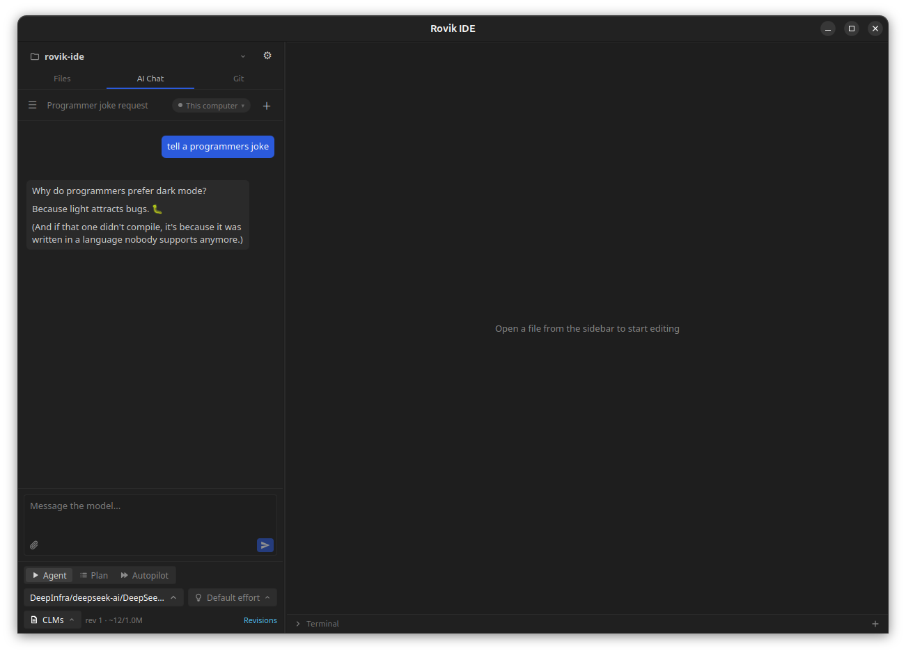

# Rovik IDE

A lightweight desktop code editor with a built-in AI coding agent.

Open a project folder, edit files, run commands in the terminal, use Git,
and chat with an AI agent that can read, change and test your code. It
runs on Linux, macOS and Windows and uses much less memory than
Electron-based editors.

Website and downloads: [rovik-ide.dev](https://rovik-ide.dev).



- [Features](#features)
- [Installing and running](#installing-and-running)
- [Getting started](#getting-started)
- [Cloud hosts](#cloud-hosts)
- [For developers](#for-developers)
- [How some parts work](#how-some-parts-work)

---

## Features

**Editor**

- Monaco editor (the editor used in VS Code) with syntax highlighting,
  themes and tabs.
- Files opened from the Files tab show plain editable source without change
  highlighting or deleted lines. Open from Git to review changes.
- Consecutive updates from disk or the agent share one undo step: Ctrl+Z
  restores the text before those updates. Typing, undoing or redoing starts
  a new group, so local edits keep their own undo history.
- Markdown files have a rendered preview, as GitHub shows them: beside the
  source (Ctrl+K V), instead of it (Ctrl+Shift+V), or switched with the
  buttons at the end of the tab strip. It scrolls with the editor, opens
  links (project files in a tab), shows the project's images, colors code
  like the editor, and its task boxes can be ticked. While typing, lists
  continue on Enter, and Ctrl+B / Ctrl+I make text bold or italic.
- IntelliSense for JavaScript/TypeScript that understands the whole
  project, not only open files. Ctrl+click jumps to a definition in another
  file, keeping the importing project's type context while browsing
  dependency declarations, including linked packages. Definition loading
  reuses shared config reads and indexes open files for faster lookups,
  once the TypeScript worker's model host is ready.
  Files the agent, git or another program creates or changes are
  picked up as they change, without reopening anything. Rust gets help from
  rust-analyzer when it's installed.
- A file tree that stays fast on very large projects and refreshes when
  files change on disk.
- The startup spinner stays visible until the project, restored tabs and
  expanded folders have finished loading. Switching projects shows a dimmed
  loading overlay until its tabs and folders are ready. Chat history loads within
  the AI Chat panel, with a spinner in its tab and a centered loading message.
  Returning to a cached chat shows it immediately without a loading indicator.
- Browser tabs: a page a dev server on a cloud host opens shows in a tab
  of the editor, hot reload and all, with an address bar for any http or
  https page (see [Servers and pages on a cloud
  host](#servers-and-pages-on-a-cloud-host)).
- Project-wide text search powered by ripgrep's engine.
- Several windows, each with a project of its own: **New window** in the
  project menu opens another, and `rovik-ide <folder>` opens a folder in a
  window of its own. A project is open in one window at a time (a copy
  sharing its chats too): opening it again brings that window to the front
  (see [Several windows](#several-windows)).
- A built-in terminal that uses your own shell, on this computer or on a
  connected [cloud host](#a-terminal-on-a-cloud-host). Each project has
  its own terminals: switching to another project, its terminals are shown,
  and the ones left keep running until you come back. Closing a terminal,
  or quitting Rovik, ends what still runs in it, a job started with `nohup`
  or `disown`ed included: as in any terminal it's hung up on first, then
  what's left is asked to stop, and what's still running two seconds later
  is killed. On macOS and Linux a program that started a session of its own
  (`setsid`, tmux's server) keeps running; on Windows everything started
  from the terminal ends, a window it opened too (an editor or a browser
  that wasn't open yet). On a cloud host the shell is hung up on, as when
  an ssh connection closes. Bash up to 5.3, and
  5.4 in development, garbles a command line taller than the terminal;
  with bash 5.1 to 5.4, on this computer, a cloud host or in WSL, a paste
  that would make one stays on one row that scrolls sideways, and wraps
  again once you've deleted enough for it to fit.
  `set horizontal-scroll-mode on` in `~/.inputrc` keeps every long line on
  one row.
- A Git panel: commit, branches, stash, history, pull and push, and a
  rebase onto any local or remote branch, found by searching. Merge
  conflicts are resolved in a side-by-side conflict resolver: the
  conflicts git wrote in the file, each settled with one side, both,
  lines ticked from either side, or an edit by hand. The repository's
  [Git hooks](#git-hooks) run as they do with git: a failing pre-commit
  or pre-push stops the commit or push and shows what it printed.
  A project that is a folder of a larger repository (a monorepo's
  package, a home folder kept in git) lists, commits and discards only
  the changes in its own folder; Discard all sends new files, staged or
  not, to the trash.

**AI agent**

- Works with any OpenAI-compatible provider: OpenAI, Anthropic, Google,
  OpenRouter, Fireworks, or a local model in Ollama or LM Studio. You add
  your own API key. Anthropic's API is spoken natively, so Claude models
  get their reasoning effort, PDFs and prompt caching (see
  [Anthropic's API](#anthropics-api)).
- Two modes:
  - **Agent** does the work: reads code, edits files, runs commands and
    checks the result. When a decision is yours to make, it asks you.
  - **Plan** only looks around, asks you questions and writes a plan. When
    you approve it, Agent mode carries it out. **Implement this plan** sends
    a request naming the saved plan's current title, with its file attached.
    Saved plans show **Implementing in chat** while their implementation run
    is active, and **Implemented in chat** after a successful run with every
    checklist step done. The chat link opens AI Chat and selects that chat.
    Interrupted runs and steps skipped or changed require another attempt or
    review. Editing a plan makes its new version available to implement again.
    This also works when you ask Agent mode to implement a plan referenced
    with `@` or its `.rovik/plans/` path, without clicking the button.
    The agent associates its checklist with that plan and the user's original
    instruction; mentioning, reading, or reviewing a plan alone does not
    record an implementation. Unclear intent remains untracked.
- **Four working principles** in its system prompt: think before coding
  (say what it assumes, ask when unsure), simplicity first, surgical
  changes, and goal-driven execution (a short plan, each step with how
  it's checked). In Autopilot it decides what it would otherwise ask, and
  says what it assumed.
- **Steer it while it works.** In Agent mode, a message you send while the
  agent works is read at its next step, as part of the same request: "use
  the existing HTTP client", "the tests are in `tests/unit`". Nothing it's
  doing is cut short. Until it's read, the message waits at the end of the
  chat, saying what it waits for (an approval, subagents, the checks), and
  ✕ takes it back into the input. A message the agent stopped before
  reading comes back into the input. See [Steering](#steering).
- **You stay in control.** You choose which commands the agent may run and
  which actions need your approval. Proposed file edits show as a diff in
  the editor, and you can accept or reject each change separately. You can
  also let a second "reviewer" AI model approve routine actions.
- **Credentials stay yours.** The agent can't read or change the files that
  hold credentials (`.env` files, private keys, cloud and package registry
  logins, Terraform state), with its tools or its commands, and it's told
  why, so it asks you for what it needs. **Settings → Restricted files**
  lists them, each with a Read and a Write box you can untick, and takes
  any other file or folder you add. See [Restricted files](#restricted-files).
- **Automatic checks.** When the agent finishes, the IDE runs the project
  checks you turned on: its type check, lint, tests or build. They're found
  in the project's files, and each is off until you tick it in Settings →
  Project checks. If anything fails, the agent is sent back to fix it.
  It's told when a fix made no progress, a fix that breaks
  something that passed before is rolled back, and tests weakened to pass
  (skipped, deleted, fewer assertions) and new suppressions of what the
  checks report (`eslint-disable`, `@ts-ignore`, `as any`, `#[allow]`,
  `# noqa`, `//nolint`) are flagged for you instead of counting as
  verified. A check that fails runs once more on the code
  before the change (in an isolated chat): what fails there too, such as
  the type errors many React Native apps have, isn't the agent's to fix and
  doesn't hold its change back. A test script that runs Jest in watch
  mode is run once.
  In Settings → Project checks, each check can opt into reusing successful
  results within the same run when its local inputs are unchanged. Use this
  for checks that depend only on local files, leaving it off for checks that
  depend on services or databases. Eligible type checks and lint run before
  AI change review, so their failures go back for repair first. Successful
  checks after a worker-group merge can also be reused at completion.
  Reuse is conservative: when the IDE cannot establish that inputs are
  unchanged, it runs the checks again. Final integrity and acceptance checks
  still apply. Editing a check's command turns reuse off.
- **Dev servers keep running.** The agent starts a server or watcher it
  means to keep (`npm run dev`, `tsc --watch`) in the background, not with
  `&`, which ends with its command: it goes on as soon as the command has
  started, with what it printed first, reads what it prints later when it
  needs to, and stops it when it's done. The chat
  shows **Background tasks: 2** under its title, which opens into each
  task, how long it has run, and a Stop for it; the agent hears it was
  stopped. A chat keeps at most 4 running, and they stop when the chat is
  deleted or moved to another computer, its changes are discarded, or
  Rovik quits. In an isolated chat they run in the chat's view, which goes
  once its changes land: the changes wait while one runs, and **Land**
  stops it.
- **Several chats at once, safely.** Each chat works on its own private
  copy of your changes, so two chats (or a chat and you) never overwrite
  each other. When a chat finishes, its changes are merged into the
  project. Conflicts are shown to you, and a landing can be undone.
- **A branch for each new chat.** When you send a new chat's first message
  while the project is on its main branch (the remote's default branch;
  without one, `init.defaultBranch`, `main` or `master`), the agent waits
  while you're asked whether to create a branch for the chat's work and
  switch to it. Its name is made up for it, and you can change it:
  `rovik-`, an adjective, a programmer's last name and 8 random letters
  and digits, such as `rovik-kind-torvalds-x7k2m9qa`. Your uncommitted
  changes come along. **Don't ask again** turns the question
  off; Settings → Agent runs turns it back on.
- **Long tasks stay on track.** Older history is trimmed automatically, or
  the agent can manage its own context (see
  [Context management](#context-management)).
  Chats show “Roviking…” (or the connector's startup label) while preparing
  a run, including while waiting for MCP servers, before the first reply.
- **Subagents (optional helpers off by default).** The agent can send scouts:
  read-only helpers that explore one question about the code in a fresh
  context and hand back a short report, so long explorations don't fill
  the agent's own context. A change reviewer always reads each finished
  change that hasn't landed, with fresh eyes, before the checks run; its
  model and budget are set in Settings → Subagents, and it has no switch.
  Each finding is ranked
  by its severity, how sure the reviewer is and whether it's about code
  the change touched: the agent fixes or answers the ones that weigh
  most, which hold the change back until they're resolved; lighter ones
  go to it as optional, and the lightest are listed only for you, since
  fixing what isn't broken is how correct code gets broken. When the
  reviewer finds blocking problems a second time in a run, a guide reads
  every review, the agent's answers and the change, and tells the agent
  where and why it goes wrong before its next attempt. When a check fails
  with a long output, or fails again, a triage helper reads all of it and
  tells the agent the root
  cause, instead of the agent getting pages of compiler output. In Plan
  mode, a plan reviewer checks each plan against the code before it's
  saved. A small task can use a single numbered step, with its files,
  concrete changes and a validation section. When the agent implements a long plan, step workers can carry it
  out one step at a time, each writing only its step's files; in an
  isolated chat, steps the plan groups can run side by side, each in its
  own copy, then merged and checked once. If those checks fail, each
  failure's cause goes back to the worker whose files it's in, the agent
  fixes the rest, and the checks run once more; if it still fails, you
  can redo the group one step at a time. The test writer automatically writes independent tests
  for code changes in Agent and Autopilot modes, even with optional
  subagents switched off. The coder delegates test creation and changes
  with `task` kind `testWriter`; direct writes to test files are refused. It works from
  the request and plan, reading test files and fixtures only: the implementation
  reaches it as outlines and as the places a search finds a name. The tests it writes
  are then its own: the coder can run them but not read them, so they check what was
  asked rather than what the code does. Agent
  runs invoke it before change review; Autopilot writes tests before
  implementation, with a fallback if none were produced. If it cannot
  write tests, the chat records the reason and continues. Pick its model
  and configure optional helpers in Settings → Subagents. Test ownership
  is enforced for Rovik's file-writing tool; inline tests, shell scripts,
  MCP tools and native CLI tools are governed by instructions, not a
  filesystem sandbox.
- **Autopilot (optional).** A chat in Autopilot mode carries out a whole
  task from one message without asking: it plans, reviews, implements,
  checks and delivers, and writes down what it couldn't decide. How
  thorough it is, when a task stops, and the commands it may never run are
  set in Settings → Autopilot.
- **MCP servers.** The agent calls the tools of the MCP servers you add in
  **Settings → MCP servers**: a command Rovik starts on this computer
  (`npx -y @modelcontextprotocol/server-github`) or a server's URL, their
  tokens kept in your system's keychain; and of those a project's own
  `.mcp.json` sets up, once you allow them. However many tools they have, the
  agent gets one tool, `mcp`, and their list in its prompt, so its
  requests stay small and cached. Each call waits for your approval unless
  Settings → Permissions & approval says otherwise. See
  [MCP servers](#mcp-servers).
- The agent follows your project's own instructions in `AGENTS.md`,
  `CLAUDE.md` and similar files.
- The agent can search the web and read pages, in a headless Chrome for
  Testing that Rovik downloads into its data folder when it first starts.
- Attach images, PDFs and text files to a message: paste them (Ctrl+V, or
  Paste in the message box's right-click menu) or pick them with the
  paperclip button. Only formats models can read are taken (see
  [Attachments](#attachments)), and only those the chosen model is set up
  for: images need Vision, PDFs need PDF, in Settings → Model providers.
  Images are sent as PNGs at most 768 pixels a side. A message copied from
  the chat or the message box pastes back with its attachments.
- Chats are saved and searchable, and they keep running in the background
  when you switch to another chat.

---

## Installing and running

### Downloads

Download the latest release from [rovik-ide.dev](https://rovik-ide.dev) or
the [GitHub releases](https://github.com/piliugin-anton/rovik-ide/releases):

| System  | Packages                                                                                |
| ------- | --------------------------------------------------------------------------------------- |
| Linux   | AppImage (any distribution), `.deb` (Debian, Ubuntu), `.rpm` (Fedora, openSUSE), 64-bit |
| macOS   | `.dmg` for Apple silicon and for Intel                                                  |
| Windows | Installer (`.exe`) or MSI package (`.msi`)                                              |

Opening it for the first time:

- **macOS:** the app isn't notarized yet. If macOS says it's damaged or
  can't be opened, move it to Applications and run
  `xattr -dr com.apple.quarantine "/Applications/Rovik IDE.app"`.
- **Windows:** SmartScreen may warn that the publisher is unknown: choose
  **More info**, then **Run anyway**.
- **Linux:** make the AppImage executable, then run it:
  `chmod +x Rovik.IDE_*.AppImage`.

Once installed, Rovik [updates itself](#updates).

### Building from source

You need [Rust](https://rustup.rs) and [Node.js](https://nodejs.org) 24,
plus your system's build tools, as below.

#### Linux

Run these from the project folder:

```bash
./setup.sh   # once: installs system packages, Rust and npm dependencies
./dev.sh     # starts the app
./build.sh   # builds an installable package (AppImage, .deb, …)
```

`setup.sh` supports apt, dnf and pacman. It asks for `sudo` to install
system packages, installs Rust through rustup if yours is missing or too
old, and runs `npm install`. You can run it again safely.

Built packages end up in `src-tauri/target/release/bundle/`.

#### macOS

1. Install the Xcode Command Line Tools: `xcode-select --install`
2. Install [Rust](https://rustup.rs) and [Node.js](https://nodejs.org) 24.
3. From the project folder:

   ```bash
   npm install
   npm run tauri dev      # start the app
   npm run tauri build    # build an installable package
   ```

#### Windows

1. Install
   [Visual Studio Build Tools](https://visualstudio.microsoft.com/visual-cpp-build-tools/)
   with the **Desktop development with C++** workload.
2. Install [Rust](https://rustup.rs) with the default
   `x86_64-pc-windows-msvc` toolchain (MinGW isn't supported).
3. Install [Node.js](https://nodejs.org) 24.
4. From the project folder, run the same `npm` commands as on macOS.

WebView2 is already part of Windows 10 and 11.

More details on prerequisites:
[Tauri prerequisites](https://v2.tauri.app/start/prerequisites/).

### Optional: virtual files driver

Some features work best with a virtual-file driver: FUSE on Linux, macFUSE
on macOS. On Windows there's none to install: the agent works in WSL
(Settings → This computer → WSL), which has FUSE. The app runs without one. When it's missing,
the app offers to install it for you; you can also do it later in
**Settings → Virtual files**. The driver is required for the agent's
self-managed context (CLM mode), and it makes the agent's shell commands
faster in isolated chats.

### Updates

Rovik installed from a release (the AppImage, `.deb` or `.rpm`, the macOS
disk image, the Windows installer or MSI package) updates itself. Every 30
minutes it looks at the latest release on GitHub, and when there's a newer
version, a notification offers it. **Update** downloads it, checks it
against Rovik's release key, installs it and restarts Rovik, which opens
your project again. Before the restart, Rovik asks about chats still at
work (they stop, and you can continue them afterwards) and about tabs with
unsaved changes. A `.deb` or `.rpm` update asks for an administrator's
password. On Windows the installer closes every Rovik window and starts
Rovik again once it's done; on Linux and macOS, Rovik's other windows keep
the version they started with and offer a restart.

**Settings → Updates** shows the version, has **Check now**, and turns the
looks off (they're on by default). They go the way **Settings → Network**
sends downloads. A build of your own isn't replaced: a new release is
offered for download instead, and a development build (`npm run tauri
dev`) looks only when you click **Check now**.

Cloud hosts run a Rovik of their own, which the app's update leaves as it
was. Once Rovik runs a new version, it offers once to bring your hosts to
it: **Update hosts** upgrades the hosts where you're one of Rovik's
administrators, for everyone on each (their runs pause while Rovik restarts
there, then go on), and for the others it says whom to ask. WSL on Windows
is brought to the app's version by itself.

---

## Getting started

1. **Open a project:** choose a folder with **Open project…**, or create one
   with **New project…**. Both buttons fill the width of the empty Files
   tab. The project's files appear in the file tree.
2. **Add a model:** open **Settings → Model providers**, paste the
   provider's base URL and your API key, and choose the models you want.
3. **Review permissions:** in **Settings → Permissions & approval**, choose
   which commands the agent may run and what needs your approval. By
   default the agent may only run a short list of safe commands (`ls`,
   `cat`, `cargo clippy`, …), and it edits files without asking. A command
   may start with a `cd` into one of the project's folders, as in
   `cd web && npm test`: only what runs there has to be on the list. Turn
   approvals on here if you want to review its edits and commands first.
4. **Chat:** open the AI Chat tab, pick a model and a mode (Agent, Plan or
   Autopilot), and describe what you want. In Agent mode you can keep
   sending it messages while it works.
5. **Check the result:** files the chat changed are listed above the
   message box. Open one to compare it with the project version, then
   **Land** the changes or **Discard** them.

Every setting applies as soon as you change it, and the Settings menu
shows each page's state: what's set, and whether it has an effect on this
computer right now. Failed reads of project or computer settings show an error
with **Try again**, so you can retry without closing Settings. The pages:

| Page                   | What it affects                                                                                                             |
| ---------------------- | --------------------------------------------------------------------------------------------------------------------------- |
| Editor                 | How code looks and is formatted in the editor: theme, font, indentation, wrapping, formatters                               |
| Model providers        | The models chats can use, with your API keys; the AI reviewer and the subagents pick theirs here too                        |
| Connectors             | Coding harnesses (Claude Code, Codex) installed where a chat runs, used in place of a model (see [Connectors](#connectors)) |
| Permissions & approval | What the agent may run, change and reach in every chat, and what waits for your approval, or an AI reviewer's, first        |
| Agent runs             | While the agent works and when it finishes: pauses, its checklist, the checks on its changes, conflicts between chats       |
| Subagents              | The helpers the agent can send, their models and limits                                                                     |
| Autopilot              | Chats that carry out a whole task without asking: effort, budget, the commands they never run                               |
| Project checks         | The type-check / lint / test / build commands of the open project, as detected (each off until you tick it) or fixed        |
| Restricted files       | The open project's files the agent may not read or change: `.env` files, keys and logins found by name, and any you add     |
| Heavy commands         | How many builds and tests run at once on this computer, so it stays responsive                                              |
| Virtual files          | Linux and macOS: the driver that isolates chats and lets the agent manage its own context, and its troubleshooting          |
| WSL                    | Windows: the WSL distribution the agent's commands run in, sandboxed (Rovik's Linux side on this computer)                  |
| Network                | How Rovik connects to model providers, download servers and cloud hosts: connection timeouts and the proxy                  |
| Cloud hosts            | Servers your chats can run on (see [Cloud hosts](#cloud-hosts))                                                             |
| Updates                | Rovik's version, the looks for a new one every 30 minutes, and installing it (see [Updates](#updates))                      |

The model, the mode (Agent, Plan or Autopilot), the reasoning effort and
the context mode are chosen per chat, above its message box. The model
picker lists the providers' models and the connectors' together, each
with its source's icon (a cloud for a provider, a plug for a connector),
with a switch to see one kind alone and a search.

### Connectors

A connector is a coding harness installed on the computer a chat runs on,
used in place of a model provider: Claude Code or Codex. **Settings →
Connectors → Add connector**. Its page groups its settings:

- **Connection**: how it signs in (the login of this computer's user; a
  token: Claude Code's long-lived one from `claude setup-token`, or a
  Codex access token; or an API key), the token or key kept in the
  keychain. **Test & refresh models** checks the program runs (with a
  request, that it's signed in) and lists its models: Claude Code's
  aliases such as `sonnet`, `opus` and `haiku`, and full names; the models
  Codex offers the account.
- **Permissions**, for its own tools (Agent mode): the permission mode its
  runs get (with Claude Code, and the tools they may or may not use
  without asking).
- **Limits** (Claude Code): the turns and the budget one message may take.
- **Advanced**: the program, its settings folder (`CLAUDE_CONFIG_DIR`,
  `CODEX_HOME`), more arguments for every run, and Claude Code's bare mode.

The models you enable show in the chat's model picker, marked as a
connector's.

When Rovik starts, it checks each connector on this computer with a test
that makes no request, so it costs no tokens: whether its program is
installed (its version), whether it's signed in (`claude auth status`,
`codex login status`), and
whether a newer version is published. It warns about any connector a chat
can pick that isn't signed in, or whose program isn't installed, with a way
to its settings. The connector rows show what the last check found as
Settings → Connectors opens, and the page checks each again meanwhile;
**Check status** asks again. A connector's page shows the same at once and
tests again, also with no request, as it opens and when you pick another
**Computer**. The check trusts a token the program has; one that expired
or was revoked shows as the chat's error at its first message.

**Set up** (on a connector's page, or on its row when it can't run) does
the rest where its chats run, this computer or a cloud host: it tests the
connector; installs the program if it's missing, once you agree, with its
makers' own installer for your user (`claude` or `codex` in
`~/.local/bin`, no admin rights); and signs it in if it isn't (`claude
auth login`, `codex login`), showing what each step prints. Here the
browser opens to sign in; for a host, Rovik opens the sign-in page in your
browser and you paste the code it shows (Codex's page asks instead for the
code its sign-in printed there, `codex login --device-auth`, as on any
computer without a screen). A connector that signs in with a token or a
key takes it in its settings. **Sign out** signs the program out. A test
also finds out whether a newer version is published (Anthropic's release
channel, `latest`; Codex's npm package), and **Update to …** then runs
the program's own updater (`claude update`, `codex update`).
When the check as Rovik starts finds a newer version on this computer, a
notification offers it too, once per version: **Update** runs the same
updater, checks the program again and says how it went.

A chat on a connector's model hands the harness the task: the model, the
effort and the message, in the project folder. The harness keeps its own
conversation for the chat, continued on each message. The chat's mode
picks how it works: in **Agent** mode the harness runs as itself, with its
own tools; in **Plan** mode and **Autopilot** it's the model behind
Rovik's agent, with Rovik's prompt and tools, so it plans as Rovik's agent
does and its plan is saved in `.rovik/plans`, for **Implement this plan**
to carry out in Agent mode. A subagent on one of its models runs as
Rovik's agent too.

- **Claude Code, in Agent mode.** It runs as itself: its own tools
  (Read, Edit, Bash…) in the project folder, its own system prompt and
  the CLAUDE.md it reads; Rovik sends no prompt. With the permission
  mode **Follow Rovik's permissions**
  (the default), each call it would ask about goes to **Permissions &
  approval**, as a call of the agent's own tool of the same kind would
  (`--permission-prompt-tool`): its commands are judged by the allowed and
  denied commands, its edits are reviewed in the editor change by change,
  and what needs an approval waits for yours or the AI reviewer's, shown
  on its call's line. Reads in the project and its read-only commands
  run without asking, as Claude Code's manual mode has them. With one of
  Claude Code's own modes (Accept edits, Everything, Auto, Manual, Plan)
  and its tool rules, Rovik's approval settings don't apply. In every mode,
  the project's [restricted files](#restricted-files) stay out of its reach:
  its Read and Edit tools are denied them by its own rules, and a command
  of its shell that would read or change one is refused before it runs. Its reply
  shows its work as Rovik's agent's shows, in the order it went: each
  stretch of its thinking ("Thought for 3 s", open to the text), and its
  tool calls as the lines of Rovik's tools of the same kind ("Read
  app.ts", "Edited app.ts", "Ran npm", its checklist as Rovik's) and the
  skills it uses by name ("Used skill pdf"), then its answer. While one
  of its tools runs, that call's line shows it at work, and the reply
  isn't said to be "Still generating". In a
  chat's own copy of the project (an isolated chat, or one on a cloud
  host), git commands that change the repository (`checkout`, `switch`,
  `reset`, `commit`, `push`…) are refused in every mode, as they are to
  Rovik's agent: Claude Code is given deny rules for them, and Rovik's
  hook refuses other spellings (`git -C . push`) before they run. The
  chat's changes reach the project when they land.
- **Claude Code, in Plan mode and Autopilot.** Claude Code is the model behind
  Rovik's agent, with Rovik's system prompt in place of its own. Rovik
  serves the run's tools to it over MCP (a server on 127.0.0.1 for that
  run alone, behind a token only it has), with Claude Code's own tools
  off. Each message of Claude Code's that calls them is a reply of
  Rovik's: Rovik runs the calls under Permissions & approval, in the
  chat's copy of the project, and gives Claude Code the results while it
  waits, however long an approval takes. Rovik's checks, checklist,
  plans, Autopilot and subagents work as with any model. The prompt goes
  in a file (`--system-prompt-file`) with the project's section split off,
  so the rest stays cached, and is rebuilt on every run
  (`--system-prompt-snapshot off`), so a changed setting, or a change of
  mode, applies to a chat's next message. Claude Code goes on in the same
  session of its own whichever tools a message gets, told first when they
  change; implementing a plan in Agent mode, it keeps its checklist with
  its own tools.
- **Codex, in Agent mode.** It runs as itself, its app server
  (`codex app-server`) in the project folder: its own tools (its shell,
  its patches, web search…), its own system prompt and the AGENTS.md it
  reads. With **Follow Rovik's
  permissions** (the default), Codex asks before every command and every
  patch, and Rovik's hooks answer as Permissions & approval would for the
  agent's own calls: its commands by the allowed and denied commands, each
  file a patch changes as Rovik's edit of it, reviewed in the editor change
  by change; of a patch you accept in part, Codex applies what you
  accepted. What Rovik allows, Codex runs without its own sandbox, as
  Claude Code runs its commands. Codex's own modes are its sandbox
  presets: **Auto** (in
  the project's folder, its own reviewer deciding on anything more),
  **Project folder** (there, without network, never asking), **Read only**
  and **Everything**. In every mode, a command or patch that would read or
  change one of the project's [restricted files](#restricted-files) is
  refused before it runs, as is git that changes the repository in a chat's
  copy of the project; a command is checked from the project's folder,
  since Codex doesn't tell its hooks the folder a command runs in. A
  command or patch that starts without Rovik's hook having seen it (a hook
  that failed) stops the turn. Its reply shows its
  work as Rovik's agent's does: its commands as what Codex read them as
  doing ("Read app.ts", "Searched", or "Ran npm"), each file a patch
  changed as an edit, its plan as Rovik's checklist. It keeps a thread of
  its own per chat; a message that gets the other tools (its own, or
  Rovik's) starts a new one, told what the chat was about.
- **Codex, in Plan mode and Autopilot.** Codex is the model behind Rovik's agent:
  Rovik's system prompt replaces its own (`baseInstructions`, with the
  project's section apart, so the rest stays the same from run to run),
  and Rovik serves the run's tools to it over MCP, as functions of their
  own. Codex's own tools are off, or refused by Rovik's hook where they
  can't be turned off, in a read-only sandbox. Each of its calls of
  Rovik's tools is a reply of Rovik's, run under Permissions & approval in
  the chat's copy of the project, its result given to Codex while it waits.
  Codex's built-in mode instructions are disabled for these runs and
  one-off helpers. New and resumed threads get Rovik's workflow instructions,
  which supersede older Codex mode messages and explain that Rovik's tools
  save plans under Rovik's permissions.
  Rovik's checks, checklist, Plan mode (Rovik's own, not Codex's),
  Autopilot and subagents work as with any model.

In Agent mode, what Claude Code or Codex changes with its own tools is the
chat's change as much as Rovik's agent's: when it finishes, the project's
checks run on it (see [Project checks](#project-checks)), and what fails
goes back to it, in the same session, as its next message; a fix of its
that breaks a check that passed is rolled back. An edit that was refused
or failed changed nothing, and doesn't count. Rovik's review of the change
and its checklist are kept with Rovik's tools, so they don't apply there.

Either way, its thinking shows: Rovik asks Claude Code for it
(`--thinking-display summarized`) and Codex for its reasoning's summary,
since current models send none unless asked. What comes is the API's
summary of the thinking, and it costs nothing more; with Rovik's tools, it
shows above the reply, as any model's does. Connector models take no
images or PDFs from the chat.

**Commands.** In a chat on a connector, typing `/` at the start of the
message lists the commands the harness offers there: Claude Code's own
(`/compact`, `/context`, `/cost`…), the project's `.claude/commands` and
the user's, and skills, each with what it takes and what it does. Rovik
asks Claude Code for the list in the project folder (no request to the
model) and keeps it a minute. Claude Code's commands that would change
what Rovik keeps aren't listed: the chat's session (`/clear`), its model
and effort (`/model`, `/effort`, `/fast`, `/config`, which save theirs as
Claude Code's defaults), its settings and approvals (`/update-config`,
`/fewer-permission-prompts`, `/doctor`, `/mcp`), the sign-in, and those
that need a terminal or work on after the run (`/color`, `/loop`,
`/goal`, `/batch`). Up and Down move through it, Enter or Tab
picks one; Escape closes it. A picked command goes to Claude Code as
typed and alone, without the editor's context before it, and its output
is the reply (`/compact` says how far it shrank the conversation). A
skill that works in a forked context (`context: fork`) shows as its step
while it runs ("Using skill review-pr"), since Claude Code prints its work
only once it's done. Only
a picked command runs as one: a message typed by hand, `/compact` or
`/etc/passwd has a typo`, goes as a message, so Claude Code reads it as
text. A command picked while the agent works isn't sent to the run, which
Claude Code would read as text in the middle of its turn: it waits at the
end of the chat and runs once the agent has finished, as Claude Code's own
terminal runs one typed while it works. Codex offers `/compact`, `/review`
(the uncommitted changes, or what you name) and its skills, from the
project, the user's folder and its own; a picked skill goes to Codex
attached, as `$name` and what you typed after it.

**Context.** The harness keeps the conversation and compacts it itself,
so a connector's chat has no context mode (Trimming, CLMs) and Rovik
doesn't estimate it. The bar above the input shows the harness's own
context after its last reply instead, "Context used: 35k / 1M (4%)", with
where it compacts on its own in the tooltip.

On a cloud host, the host needs its own installation: an administrator
runs `sudo /opt/rovik/bin/rovik-agentd admin claude-code` (or `admin
codex`) once, which installs Anthropic's package (OpenAI's installer, for
Codex) for every user (see [docs/cloud-hosts.md](docs/cloud-hosts.md)), or
each user runs **Set up** with the host chosen, which installs it for them
alone. The host's page in **Settings → Cloud hosts** lists the connectors
installed there for you, in one line: "Connectors installed: Claude Code,
Codex". Each user's chats sign in with the token or key of the connector's
settings, or the login Set up made for them there.

When the agent runs commands from the IDE, they get the same `PATH` as your
login shell, so tools like `npm`, `cargo` and Homebrew packages are found
even when you start the app from a desktop icon. A tool installed after the
app (or a cloud host's daemon) started, by a host's setup script for one, is
found too: when a command fails for want of a program that isn't on that
`PATH`, or an Autopilot install needs one, the login shell's is read again.

Rovik makes ready what a command needs, before it runs and again when it
fails for want of a program or a package. The same goes for the agent's own
commands and for Claude Code's and Codex's own shells (through Rovik's
hooks, whatever their permission mode):

- **Toolchains.** On a cloud host, the Node or Rust version the project asks
  for is installed for the whole server if it isn't there, and Yarn and pnpm
  run through Corepack at the version the project's `packageManager` names
  ([docs/cloud-hosts.md](docs/cloud-hosts.md), "Shared toolchains and
  caches"). On your own computer Rovik installs no toolchain: the agent is
  told what's missing, so it can tell you.
- **Dependencies.** When a command fails for want of the project's
  dependencies (no `node_modules`, so `vite: not found` or
  `Cannot find module 'react'`), the project's install runs (`npm ci`,
  `pnpm install --frozen-lockfile`, `uv sync`…), as the Autopilot Prepare
  stage runs it: once, at a workspace's root, only where Permissions &
  approval would let that install run without asking (in an Autopilot task,
  where its Prepare setting is on too), and never in Plan mode. Otherwise
  the agent is told which install to run.
- **Services.** A project whose compose file (`compose.yaml`,
  `docker-compose.yml`) declares the databases, caches and queues its code
  needs gets them named in the agent's prompt, read with Docker Compose
  itself where it's installed. When a command fails to connect to a port
  one of them publishes (`connect ECONNREFUSED 127.0.0.1:5432`, Prisma's
  "Can't reach database server", libpq's, MySQL's, Kafka's, JDBC's), or
  looks one up by its name (`getaddrinfo ENOTFOUND db`), the agent is told
  which service it needed and that it isn't running. On your own computer
  it asks you to start it (`docker compose up -d db`): its commands can't
  start containers, since the sandbox closes Docker's and Podman's sockets
  to them. On a cloud host your daemon starts it under your own Podman, its
  ports in your private network there and its image fetched once for the
  whole server, and the command runs again
  ([docs/cloud-hosts.md](docs/cloud-hosts.md#project-services)). The
  agent's commands can't run containers there, not even with the server's
  Podman: a `docker compose up` of theirs has your daemon start what it
  names, and one that reaches for Docker or Podman otherwise is told so. A
  service looked up by its name is reached at its published port on
  localhost instead, and the agent is told so.
- **Running it again.** A command that is one program (`npm test`) runs again
  by itself once what it lacked is there, and the agent sees both why and the
  second run. A longer one (`cd web && npm test`) is left to the agent, since
  running it twice could repeat its first parts; Claude Code or Codex is
  told beside the failed command's result.

What a project needs is read the same way everywhere (these checks, the
Prepare stage, the toolchains a host installs): its own folder, the packages
one folder down (a monorepo's `web/`, a Tauri app's `src-tauri/`), and a Node
workspace's members wherever they are. A root `package.json` that only lists
its workspaces still gets the Node version its members name, and one install
at the root. A language is one module (`src-tauri/crates/rovik-core/src/ecosystems/`):
Node, Rust, Python and Go are there, and another implements the same trait.

---

## Cloud hosts

A cloud host is a Linux server that your chats can move to and run on. You
add one in **Settings → Cloud hosts**, and Rovik logs in to it over SSH as
your own account there. If you run a server that several people share, see
[Rovik on a team server](docs/cloud-hosts.md).

### An SSH key for a cloud host

Make the key on the computer that runs Rovik, put its public half in your
own account on the server, then point Rovik at the private half.

1. **Make the key.** On macOS or Linux:

   ```bash
   ssh-keygen -t ed25519 -f ~/.ssh/rovik_ed25519 -C "rovik on my-laptop"
   ```

   On Windows, in PowerShell (Windows 10 and 11 include the OpenSSH client):

   ```powershell
   ssh-keygen -t ed25519 -f $env:USERPROFILE\.ssh\rovik_ed25519 -C "rovik on my-laptop"
   ```

   A passphrase is optional. If you set one, Rovik keeps it in the system
   keychain. You get two files: `rovik_ed25519`, the private key, which never
   leaves your computer, and `rovik_ed25519.pub`, the public key, which goes
   on the server and is safe to share.

2. **Put the public key in your account on the server.** Use a regular
   account: Rovik's daemon never runs as root, so it won't deploy over a root
   login, and on a shared server each person has their own account. If you
   can already log in with a password, on macOS or Linux:

   ```bash
   ssh-copy-id -i ~/.ssh/rovik_ed25519.pub you@server
   ```

   Windows has no `ssh-copy-id`. In PowerShell:

   ```powershell
   type $env:USERPROFILE\.ssh\rovik_ed25519.pub | ssh you@server "umask 077; mkdir -p ~/.ssh && cat >> ~/.ssh/authorized_keys"
   ```

   If you can't log in yet, send the `.pub` file to the server's
   administrator, who adds it to your account (here `ann`):

   ```bash
   sudo adduser ann   # only if the account doesn't exist yet
   sudo mkdir -p /home/ann/.ssh
   sudo tee -a /home/ann/.ssh/authorized_keys < rovik_ed25519.pub > /dev/null
   sudo chown -R ann: /home/ann/.ssh
   sudo chmod 700 /home/ann/.ssh && sudo chmod 600 /home/ann/.ssh/authorized_keys
   ```

   On a new cloud server, you can instead paste the contents of the `.pub`
   file into the provider's SSH keys field when you create the server. If
   the provider only sets up root, create a regular account as above first.

3. **Check it from a terminal:**

   ```bash
   ssh -i ~/.ssh/rovik_ed25519 you@server
   ```

   It should log you in without asking for a password. It asks only for the
   key's passphrase, if you set one.

4. **Add the host in Rovik.** In **Settings → Cloud hosts**, click
   **+ Add host** and fill in **Host**, **Port** and **User** (your account).
   Set **Log in with** to **A key file**. In **Key file**, enter the full path
   to the private key, not the `.pub` file: `/home/you/.ssh/rovik_ed25519` on
   Linux, `/Users/you/.ssh/rovik_ed25519` on macOS, or
   `C:\Users\you\.ssh\rovik_ed25519` on Windows. Enter the **Key passphrase**
   only if the key has one. Click **Save**, then **Test connection**.

5. **Trust the server's key.** The first test shows the server's key
   fingerprint. Click **Trust this key** once it matches one of the lines
   this prints on the server:

   ```bash
   for key in /etc/ssh/ssh_host_*_key.pub; do ssh-keygen -lf "$key"; done
   ```

Instead of a key file, you can load the key into your SSH agent
(`ssh-add ~/.ssh/rovik_ed25519`) and choose **My SSH agent**. Rovik then
never reads the key file. On Windows, Rovik uses the OpenSSH Authentication
Agent service, which is off until you start it, or Pageant. To start the
service, in PowerShell run as administrator:

```powershell
Get-Service ssh-agent | Set-Service -StartupType Automatic -PassThru | Start-Service
```

Ed25519 keys are the best choice. RSA and ECDSA keys work too, and so do
PuTTYgen `.ppk` files, so an existing PuTTY key works as it is.

On a server several people share, whoever deploys Rovik there first becomes
its administrator, and that account needs `sudo`. Everyone else only needs
their own account with their key in it. Deploying where Rovik is installed
already, the app trusts the installed build when it's one of Rovik's
releases. Any other build, such as an administrator's own, shows in
**Test connection** with its SHA-256, and the app connects once you click
**Trust this build**.

### A terminal on a cloud host

Once a cloud host is connected, the **+** of the terminal panel asks where
the new terminal runs: **Local**, on this computer, or **_name_ (remote)**,
your login shell on that host, in your home folder there. `` Ctrl+Shift+` ``
still opens a local one at once. While a host is connected, each tab says
where it runs: `bash (local)`, `bash (Build server (remote))`.

A remote terminal logs in as the host's settings say, on a connection of its
own. On a host set to **My system ssh**, it runs your own `ssh` to the host,
with your configuration.

Where your login shell there is bash 4.4 to 5.4, Rovik starts it as it does
on this computer: with a file of Rovik's, saved in `~/.rovik/terminal`, that
reads the same login files and keeps a long pasted line from being garbled
(see the terminal above). Started this way, the host shows no login banner
(the message of the day, "Last login"). Through **My system ssh** the shell
starts as your ssh starts it.

### Servers and pages on a cloud host

On a server several people share, the agent's commands run in a network of
your own there: its dev servers can take any port without clashing with
another user's, and nobody else can reach them, while the agent tests them
with `curl localhost:3000`, or opens their pages in its own browser, which
runs in that network too, as it would on your computer. When a command
opens a page of one of them (`vite --open`, `xdg-open
http://localhost:5173`), Rovik shows it in a browser tab of the editor,
through a port of this computer forwarded to it: the same port when it's
free here, another when it isn't. The tab loads the page through a second
port of Rovik's, which drops what keeps a page out of a frame
(`X-Frame-Options` and CSP `frame-ancestors`, as Django, Rails or helmet
send them) and passes WebSockets through, so the dev server's hot reload
works in the tab. On Windows it also makes the page's cookies ones a frame
keeps, so signing in to it works there. It adds a small script of Rovik's
to each page it loads, which tells the tab where the page is: the tab's
address bar follows the page as you click through it, and Reload and
**Open in your browser** take it there. An https page opens in your browser
instead, and so does a window the page opens. A page of another site that
refuses to be framed, as most sign-in pages do, shows nothing in a tab: open
it in your browser. The chat shows **Opened ports:** under its title, each port
on a button that opens its page in a tab, or, as its ▾ chooses for every
port, copies the address here that leads to it; **Background tasks: 1,
open ports:** while the agent has a server running there. A dev server
the agent leaves running in the background serves its page until it's
stopped; one it starts with `&` ends with its command, and its page with
it. Once nothing listens on a server's port any more, as when its command
timed out or was stopped, the port leaves that row and the tabs showing
its pages close. A page at any other address is refused. See
[Rovik on a team server](docs/cloud-hosts.md#each-users-own-network).

---

## For developers

### Tech stack

| Part           | Choice                         | Why                                                                                                                |
| -------------- | ------------------------------ | ------------------------------------------------------------------------------------------------------------------ |
| App shell      | [Tauri 2](https://tauri.app)   | Uses the OS's own web view instead of bundling Chromium, so it uses far less memory than Electron.                 |
| UI             | [SolidJS](https://solidjs.com) | No virtual DOM: an update touches only the DOM nodes that depend on it, so the UI stays fast as it grows.          |
| Editor         | Monaco                         | VS Code's editor component.                                                                                        |
| Long lists     | `@tanstack/solid-virtual`      | Only visible rows are rendered, so a tree with 50,000 files costs about the same as one with 50.                   |
| Backend        | Rust                           | Files, Git (libgit2), search (ripgrep crates), terminal, language servers, the AI agent, chat storage (SQLite).    |
| Code structure | tree-sitter                    | Outlines of source files for the agent: find a symbol, build a "repo map" of the most relevant code for a request. |

The AI agent runs **in the Rust backend**, not in the web view. A run keeps
going if you switch chats or reload the UI; the frontend only starts it,
stops it, answers its approvals and shows its progress.

### Commands

| Command                                         | What it does                                                                        |
| ----------------------------------------------- | ----------------------------------------------------------------------------------- |
| `npm run tauri dev`                             | Run the app with hot reload (same as `./dev.sh`)                                    |
| `npm run tauri build`                           | Build a release package (same as `./build.sh`)                                      |
| `npm test`                                      | Frontend unit tests (`src/**/*.test.ts`)                                            |
| `npm run typecheck`                             | TypeScript type check of the app, its tests and its build config                    |
| `npm run test:scripts`, `npm run test:eval`     | Tests of the release scripts and of the evaluation harness                          |
| `cd src-tauri && cargo nextest run --workspace` | Backend tests, every crate, as CI runs them ([cargo-nextest](https://nexte.st))     |
| `cd src-tauri && cargo test --workspace`        | The same with cargo's own runner: slower, doctests included                         |
| `cd src-tauri && cargo test vfs -- --ignored`   | Mounts a real virtual volume (Linux) and runs shell tools and Git on it             |
| `npm run format`                                | Format with Prettier (`format:check` to verify)                                     |
| `scripts/build-agentd.sh`                       | Static builds of the daemon for Linux servers (x86_64 and aarch64)                  |
| `node scripts/e2e/run.mjs`                      | End-to-end runs of a built app ([scripts/e2e](scripts/e2e/README.md))               |
| `node scripts/eval/eval.mjs`                    | The agent's evaluation on a fixed task set ([scripts/eval](scripts/eval/README.md)) |

`scripts/build-agentd.sh` needs zig and cargo-zigbuild:
`pip install cargo-zigbuild` brings both. Each build is a single file that
runs on any Linux, in `src-tauri/target/agentd/`. To deploy one, start the
app with `ROVIK_AGENTD_BINARY` set to its path.

### Releases

Every merge to master is released. The **Release** workflow
(`.github/workflows/release.yml`) runs on each one:

1. It runs the checks first, the CI workflow's: the tests on Linux, macOS
   and Windows. A merge that fails them isn't released.
2. It chooses the version: the one in the sources while no release has it
   (the first release, or one a pull request set with
   `scripts/set-version.sh 1.3.0`), otherwise the sources' version with
   its last number raised, `1.2.3` to `1.2.4`, which it commits to master
   as `Release 1.2.4 [skip ci]`.
3. It builds the app for Linux (AppImage, .deb, .rpm), macOS (a disk
   image each for Apple silicon and Intel) and Windows (installer and MSI
   package), and the daemon for x86_64 and aarch64 Linux servers.
4. It signs the builds and publishes them on the version's GitHub
   release, tagged `v1.2.4`, with `latest.json`, what the installed apps'
   updates read (see [Updates](#updates)): each kind of app's bundle on
   the release and its signature, written by `scripts/updater-manifest.mjs`
   once every platform's are there. The download buttons on
   [rovik-ide.dev](https://rovik-ide.dev) show it at once: they ask GitHub
   for the latest release, and so do the apps.

Nothing is published until every build is on the release, so a run that
fails leaves the latest release as it was. The next merge publishes the
version it couldn't; so do **Re-run failed jobs** on its run and **Run
workflow** (in the **Actions** tab, under **Release**) with the version
left empty. **Run workflow** with a version, such as `2.0.0`, releases
that version from the branch you pick.

The app downloads the daemon for a server from its own version's release,
and checks it against the release key before it goes to the server. The
daemon on a server checks an upgrade against the same key, and so does the
app's own update (tauri-plugin-updater, `src-tauri/src/updates.rs`), whose
signatures also say the version they were made for: a `latest.json` that
pairs a new version with an older release's bundle is refused.

Only the release builds the updater's bundles and their signatures
(`--config src-tauri/tauri.updater.conf.json`, which sets
`bundle.createUpdaterArtifacts`): `tauri build` refuses to make them
without the signing key, so a developer's build and the end-to-end runs
make none. A pre-release isn't GitHub's latest release, so installed apps
aren't offered it.

Before the first release, make the key once:

1. Run `npx tauri signer generate -w ~/.tauri/rovik.key` and choose a
   password. Keep the file and the password safe: without them there are
   no more signed releases.
2. In the repository's **Settings → Secrets and variables → Actions**, add
   `TAURI_SIGNING_PRIVATE_KEY`, with the contents of `~/.tauri/rovik.key`,
   and `TAURI_SIGNING_PRIVATE_KEY_PASSWORD`, with the password.
3. Paste the public key, the one line in `~/.tauri/rovik.key.pub`, below
   the comments in `src-tauri/release-key.pub`, and in
   `plugins.updater.pubkey` in `src-tauri/tauri.conf.json` (the updater
   takes it from `release-key.pub`, but `tauri build` checks the bundles'
   signatures against this one; a test keeps the two the same), and
   commit them.

Versions have numbers only, such as `1.2.3`, or `1.2.3-4` for a
pre-release, which GitHub publishes as one: a Windows installer refuses
anything else. The version is written in `src-tauri/Cargo.toml`
(`[workspace.package]`) and `package.json`; to change it by hand, run
`scripts/set-version.sh 1.2.3`. After a pre-release such as `1.2.3-4`,
merges release `1.2.3-5`, `1.2.3-6`… until a pull request sets the next
version, or **Run workflow** releases one.

#### Protecting master

GitHub can refuse to merge a pull request until its checks pass. In the
repository's **Settings → Rules → Rulesets**, choose **New ruleset → New
branch ruleset**:

1. Name it (`master`) and set **Enforcement status** to **Active**.
2. Under **Bypass list**, add **Repository admin**, set to **Always
   allow**: the release's commit of the version is pushed past the rules
   with your token (below). You can still merge past them on purpose.
3. Under **Target branches**, choose **Add target → Include default
   branch**.
4. Tick **Require a pull request before merging** and **Require status
   checks to pass**. Under **Add checks**, add the six checks (GitHub
   suggests a check once it has run in the past week):
   - `Rust tests (Linux)`
   - `Rust tests (Linux, Landlock)`
   - `Rust tests (macOS)`
   - `Rust tests (Windows)`
   - `Evaluation dry run`
   - `Frontend tests, types and formatting`

   Leave **Require branches to be up to date before merging** off: the
   release's commit of the version after each merge would put every open
   pull request behind. The release runs the checks on each merge anyway.

5. Choose **Create**.

Then give the release a token that may push past the rules. Make a
fine-grained token (**your GitHub settings → Developer settings → Personal
access tokens → Fine-grained tokens**) for this repository only, with
**Contents: Read and write**, and add it to the repository's **Settings →
Secrets and variables → Actions** as `RELEASE_TOKEN`. Without it, a
protected master refuses the release's commit of the version, and the
release stops there. The token expires on the date you choose: choose the
latest it offers, and when it runs out, replace the secret with a new one
(a release with an expired token stops at its checkout).

To debug model requests, set `ROVIK_API_LOG=1`. Every request and response
is then logged to `<temp dir>/rovik-api-log.jsonl`; set it to a file path
to log there instead. API keys are not written to the log.

The app's own log goes to stderr: what its hosts' connections, mirrors and
moves report, at level info. `ROVIK_LOG=debug` (or `trace`, `warn`,
`error`) sets the level.

### Project layout

```
src/                     frontend (SolidJS + TypeScript)
  App.tsx                main window: wires the panels together
  components/            UI: Editor, FileTree, ChatPanel, GitPanel,
                         TerminalPanel, SearchPanel, settings pages, …
  lib/                   state and logic, no UI
    agentRuns.ts         starts, stops and follows agent runs
    approvals.ts         approvals waiting for the user
    permissions.ts       permission settings (enforced in the backend)
    intellisense/        project-wide TypeScript IntelliSense (and its worker)
    lsp/                 language server client (rust-analyzer)
    commands.ts          typed wrappers around backend commands

src-tauri/               backend (Rust), a Cargo workspace
  src/                   the app
    lib.rs               app setup: plugins and command registration
    commands/            the commands of the agent and its chats, over the core
    filesystem/          directory listing and the file watcher
    git/, git_sync.rs    Git panel: status, branches, history, pull, push, hooks
    terminal.rs          the terminal panel
    lsp/                 language servers, bridged to the editor
    instances.rs         several windows: which window has which project
    shared_state.rs      the state the windows share (tabs, settings, …)
    updates.rs           the app's own updates
  crates/rovik-core/src/ the agent and what it uses, without Tauri
    core.rs              what the agent needs from its host (`Core`)
    agent_run/           the AI agent: model turns, tool calls, approvals,
                         AI reviewer, verification checks, subagents,
                         Autopilot, steering
    chat_request.rs      sending requests to model providers
    anthropic/           Anthropic's API, spoken natively (Messages API)
    chat_db/             chat storage (SQLite)
    clm/                 agent-managed context (CLM mode)
    overlay/             each chat's private view of the project
    vfs/                 virtual files (FUSE / macFUSE)
    workload/            queue for heavy commands (builds, tests)
    merge.rs             three-way merge (no git program needed)
    code_search.rs       project search
    file_guard.rs        stops a write from overwriting changes it hasn't seen
    restricted_files.rs  the files the agent may not read or change (.env, keys…)
    outline/, repo_map/  tree-sitter outlines and the repo map
    project_profile.rs   detects the stack, checks and agent instruction files
    browser_tools.rs     web search / browsing for the agent
    pinned_browser.rs    the Chrome for Testing build the browser tools use
  crates/rovik-protocol/ what the app and the cloud daemon send each other,
                         and how releases are signed
  crates/rovik-client/   the app's side of that: connecting to hosts over SSH,
                         deploying the daemon, WSL
  crates/rovik-agentd/   the daemon: the agent on a cloud host or in WSL
  crates/rovik-headless/ the agent without a window, for evaluations
  crates/eoka/           headless Chrome automation (for the browser tools)
  crates/russh/          SSH: russh with fixes, outside the workspace (FORK.md)

docs/                    team servers (cloud-hosts.md), the WSL checklist,
                         the backend review
docs/design/             design documents: chat isolation, subagents,
                         Autopilot, cloud hosts, steering, Evolve
scripts/test.mjs         frontend test runner
scripts/e2e/             end-to-end runs of a built app
scripts/eval/            the agent's evaluation (tasks, grading)
website/                 the site at rovik-ide.dev, and the icon's drawing
                         (website/README.md)
```

---

## How some parts work

### Several windows

Each window is a Rovik process of its own, with a project of its own. All
of them share one chats database, settings and data folder, but a chat's
run, its Autopilot task and the files it has open live in the memory of the
process that has its project: two windows on one project would change its
chats unaware of each other. So a project is claimed by the window that
opens it, with an OS lock on a file in `<data>/open-projects`, named after
its folder and its project ID (copies sharing the chats share the ID). The
lock goes with the window, a crash included. Opening a project another
window has asks that window to come to the front instead, over a localhost
connection that only takes the token it wrote next to its lock. A window
with no folder open claims the chats without a project, so a second such
window shows a note instead of them. A window that switches to another
project while chats of the first are still at work (a run, an Autopilot
task, a stage waiting out a rate limit) keeps the first claimed until they
finish.

What one process must not do to another's work is guarded the same way:

- A chat at work holds a lock in `<data>/chats-at-work`. No other window
  starts a run in it, resumes it, or marks its unanswered message failed.
- An open overlay holds a lock in its store. Another window's startup
  cleanup leaves it alone, and no other window opens it, imports results
  into it or deletes it.
- A landing being written holds a lock in its journal's folder, so another
  window starting meanwhile doesn't "finish" it as interrupted.
- Each database write takes the write lock as it begins (`BEGIN IMMEDIATE`)
  and waits for the other window's commit, rather than failing halfway.
  The marker that says the database is open is shared: the integrity check
  and attachment cleanup run only in a window that starts alone.
- What only one process can have gets a slot number per window (1, 2, …):
  the virtual files' folder (`vfs`, `vfs-2`), the system ssh's forwarding
  sockets, and the headless browser's profile under snap Chromium.
- AI settings are saved onto the file as it is now: a window only changes
  what it changed itself, so an older copy in another window never drops a
  provider or a key saved meanwhile.
- The heavy-build slots (Settings → Heavy commands) are the machine's: a
  slot one window's build holds is taken in every window, by a lock in
  `<data>/heavy-slots`, and a busy terminal counts in all of them too. The
  number of slots set in one window applies in the others.
- A window that crashed mid-reply leaves its chat's message unanswered, and
  its own drafts are its own (each window's browser storage is): the window
  that opens that project next marks the message failed and puts its text
  back in the input, as the crashed window would have at its restart.
- Every window opens where the last one was left; a window started while
  others run steps down from there, so it doesn't hide the one it came from.
- Every window connects to the cloud hosts, and a chat on a host is its
  project's window's: that window imports and lands its results, pulls its
  rows and shows its approvals and questions. Land, Undo and Discard of
  such a chat are refused in another window. The chats of a project open
  in no window are every window's, and a mirrored chat is pulled by one
  window at a time.
- Each window follows the hosts' settings file: a host another window
  added, deployed again (a new token), changed or removed is connected
  again or let go of here within seconds, and before a window sends a host
  its configuration it reads the host's approval policy again, so an older
  window doesn't send back the one the user just changed. The file is
  changed by one window at a time.
- A window open while a newer Rovik updated the chat database (an update
  installed while it ran) stops writing to it: close it and open Rovik
  again. rust-analyzer's older managed versions remain available, as another
  window may still run or restart one.
- What a window used to keep in its own browser storage, and so wrote back
  whole over what other windows had saved, is shared in `<data>/shared`: a
  file each for the projects' tabs, the editor settings, the reasoning
  effort per model, rust-analyzer's choices and the chats' unread marks. A
  save changes only the entries it changed, one window at a time, and a
  window reads them again as it comes to the front. So a project closed
  with its window opens with its tabs in another, and a setting changed in
  one window isn't undone by another's. A window's unread dots are for its
  own project's chats.
- A lock is unlocked as it's let go, not only closed: a program another
  thread starts at that moment shares the open file until its exec, which
  kept a lock let go held meanwhile.

### Git hooks

The Git panel works through libgit2, which runs no hooks, so the panel
runs them itself (`src-tauri/crates/rovik-client/src/git/hooks.rs`), where git would and with
git's arguments and input:

| In the Git panel               | Hooks that run                                               |
| ------------------------------ | ------------------------------------------------------------ |
| Commit                         | pre-commit, prepare-commit-msg, commit-msg, post-commit      |
| Push                           | pre-push                                                     |
| Switching branch               | post-checkout                                                |
| Pull that fast-forwards        | post-merge                                                   |
| Pull that merges               | pre-merge-commit, prepare-commit-msg, commit-msg, post-merge |
| Continuing a merge (conflicts) | pre-commit, prepare-commit-msg, commit-msg, post-commit      |
| Pull that rebases, or Rebase…  | pre-rebase, post-rewrite                                     |

A hook that runs before (pre-…, prepare-commit-msg, commit-msg) and fails
stops the action, and the panel shows what the hook printed. A merge it
stops stays in progress, to continue or abort. What a pre-commit hook
stages is committed, and the message is what the message hooks leave in
`.git/COMMIT_EDITMSG`. Hooks that run after can't stop anything; their
failure is only logged, as git ignores it.

When a hook that checks stops a commit, a push or a merge's commit, the
error has a button to try once more without it: **Commit without hooks**,
**Push without hooks** or **Commit merge without hooks**, as git's
`--no-verify`. That skips pre-commit, commit-msg, pre-merge-commit and
pre-push for that one try. prepare-commit-msg and the hooks that come
after still run, as with git, and a push after such a commit still runs
pre-push. The panel tells the hook from the error (`src/lib/gitHooks.ts`).

The file tree doesn't show `.git`, so the Git panel's ⋯ menu has
**Git hooks…** (`src/components/GitHooksView.tsx`,
`src-tauri/crates/rovik-client/src/git/hook_files.rs`). It lists each of the hooks above with
its state: on, not executable (skipped), only git's example (`.sample`),
or not there. A hook opens in the editor. **Create** makes one from a
small template, executable, and opens it. **Enable** makes one executable
(`chmod +x`), and the trash button moves one to the trash. With husky 9,
whose `core.hooksPath` is its generated `.husky/_`, the view shows the
hooks you write in `.husky/` instead.

Hooks are found as git finds them: in `core.hooksPath` when it's set (a
relative path is from the working folder), else in `.git/hooks`. So
husky, lefthook, pre-commit and simple-git-hooks work as they are. Each
runs in the working folder, with the PATH of the user's login shell (for
`npx`, `node`, …), and without a terminal, so a hook can't wait on input.

- **macOS, Linux:** the hook file must be executable (`chmod +x
.git/hooks/pre-commit`), as git requires. One that isn't is skipped, as
  git skips it. A script without a `#!` line runs with `/bin/sh`.
- **Windows:** a hook script runs with the `sh` of
  [Git for Windows](https://git-scm.com/download/win), which reads its
  `#!` line (`#!/bin/sh`, `#!/usr/bin/env node`, …) as git does, with Git
  for Windows' tools (grep, sed, …) on the PATH. A `<hook>.exe` runs as it
  is. Without Git for Windows a script hook can't run: the action stops
  and says so, rather than going on as if the hook had passed.

### Project checks

When the agent finishes a change, the IDE runs the project's checks (type
check, lint, tests) and sends what fails back to it. Detection only
suggests them: each check found is off until the user ticks it in
Settings → Project checks, which saves the project's list
(`agent_run/project.rs`, `effective_checks`). An Autopilot task with no
check on runs its plan's validation commands instead. What the checks know
lives in tables (paths under `src-tauri/crates/rovik-core/src/`), so
teaching them a new tool is usually one row:

| To teach the checks…                                     | Add it to                                                                                                 |
| -------------------------------------------------------- | --------------------------------------------------------------------------------------------------------- |
| another package.json script name for a kind of check     | `CHECK_SCRIPTS` in `project_profile/node.rs` (and its copy in the frontend's `src/lib/projectProfile.ts`) |
| a framework to name in the stack the agent is told about | `STACKS` in `project_profile/node.rs`                                                                     |
| a test runner's watch mode, which never ends             | `WATCHERS` in `project_profile/node.rs`                                                                   |
| a tool's way of printing its failures                    | a rule in `RULES`, `agent_run/command_output.rs`                                                          |
| a cache or home folder a tool must write to              | `TOOL_DIRS` or `TOOL_HOMES` in `overlay/confine.rs`                                                       |

A check that fails runs once more on the code before the change
(`agent_run/before.rs`): in an isolated chat, the project as it is, in a
throwaway overlay. Failures are compared by key (an error's file, code and
message, or a test's name, with paths relative to where each run was), and
those that fail there too are set apart: a check that fails only as it did
before is `preexisting` in its record and doesn't hold the change back.
React Native apps, whose bundler never type-checks, often have such
failures.

A connector's harness in Agent mode changes files with its own tools
(`connectors/mod.rs`). After each of its turns, its steps that succeeded
count as the agent's own calls would (`agent_run/harness_changes.rs`),
each connector saying what its steps did (`Connector::step_calls`); what a
file was before is read as the run lets the harness's call change it, so a
fix round that broke something can be rolled back.

### Restricted files

What the agent reads goes to its model's provider and stays in the chat's
history, so the files that hold credentials are kept from it
(`src-tauri/crates/rovik-core/src/restricted_files.rs`): by default the
ones whose names say so (`.env` and `.env.*` but templates such as
`.env.example` and code such as `.env.ts`, `.envrc`, private keys and
keystores, `.netrc`, `.git-credentials`, `credentials` and `secrets` data
files but a Helm chart's templates, Google Cloud keys, Terraform variables
and state, `wp-config.php`, anything in `.ssh`, `.aws`, `.gnupg` or
`.kube`), package managers' settings that hold a token or a password
(`.npmrc`, `.yarnrc.yml`, `gradle.properties`, `pip.conf`; not one that
only sets options), and the user's own entries, saved with the project's
settings from Settings → Restricted files, which win. Reading one is refused whether
it exists or not (git may hold a deleted one); changing one, once it
exists, so the agent may still create a new `.env`.

A call that would read or change one is refused before it runs or waits
for an approval, with the reason and what to do instead
(`agent_run/restricted.rs`):

- `read`, `outline`, `diagnostics` and `neighbours` of one, `write` to one
  the agent may not change, and an edit of part of one it may not read;
- a command whose words say it would: `cat .env`, `cp .env /tmp`,
  `xargs -a .env` or `tar -T .env` (a list of names, which their errors
  print), `echo X >> .env`, `rm .env`, `rm -r`, `cp -r` or an archive
  (`tar czf x.tgz .`, `zip -r`) of a folder holding one that its excludes
  don't leave out, `git checkout -- .env`, `git clean -fdx` (which deletes ignored
  `.env`s), `git reset --hard` or `git stash` over changes to one the
  repository tracks anywhere in it (git's paths read as git reads them:
  `git checkout -- config`, `'*.pem'`), `git log -p .env` but not
  `git log --oneline .env`, and what prints the values of one (`docker compose config`,
  `terraform output`); in a `bash -c` script too, from the folder a `cd`
  left it in. A search (`grep`, `rg`) is refused only when it would
  print a line of one, which is looked for there, in the files it would
  pick (build output too, not dependencies): `grep -r useState .` runs,
  `grep -r API_KEY .` doesn't, nor one through more files than can be
  checked (nor a command whose check takes over 10 seconds). Files a
  command's words don't name are judged by what lists
  them (`for f in .env*; do cat "$f"; done`, `f=.env`,
  `find … -exec cat {} +`, `ls -A | xargs cat`, `echo .env | xargs cat`),
  a folder among them that a program takes whole by all it holds
  (`find . -name config -exec rm -rf {} +`, `ls | xargs rm -rf`),
  a search of them by the lines it would print, and code given to an interpreter
  (`python3 -c "open('.env')"`) by the files it names. A here-document's
  lines are text (a commit message, a file written whole), but not the
  `$(…)` the shell runs in them, nor lines a shell (`bash <<'EOF'`) or
  an interpreter (`python3 - <<'PY'`) runs. Loading one into
  the environment (`source .env`, `--env-file`, `dotenv`, `X=$(grep -r KEY .)`)
  is using it, unless the command prints the variables (`echo $API_KEY`,
  `printenv`, `node -e "console.log(process.env.KEY)"`) or copies them into a
  file. A program that only uses one
  runs (`node --env-file=.env`), as does a script of the project's:
  commands are judged by their words, which keeps credentials from being
  read by mistake, not from an agent set on guessing them (a search
  refused says a line matched). What git itself prints isn't checked:
  `git diff`, `git log -p` and `git grep` show a restricted file the
  repository tracks, so credentials belong in files git ignores
  (`.env.local`).

`search_code` leaves their lines out, saying how many matched where; the
repository map leaves out their declarations, and the diffs models are
shown their changes (the reviewers', a step's brief, a rolled-back
attempt, what the project changed meanwhile, a merge conflict's two
versions); an edit of one never goes to the AI reviewer. Claude Code
with its own tools gets them as deny rules of its own (`Read(./.env)`,
`Edit(./.env)`), and its `PreToolUse` hook checks its calls as Rovik's
own are checked: its shell's commands, from the folder its shell is in,
and its `Read`, `Edit`, `Write` and `Grep`. A call the hook can't put to
Rovik doesn't run. Codex with its own tools has its `PreToolUse` hook check
the same: its shell's commands, from the project's folder (Codex doesn't
tell its hooks the folder its shell is in), each file a patch adds,
changes or deletes, and the images it views. To teach it another name, add
it to `SECRET_NAMES` or its kin in `restricted_files.rs`.

### Long-term memory

**Settings → Long-term memory** shows what the open project's memory holds —
how many memories, and how many of them are verified — and switches it off for
that project (on unless you turn it off). **Manage memories…** opens them: a
search box that finds a memory by a word of its title or text, a tag or a file
name; **Edit** rewrites a memory's title and text; **Delete** removes one, and
**Clear all memories…** removes every memory the project keeps, both after
asking. Search and page controls stay visible while the list scrolls; a failed
read offers **Try again**. Each project's memory is a SQLite file
of its own in the app's data folder (`memory/<project>.db`), so nothing is
written into your repository. The store is the `verified-code-memory` crate in
`src-tauri/crates/verified-code-memory`.

Plan implementation memories use the named plan request as their title, rather
than the generic instruction sent with the expanded plan. They also retain the
project-relative plan path and its implementation-time SHA-256 fingerprint. The
plan is included among the memory’s associated files, separately from the files
the run changed.

A chat's run uses it at four points:

- **When it starts**, it recalls up to eight memories that fit the request: the
  ones that share a word that names something with it, or name a file it is
  about — which is also all a memory needs to share to be recalled at all, so a
  request the project has no memory of recalls nothing rather than its most
  recent notes. The ones evidence backs go to the model as the last section of
  its context; the chat shows all of them above the message box as **Relevant
  prior work**.
- **Before it edits a file** one of them is about, the call carries a note
  saying what the project learned about that file.
- **After the checks run**, a round changes nothing about the memories the run
  used. A green suite says the project's checks are happy, not that a particular
  remembered claim is true, so nothing is promoted; a failure in a file a memory
  names marks that memory to be **checked again** (it keeps its claim, its trust
  and its evidence) rather than invalidating it — a red check nearby doesn't show
  the claim was wrong.
- **When it ends**, the panel says how the run itself ended: _The checks passed
  after this_, _The checks failed after this_, or nothing when the run was
  interrupted or had nothing checked. That is an association, not a verdict: it
  does not claim any memory helped, and it does not make one look newer.

**Retrieval happens at the decisions, not only at the start.** The prompt's
memory section has an allowance of its own (about 2,000 tokens) and every record
in it carries its id, whether it still applies, its evidence and its files. The
section is rebuilt whenever what the run holds changes, so the next request is
never a rendering of an older state. When a round of checks fails, what the
project learned about that failure lands in front of the model before it chooses
a fix — once per failure, and only records evidence backs. A subagent starts with
a small packet scoped to its brief and never writes memory back; the read-only
**scout** can also search it.

The agent can look deeper itself, with two read-only tools: **`memory_search`**
(by words or by the files it is about, at most eight records, four by default) and
**`memory_get`** (one record in full, by the id the packet or a search shows).
Neither can mark a memory verified. When the project's memory is off, or its file
couldn't be opened, they answer so — never with an empty result, which would read
as "the project knows nothing about that".

A memory keeps two questions apart: its **trust** — what evidence once supported
what it says — and whether it still **applies** — nothing suggests the claim or
the code it names changed. Correcting a memory's title or text is your
assertion: the memory keeps its old evidence for the record, but it stops being
one a run may rely on until something confirms the new wording, so an edit can't
launder an unverified claim into a trusted one. **Manage memories…** shows rows
that need another look as _check again_, and those nobody ever checked as
_unchecked_.

The run also keeps an account of itself: the request's first line as its title,
then its outcome, the files it changed and what the checks said, promoted when
they passed. A run that made a failing check pass adds a procedure saying what
failed and what fixed it, replacing an older one for the same check, so the
memory revises instead of piling up. Those and the checks' promotions are what a
later run finds as prior work, and so is what you change in **Manage
memories…**: a corrected title or text, a memory you deleted, or a memory
cleared altogether.

### Allowed hosts

**Settings → Permissions & approval → Network** limits the hosts the
agent reaches: **Any host** (the default) or **Listed only**, with the
list below it (`src-tauri/crates/rovik-core/src/allowed_hosts.rs`;
design: [`docs/design/allowed-hosts-plan.md`](docs/design/allowed-hosts-plan.md)).
An entry is a host's name, which matches that host alone (`docs.rs`
doesn't match `www.docs.rs`), a name's subdomains (`*.github.com` matches
`api.github.com`, not `github.com`: list both for both), or an address
(`10.0.0.5`, `[fd00::1]`). What's typed is kept as a URL's host is:
`https://Docs.RS/tokio` is `docs.rs`. A listed host is reached on any port
and path. This computer's own services (`localhost`, `127.0.0.1`, `::1`)
are always reachable.

With the list on, the agent's web tools are checked before they run:
`browse_url`, `browser_screenshot` with a page to open, and Claude Code's
`WebFetch` under Rovik's permissions are refused for a host that isn't
listed, with the list and the setting named so the agent can ask you;
`web_search`, which goes to `html.duckduckgo.com`, is offered only when
that host is listed. `browse_url`'s description names the listed hosts,
as `bash`'s names the allowed commands.

What holds is Rovik's filter (`allowed_hosts/filter.rs`): a proxy of
Rovik's own that passes a connection to a listed host on and refuses any
other. The agent's browser goes through it while the list is on, so every
request Chrome makes is checked: a page's scripts, images and frames, and
a redirect to another host, while this computer's own pages load
directly. A tool's result names the hosts a page was kept from ("Not
loaded (not in the user's allowed hosts): fonts.googleapis.com"). Chrome
starts again when the list is turned on or off, and the filter goes on
the way Settings → Network says the agent's browser goes. A cloud host
follows the list of the last of your computers to send it settings.

The agent's commands go through the filter too, and have no way around
it. On Linux, and so in WSL, where a Windows computer's commands run, they
start in a network of their own while the list is on, sealed: its
loopback is up and nothing else is reachable, so the filter, listening
inside, is their only way out
(`overlay/confine/network.rs`). Their proxy variables (`HTTPS_PROXY`,
`HTTP_PROXY`, `ALL_PROXY`, and `NODE_USE_ENV_PROXY` for Node) name it, as
curl, git, npm, pip, cargo and most tools follow; a program that ignores
them reaches nothing, and no name is looked up. Rovik bridges that
network's loopback with your computer's (`network/bridge.rs`): a dev
server the agent starts is at `localhost` in your browser, and a database
you run is at `localhost` for its tests, but never a proxy of yours or
DNS. A command's result names the hosts that were kept out ("The user's
allowed hosts kept these out: registry.npmjs.org"), and `bash`'s
description names the list. Turning the list on or off stops what the
agent left running in the background, which would keep the network it
started in; a team server's private network is sealed in place, its
servers kept. The sealed network needs pasta (the `passt` package): where
it can't be made, the agent's commands are refused while the list is on,
with why.

On macOS, Seatbelt holds the agent's commands to this computer's own
services (`localhost`), where the filter listens, and a proxy of yours
there is closed to them. Names can still be looked up there, as macOS
answers them through a service of its own, so a command could carry a
little data out in a name it looks up.

Claude Code and Codex start the same way while the list is on: in the
agent's network on Linux, under the same Seatbelt rules on macOS, with the
filter as their proxy (`allowed_hosts.rs` `hold_program`). Their own
service's hosts must be listed for their runs to work (`api.anthropic.com`
for Claude Code; `api.openai.com` or `chatgpt.com` for Codex): a run that
fails names the hosts the list kept out. Their web search, which their
providers run on their own servers, out of the list's reach, is off. On
Windows itself nothing holds their programs, so their runs there are
refused while the list is on; a project in WSL runs them there, held. On a
cloud host, a project's services start on internal networks of their own
while the list is on: they reach each other, and nothing outside.

What the list can't promise: this computer's own services stay
reachable, so one of yours that fetches pages for whoever asks (a proxy
that neither the environment, the system nor Settings → Network names)
could carry data out; on macOS a command can still look names up; and a
listed host is reached in full, every port and path of it. A program that
ignores the proxy variables doesn't get around the list: it reaches
nothing.

### MCP servers

**Settings → MCP servers** lists the MCP servers whose tools the agent can
call (`src-tauri/crates/rovik-core/src/mcp/`; design:
[`docs/design/mcp-plan.md`](docs/design/mcp-plan.md)). A server is a
command Rovik starts, with its arguments (one per line) and environment
variables, or the URL of a server, with its headers (`Authorization`). A
URL is spoken to on Streamable HTTP, or on the old HTTP+SSE transport
(2024-11-05): when its entry says so (`"type": "sse"`), or when its server
refuses Streamable HTTP's first POST (400, 404 or 405 without a JSON-RPC
error), as that transport's backwards compatibility has it (design:
[`docs/design/mcp-plan-2.md`](docs/design/mcp-plan-2.md), Q13). Rovik
posts its messages only to an endpoint on the stream's own origin.
**Add from JSON** takes a server's setup as its instructions give it for
Claude Desktop, Claude Code, Cursor or VS Code: an `mcpServers` object, or
one server's entry.

A value marked **Secret** (a new one is, until you untick it) is kept in
your system's keychain, or where there's none in the encrypted file the API
keys use, never in the settings file: the page only shows whether it's
saved. **Test** starts the server as the form has it, in the open project's
folder for a command, lists its tools, and stops it (**Test on** picks this
computer or a connected host); a tool unticked there
is left out of the agent's list.

**Signing in** (design:
[`docs/design/mcp-plan-2.md`](docs/design/mcp-plan-2.md), Q14): a URL
server that answers 401 needs a sign-in, and Rovik does it itself, as the
MCP spec's authorization has it. **Sign in** on the server's row opens its
sign-in page in your browser, which comes back to Rovik on this computer's
loopback (`http://127.0.0.1:<port>/callback`). Rovik signs in as the OAuth
client entered on the server's form (**OAuth client ID**, and its secret
if it has one, kept in the keychain), else as itself: by its client ID,
the document `https://rovik-ide.dev/oauth/client.json`, where the server
takes those, else as a client it registers with the server's sign-in,
kept for the next time. The sign-in uses PKCE and names the server it's
for (`resource`); its tokens are kept in the keychain, never in a log or a
command line, and refreshed before they expire and when the server
refuses them.

- Each place has its own sign-in, as refresh tokens change with each use:
  **Sign in** signs in for this computer, then for each connected cloud
  host and WSL, one browser tab after another; a host keeps its tokens
  with its keys and refreshes them there. The row says where the server is
  signed in ("Signed in: This computer, build-server"), and **Sign out**
  forgets every place's sign-in, as removing the server does: a host
  that's away is signed out as it next connects.
- A server without a sign-in, or whose sign-in it refuses (its refresh,
  or even a fresh token), is listed unavailable to the agent, saying to
  sign in from Settings → MCP servers; a refused sign-in is forgotten
  there, so the row offers **Sign in** for that place again. One that
  wants wider scopes (a 403 `insufficient_scope`) names them, and its row
  says where it needs more permissions: the next sign-in there asks for
  them.
- A server with an `Authorization` header of its own is never offered a
  sign-in. A setup that signs in through a bridge command such as
  `npx mcp-remote <url>` still works as it is.

**A project's own servers** (design:
[`docs/design/mcp-plan-2.md`](docs/design/mcp-plan-2.md), Q12): a run
reads the project's `.mcp.json` (Claude Code), `.cursor/mcp.json` (Cursor)
and `.vscode/mcp.json` (VS Code) as it starts, in the chat's view of the
project (on a host, its worktree), and leaves out an entry turned off
there (`disabled`). Their values name variables rather than hold secrets:
`${VAR}` and `${VAR:-default}` (in `.mcp.json`), `${env:VAR}`, VS Code's
`${input:id}`; `${workspaceFolder}` and `${userHome}` are filled in.

- A server you haven't allowed, as its file has it now, doesn't run. The
  chat shows a card with each one, what it runs or the URL it posts to,
  its file, and a field for each variable: filled from this computer's
  environment where it's set there, and not asked for again once its value
  is saved. **Allow** keeps the values in the keychain, by project, and
  the approval in the project's settings in Rovik (not in the
  repository); **Not now** puts them off until Rovik is closed. The
  agent's list says they wait, so it can tell you when the task needs one.
- An approval is of the server's entry as it was, hashed: one whose entry
  changes (an edit, a pull, the agent's) asks again, and so does one whose
  value is gone from the keychain. Allowed servers join the next run's
  list, marked as the project's, and so does each call's approval.
- Duplicates are one: two URL servers with the same URL and the same
  auth headers, or two commands with the same command, arguments and
  environment. The first in the order above keeps its name. One that is
  already one of your servers (its URL and the names of its auth headers,
  or its command, arguments and env var names) is dropped; one with the
  name of one of yours is left out, the card saying so: yours wins.
- Settings → MCP servers lists every project's allowed servers, with
  **Revoke**, which also forgets the values of their variables that no
  other allowed server of the project takes. One reached at a URL is
  signed in to from there, as your own are; revoking it signs it out, and
  one whose entry changes needs a sign-in of its own once allowed again,
  the old entry's forgotten.
- A host's chats run the allowed servers with no one to ask: the
  approvals go with the project's settings, and the values with each
  start, as your servers' secrets do.

The agent gets one tool, `mcp`, however many servers and tools there are,
and its system prompt lists each tool on a line: its name
(`github.create_issue`), its arguments and what it does. It asks for a
tool's full schema (`describe`) when the line isn't enough. The tools sent
with each request stay the same, so prompt caching holds, and a server
with many tools costs a few thousand tokens of prompt, not their schemas.
The list is made as a run starts. A server starts when a run first needs it
and keeps running while Rovik is open, a command's once per project folder
(on a host, once per chat, stopped after 30 minutes unused);
one that fails is tried again a minute later, and meanwhile the agent's
list says why it's unavailable.

- Each call goes by **MCP tool calls** in Settings → Permissions &
  approval, which asks you by default; the approval names the server's tool
  and its arguments.
- Plan mode and scouts list and call only the tools a server marks
  read-only (`readOnlyHint`); other subagents get no `mcp`.
- A result longer than 20,000 characters is cut; Rovik's agent can read
  the whole of it, saved, by line range.
- Claude Code and Codex with their own tools (Agent mode) are served the
  same tool by Rovik, as `mcp__rovik__mcp`, with the list after their own
  prompt, and Rovik approves and runs each call. In Plan mode and
  Autopilot `mcp` is one of Rovik's tools they call. Claude Code doesn't
  start the servers of the project's `.mcp.json` itself, as its headless
  runs would without asking: Rovik turns them off there
  (`disabledMcpjsonServers`) and serves those you allow, as above.

What to keep in mind:

- A server works outside Rovik's protections: a filesystem or git server
  changes the project itself, not an isolated chat's copy, and the
  restricted files and the allowed hosts don't hold it.
- What a server's tools say, their descriptions and results, reaches the
  model: add a server only as far as you trust its author. A project's
  file decides what its server runs: allow one only as you'd run it
  yourself.
- On a cloud host or in WSL, a chat runs your enabled servers there, as
  you and outside the commands' sandbox, and each start sends their secret
  values to the host, where they stay in `~/.rovik/keys.json` with the API
  keys until you remove the keys (Settings → Cloud hosts lists them, by
  how many servers, and removing them stops the servers there), as do the
  servers' sign-ins made for the host. A command must be installed on the host
  (`npx`, `uvx`, Docker...): Rovik installs and translates nothing, and a
  server that can't start is listed unavailable with why. A URL server at
  `localhost` (or `127.0.0.1`, `[::1]`) is one on your computer: a host's
  chats reach it through Rovik there, so only while that computer is on and
  Rovik runs, and only the servers your settings have, and on HTTP+SSE the
  endpoint their stream names (in WSL with mirrored networking, the host
  reaches it itself). A host on an older Rovik gets no
  secrets, and **Test on** in Settings → MCP servers doesn't offer it.
- Your own servers' values are used as written: `${VAR}` isn't read from
  the environment.

### Steering

In Agent mode, Enter (or the Send arrow beside Stop) sends what's typed to
the running agent instead of waiting for it to finish
(`agent_run/steer.rs`, `src/lib/steering.ts`; design in
[`docs/design/steering-plan.md`](docs/design/steering-plan.md)). Plan
mode and Autopilot tasks take no messages while they work: the text stays
in the input.

- A message waits in the run's queue (up to 10 at once) and is read once
  every call of the agent's current reply has its result, before its next
  request to the model. No reply or command is cut short.
- On Claude Code, which runs its own tools in Agent mode, a message goes to
  Claude Code as soon as it's sent, and Claude Code reads it at its own
  next step, once its running tools finish, as in its terminal. The chat
  shows it there, between what Claude Code did before and what it does
  next, all in the same turn. Once Claude Code has it, ✕ can't take it
  back. Codex also takes messages during its turn and reads them at its
  next step. A message stays queued until Codex reports reading it; one
  it hasn't read when stopped comes back into the input.
- It's read as the user's words, after a short note telling the agent it
  belongs to the same request, and stored where it was read, marked
  `meta.steer`. It doesn't start a new request: the focus note, the
  reviewers and the subagents' briefs see it as part of the one under way.
- An approval waiting is answered first: after Allow, the reply's other
  calls run, then the message is read; after Deny, it's read at once.
  Subagents the agent started report back first.
- When the agent says it's done, a message waiting is read instead of
  starting the end-of-run checks, and the checks run again at its next end.
  Nothing lands before the agent has read it.
- A message the run didn't read (Stop, an error) goes back into the input,
  with a notice. One sent just as the run ended is sent as a new message
  once it has. A crash puts queued messages back into the input too;
  nothing is sent on its own after a restart.
- From the third steering message in one request, a line under the input
  suggests a fresh start with one message that says it all.
- It works the same for a chat on a cloud host. The run log has a `steer`
  line for each step of a message's life, and the headless runner can send
  scripted messages (`--steer "TEXT@N"`).

### Desktop backend migration

`rovik-client::desktop_backend::DesktopBackend` initializes the desktop's core,
credentials, MCP services, and remote-host routing without depending on Tauri.
The desktop supplies event publishers and keeps native window callbacks in the
application layer. Initialization fails if remote chat ownership cannot be
loaded, rather than treating those chats as local.

Unix windows now attach to a shared backend with singleton ownership and a
private readiness socket. The packaged app hosts it in `--desktop-backend` mode;
`rovik-desktopd` provides the same host as a standalone binary.
`local_backend::ensure_backend` negotiates safe upgrades and attaches to the host,
or starts that binary and waits for initialization. The handshake identifies the protocol,
backend boot, and client session; the daemon retains ownership through shutdown.
A newly launched backend retries transient readiness timeouts within its existing
30-second startup budget. Authentication and protocol errors still stop startup.

The shared backend writes its standard output and diagnostics to `backend.log`
in its private backend directory under the app data directory. Its output handles
remain valid after the launching window or `tauri dev` process exits.
The Unix endpoint also serves bounded typed request/reply calls through
`local_backend::rpc::Client`. Requests route by their chat or message identity;
run start, steering, deletion, and configuration use the existing remote-routing
operations. Status includes connected hosts, and `call_host` explicitly targets
a host for operations such as connector setup. The handshake requires client
acknowledgement before accepting operations; a stalled handshake cannot block
other clients. A lost or cancelled reply invalidates the client connection, and
mutations are never retried automatically. Unix command-session recovery is
explicit; Windows named pipes remain outstanding. Desktop-only commands and
events use their own adapters. Build the standalone host with
`cargo build -p rovik-client --bin rovik-desktopd` from `src-tauri/`.

Agent controls, connector operations, chat mutations, and CLM commands now use
`DesktopConnection`, which supplies the same typed replies in embedded and Unix
IPC modes. Unix desktops select IPC by default; Windows keeps its embedded
host pending transport support. IPC connection errors
never create an embedded backend as a fallback. Checklists continue to read the
local chat rows, including cached remote rows when their host is offline.

Overlay operations and non-streaming VFS mount, file, and history commands also
use the adapter. Local protocol 18 provides private client event connections alongside
explicit desktop requests. VFS subscriptions now use this transport in both
embedded and IPC modes. Each client owns its subscriptions; disconnecting it
cleans up only its resources. Bounded queues fail explicitly if a consumer falls
behind, and native callback loss cancels its producer. See the
[desktop backend migration](docs/design/desktop-command-migration.md).

Chat data and drafts, attachments, CLM tools, memory, AI/project/network settings,
host operations, and non-browser MCP operations now run behind that boundary.
Structured host-deployment errors retain their fields. Desktop operations keep
their service-specific deadlines instead of using the framing timeout as a
whole-operation deadline. Attachments use bounded base64 frames, preserving the
existing image size limit. Project registration, browser sign-in, host-test
progress, and other event-dependent operations also use desktop RPC.

### Chat isolation

If an isolated chat cannot mount or lock its overlay, the run stops with an
error. It never falls back to writing directly in the project folder. Restore
access to the overlay and retry.

Every agent run works in an **overlay**: the project as it is on disk, with
that chat's changes on top. Only the changed files are stored. When a run
ends, its changes are **landed**: merged with whatever changed in the
project meanwhile, checked, and written. A clean merge with passing checks
lands on its own. Anything else (conflicts, failing checks, a dev server the
agent left running in the chat's view) is shown in the bar above the chat's
message box, where you can resolve conflicts, land anyway, discard, or undo
a landing. The changed-file list scrolls independently, keeping the bar’s
actions visible.

On Linux, every command the agent runs is sandboxed with bubblewrap
(`bwrap`): the system is read-only to it but for the chat's own folders
(its view or worktree, its build folder, `/tmp` and the toolchains' caches
under your home). Within those caches, what would run outside the sandbox
later stays read-only: the folders of programs on your PATH (`~/.cargo/bin`,
`~/.local/bin`, `~/go/bin`, Bun's, Deno's and Yarn's) and the files your
shell and cargo read (`~/.cargo/config.toml`, `~/.cargo/env`), so the agent
can't install a tool for you (`cargo install`, `pip install --user`): run
that in your own terminal. The credential stores (`~/.rovik`, `~/.ssh`, `~/.aws`,
`~/.gnupg`, the cloud CLIs' folders, Expo's login in `~/.expo`) and the
single files that hold logins (`~/.netrc`, `~/.git-credentials`,
`~/.npmrc`, `~/.pypirc`, `~/.Xauthority`, cargo's token in `~/.cargo`) are
empty to it, it sees no other process, and it has no capabilities, so it can't
undo any of that. Your local services' sockets are closed to it: the SSH
and GPG agents', your desktop session's (X11, Wayland, the session bus,
everything in your runtime folder `/run/user/<uid>`), the system bus's and
the container daemons' (Docker, Podman), and the variables that name them
are left out of its environment. From Linux 6.12 the abstract sockets made
outside it, such as X11's, are closed too. Expo's CLI, which writes its state on every run, gets a
folder of its own under `~/.cache/rovik-ide` instead of `~/.expo`. An
isolated chat's commands also see its overlay at the project's own path,
so one that names the project by its full path still stays in the chat.
The .deb and .rpm packages depend on bubblewrap, and the app offers to
install it at start where it's missing (the AppImage can't carry it).
Where bubblewrap can't run (not installed, or user namespaces forbidden,
as in many containers), the commands run under the kernel's own sandbox,
Landlock (Linux 6.2 and later, nothing to install), with the same policy
but lighter: it doesn't hide the other processes, ends only what a command
leaves running in its own process group (a daemon that leaves the group
goes on), can't close the agents' and the session's sockets (only the
abstract ones, from Linux 6.12) or hide a login file inside a folder the
commands may write to (cargo's token), and like Seatbelt below it can't redirect a path, and
listing your home folder itself fails; the app then sets bubblewrap up by
itself once, and offers it again if that fails. With neither, the agent's
commands are refused. Ubuntu 23.10 and later
restrict unprivileged user namespaces through AppArmor, which stops
bubblewrap from making its sandbox: the packages add a small profile that
lets `/usr/bin/bwrap` make one (`rovik-bwrap`, removed with Rovik), and the
app offers to add it at start where it's missing. Your own terminal isn't
sandboxed, and `ROVIK_CONFINE_COMMANDS=0` turns the sandbox off for
troubleshooting. On Windows, Rovik's Linux side runs in a WSL2
distribution (Settings → This computer → WSL): the daemon runs inside it
with the same sandbox, every chat of a project moves there by itself when
it first runs, the app reaches it through `wsl.exe`, and Rovik there
follows the app's updates; a chat without a project, or a computer
without WSL, is refused its commands. On macOS every command runs under
Seatbelt (`sandbox-exec`, part of macOS) with the same policy: the system
read-only but for the chat's own folders, `/tmp` and the caches (including
`~/Library/Caches`), the credential stores (with `~/Library/Keychains`)
out of reach, and the SSH agent's and Docker's sockets closed. Seatbelt can't redirect a path, so an isolated chat's commands
see the project read-only rather than the chat's view at its path, and a
command naming the project's full path is refused by text there. Unlike
bubblewrap it doesn't hide the other processes.

Limits: 512 MiB of changed files per chat (warning at 80%). Build output and
dependency folders don't count toward it. Heavy commands such as builds and
tests share a small number of CPU "slots" (one by default) so that several
chats building at once don't freeze the machine. A heavy command in your
own terminal takes a slot too, and is never slowed down.

Design and reasoning: [`docs/design/chat-isolation-plan.md`](docs/design/chat-isolation-plan.md).

### Virtual files

`src-tauri/crates/rovik-core/src/vfs/` provides files that live in the app's memory but look
like real files to every other program. Commands the agent runs can `cat`,
`grep`, `sed -i` or execute them, and the app sees what they changed.

| OS      | Driver  | Installed from                                      | Notes                                                                                                                                                                                                                      |
| ------- | ------- | --------------------------------------------------- | -------------------------------------------------------------------------------------------------------------------------------------------------------------------------------------------------------------------------- |
| Linux   | FUSE 3  | the distro's `fuse3` package, via polkit (`pkexec`) | Mounted with `fusermount3`; libfuse isn't needed to build or run.                                                                                                                                                          |
| macOS   | macFUSE | the official `.dmg` (signature checked)             | Selects FSKit on macOS 15.4+ with macFUSE 5.1+. FSKit requires the current MFMount message API (install a current macFUSE release); kernel mounts use device descriptors. Older systems need the kernel extension allowed. |
| Windows | none    | —                                                   | The agent works in WSL, whose daemon mounts them with FUSE. A chat of a project runs there; without WSL it doesn't start.                                                                                                  |

The app starts without the driver; only mounting needs it. At startup it
checks in the background and either mounts the volume or offers once to
install the driver (`src/lib/virtualFilesStartup.ts`). If mounting fails,
**Settings → Virtual files** explains why and what to do, and keeps
retrying (`problem.rs`).

Using it from Rust:

```rust
let vfs = app.state::<vfs::VfsState>();
let path = vfs.create_file("plans/step-1.md", b"...", false)?; // a real path

// Be told when a program finishes writing a file:
let id = vfs.subscribe(EventMask::CLOSED, |e| {
    if let Op::Closed { modified: true } = e.op { /* e.path was changed */ }
});

// Every file keeps its revisions:
let revisions = vfs.revisions("notes.md")?;
let old = vfs.read_revision("notes.md", 2)?;
vfs.restore_revision("notes.md", 2)?; // creates a new revision
```

From the frontend, `src/lib/virtualFiles.ts` offers the same calls
(`writeVirtualFile`, `subscribeVirtualFiles`, `listRevisions`, …).

Details:

- Events: created, opened, read, written, truncated, closed (with whether it
  was modified), removed, renamed. `subscribe_batched` delivers them in
  batches on a background thread. With no subscribers, the cost is a single
  atomic check. See `vfs/events.rs` for what a callback may do.
- History: a revision is saved when a program closes a file it modified, or
  when the app writes it. History follows renames and "safe saves" (a
  temporary file renamed over the original) and survives deletion. Up to 64
  revisions per file and 256 MiB in total are kept, oldest dropped first;
  files over 32 MiB aren't versioned (`set_history_limits`).
- Files: `store.rs` (the in-memory filesystem with POSIX semantics),
  `fuse.rs` / `macfuse.rs` (OS drivers), `problem.rs`
  (mount errors), `events.rs`, `history.rs`, `driver.rs` (finding and
  installing the driver).

### Context management

The row under the model picker in the AI Chat tab sets, per chat, how the
agent's context is kept within the model's limit (`src/lib/contextMode.ts`):

- **Trimming** (default): the app shortens older history. Outdated content
  becomes a short note, old tool results are cut, and the oldest turns are
  dropped (`src-tauri/crates/rovik-core/src/chat_db/history.rs`).
- **CLMs**
  ([Context Language Models](https://github.com/facebookresearch/context-language-models)):
  the agent manages its own context by editing it as a file
  (`src-tauri/crates/rovik-core/src/clm/`). Requires the virtual files driver; without it, the
  chat falls back to Trimming.

Links to `@context/TASK.md` and other context files open from the chat that owns
them. Mounted local files remain editable; remote or unmounted files open as
read-only snapshots. Saved task cards remain readable after a backend restart.

How CLM mode works:

- Before each request, the context is written to
  `context/<chat>/LIVE_CONTEXT.md` on the virtual volume, one
  `[[CTX_TURN n role=… id=…]]` block per message. The agent edits it with
  its normal tools, and whatever the file says when the next request goes
  out becomes its context.
- Edits are read back tolerantly (`clm/document.rs`). An edit that grows the
  context past the budget, or empties it, is rejected and the agent is told
  why. Stored messages are never changed.
- **Your messages are protected.** If an edit removes or rewrites one of
  your messages, the app puts it back. (A very long one, such as a pasted
  log, may be shortened, with a pointer to the full text.)
- The agent keeps its own notes in a task card, `@context/TASK.md` (goal,
  scope, decisions, progress, next step). It's saved in the chat database
  and survives restarts. The root `context/` directory belongs to the chat:
  its files are excluded from the landing list and never land in the project.
  Context and task-card edits are bookkeeping and do not trigger change reviews.
- Every state of the file is a revision the agent can read
  (`@context/revisions/<n>.md`) or restore (`restore_context`). The context
  row in the UI shows the current revision and size, and lets you view or
  restore revisions.
- The agent gets size reminders at 50% and 75% of the budget, and on every
  request from 90%. Past the budget, old tool output is withheld first, then
  the request is trimmed as in Trimming mode.
- The task card, the checklist and the reasoning sent back with the run's
  steps go with every request but aren't in the file: their room comes out
  of the budget, so a context at its budget still leaves the reply its room.
- The CLM part of the system prompt is identical on every request of a
  chat, so providers can cache it.

Prompt caching (`src-tauri/crates/rovik-core/src/prompt_cache.rs`): providers serve the
start of a request from their cache when it's byte-identical to an
earlier request's, so every request is built in two zones. The system
prompt, the tool schemas and the history only grow from one step to the
next: trimming replaces and drops in batches, and once over the budget it
cuts down to 85% of it and keeps that cut while the requests fit, so the
cut moves once in several steps; a user message is sent the same way on
every turn. The repository map goes on the run's request, before its text:
the initial map stays unchanged for that run. At most every two minutes,
the run rebuilds it and appends only changed entries to history. Entries that
leave the selected map are not necessarily deleted from the project. A new
run starts with a fresh map on its request. What changes between steps
(the focus note, context notes) rides on the last message, after everything
cacheable. Nothing long goes there: the end of the request is where the
model looks for what to do next, and a map there read as the start of the
task. On top of that, OpenAI gets a `prompt_cache_key` per chat, and
OpenRouter and Anthropic's API get `cache_control` breakpoints (Anthropic
models need them): on the system prompt and on the latest message the next
step sends unchanged, never on the last one, whose notes the next step
drops.
The run log's reply lines carry `cachedTokens`, and the headless report
the cache hit rate, so the effect of a change to the prompt can be seen.

Checklist transitions can finish the current step and start the next in one
`todo` call. The agent waits for its result and any requested compaction before
working on the next step. Successful recognized test/build/check commands show
counts, warnings and a short closing summary (about 4,000 characters across
stdout and stderr). Short output and ordinary data commands keep their output;
failures retain error-focused formatting. Shortened output remains available
through the saved `@checks/…` path returned by the tool.

Map refresh logs include `strategy: "append"` and `updateChars`. Compare the
same tasks and model with the evaluation suite before claiming cache savings:
track uncached/cached input, output/reasoning, model calls, pass rate and repair
rounds. Prefix-preservation tests do not measure provider cache hits. Approval
review usage and cache-specific fallback pricing still need accounting fixes
before comparing total cost per successful task.

### Attachments

What can be attached is what models take through the OpenAI-compatible APIs
the app talks to (`src/lib/attachmentFormats.ts`):

| Kind   | Formats                                        | Sent as                                                | Models        |
| ------ | ---------------------------------------------- | ------------------------------------------------------ | ------------- |
| Images | PNG, JPEG, WebP, GIF                           | `image_url` parts, as PNGs (below)                     | marked Vision |
| PDF    | PDF                                            | `file` parts (`input_file` on the Responses API)       | marked PDF    |
| Text   | UTF-8 text: code, Markdown, CSV, JSON, logs, … | in the message, in an `<attached_file name="…">` block | all           |

- OpenAI's models (GPT-4o and later) take PDFs, and OpenRouter takes them
  for every model, reading out the text where a model can't. Claude models
  on Anthropic's API take them as documents; Anthropic's model list says
  which models take images and PDFs, and fetching it sets Vision and PDF
  for them. Gemini's OpenAI-compatible endpoint leaves PDFs out, so PDF is
  off until it's turned on for a model, as Vision is.
- An attached image (up to 50 MB) is stored as a PNG at most 768×768
  pixels, its shape kept and never enlarged (`src-tauri/crates/rovik-core/src/chat_db/images.rs`):
  read with the `image` crate, scaled with `fast_image_resize` (Lanczos3
  convolution, transparency premultiplied), turned by its EXIF orientation.
  An animation keeps its first frame (Gemini takes no GIF).
- Word, Excel, PowerPoint, archives, audio and video aren't attached:
  Chat Completions takes no such files. A Word document can be saved as PDF.
- A model not set up for a kind of file doesn't get it attached, and isn't
  sent one the user attached for another model; earlier messages' files
  become a note in the history when the model can't see them.
- Images and PDFs are stored once each (SHA-256) under `attachments/` in
  the app's data folder, sent before the message's text, and counted in
  the context estimate (a PDF by its pages). The current request's files go
  with every step of its run; earlier requests' files are dropped first
  when the history is over budget.

### Anthropic's API

A provider whose base URL is on `api.anthropic.com` (for example
`https://api.anthropic.com/v1`) is spoken to in Anthropic's own Messages
API, not its OpenAI-compatible endpoint, which ignores the reasoning
effort, never returns the model's reasoning, drops PDFs and caches nothing
(`src-tauri/crates/rovik-core/src/anthropic/`):

- Every request there carries the headers Anthropic requires: the key as
  `x-api-key` and `anthropic-version`, plus the `anthropic-beta` a
  request's features need. The model list, asked for all models at once,
  gets them too.
- The request the app builds for every provider is translated on the way
  out (system prompt, images, PDFs as documents, tool calls and results,
  `cache_control` breakpoints) and the reply on the way in
  (`chat_request/messages.rs`), so chats, subagents and the reviewer work
  as with any provider.
- What each model takes comes from Anthropic's Models API, once per model:
  its thinking modes, effort levels and output limit. `max_tokens`, which
  the API requires, is the model's most when streaming (it doesn't count
  against the rate limits), at most 16,000 otherwise.
- The effort picked in the chat goes in the model's own form: adaptive
  thinking with `output_config.effort`, or a thinking budget on models from
  before adaptive thinking. "No thinking" turns thinking off as far as the
  model allows, and models that can't turn it off get their lowest effort.
  The reasoning is shown, summarized, and its signed thinking blocks go
  back with the run's next steps where they were. Anthropic binds those
  blocks to the exact conversation, which the app's history doesn't keep
  byte for byte (notes move on, old results shrink), so a request asks the
  API to leave out a block whose conversation changed rather than refuse
  the request.
- A refusal naming something a model doesn't take (a thinking mode, an
  effort level, a sampling parameter, a forced tool, more output than it
  writes) gets the request sent again without it, and the model is
  remembered that way while the app runs.
- When a model's safety classifiers decline a request
  (`stop_reason: "refusal"`), the chat shows why, and the request isn't
  retried as it is.

### OpenAI's Responses API

A chat with a model on an OpenAI-compatible provider goes to the
provider's `/responses` (OpenAI's Responses API) first, and moves to its
`/chat/completions` when the provider says the model is there
(`src-tauri/crates/rovik-core/src/chat_request/responses.rs`). A Responses
API that can't read the tool calls sent back without an `id` on each, which
OpenAI's doesn't need (SGLang's router reads a run's first request but not
the next ones), gets them with ids, and the model stays there; one that
can't read the request even then moves to `/chat/completions`. Nothing is
stored with the provider (`store: false`): the whole history goes with
every request, so the model's own output goes back with it:

- Every request asks for the model's reasoning, encrypted
  (`include: ["reasoning.encrypted_content"]`), whatever the effort picked,
  except "No thinking": at the provider's default effort a model reasons
  too.
- A step's reasoning and commentary (the notes a model writes between its
  tool calls, shown with its reasoning) go back with the run's next steps
  in the order they came, each right before the call it preceded, as
  OpenAI asks of a tool-calling loop.
- A model that refuses the request for its reasoning, or the reasoning sent
  back, gets the request again without it, and isn't sent it again while
  the app runs. The other models on the same provider still are.

### Cloud project memory

Updated cloud hosts synchronize project memories with the desktop. Separate cloud
chats share a store keyed by project ID. Claims, source links, evidence and trust
states travel in bounded incremental pages; edits require revalidation, deletions
retain markers, and clearing history prevents an offline host from restoring it.
Synchronization runs with project transfers, starts, completed remote runs,
reconnections, moves back and memory manager actions. Offline changes catch up
on reconnection. Older daemons need an upgrade to advertise `memory-sync`.

The Settings memory manager uses the local replica and synchronizes corrections
with connected hosts. Restricted-file claims are omitted from exports. Embedding
models and derived indexes remain local to each machine. See the
[cloud memory synchronization review](docs/design/cloud-memory-sync-nov7-2026.md)
for lifecycle, compatibility and regression coverage.

### Memory evaluation and optional local semantic retrieval

The memory manager reads 50 records per page. Runs retain file-content versions
for associated source files, so an unrelated commit does not invalidate a fact,
while a changed or missing source prevents it from steering a new run. Historical
verification is retained for audit. Structured findings recorded with
`memory_remember` stay provisional; a run can record at most three concise claims.

Successful source reads and code-search hits can fill unused memory slots with
verified, current memories about those files before the next model decision.
File lookups are cached across repeated reads and paused verification. Exact
copies share one retrieval/context slot; records with different evidence,
source links, scopes or applicability remain distinct, and all stored history
stays available in the manager. Repeating a claim with a new source observation
preserves that observation as a provisional record.

Run `node scripts/eval/memory.mjs` to evaluate the SQLite retriever on the 120-case
synthetic set. Development and held-out cases are separated by incident. The
JSON report includes Recall@8, MRR, nDCG, no-match injections and per-case timing.
These are retrieval checks, not measurements of real agent answer quality.
`node scripts/eval/memory.mjs --gate --agent-results <paired-results.json>` also
requires paired held-out coding-task results; without them the release gate fails.
Each result supplies `id`, `split: "heldout"`, `memoryRelevant`, and `memoryOff` /
`memoryOn` objects containing `passed`, a pinned `model`, and `configuration`.
Use the same configuration fingerprint for tools, token budget, seeds and check
environment in both arms; vary only memory. Include memory-irrelevant controls.
See [the implementation review](docs/design/long-term-memory-review-nov7-2026.md)
for remaining evidence and rollout requirements.

Semantic retrieval uses a native Rust ONNX backend with the pinned English
`all-MiniLM-L6-v2` model. Enable it in the project's saved settings:

```json
{
  "memoryCapture": true,
  "memorySemantic": {
    "mode": "shadow",
    "threshold": 0.3
  }
}
```

On first use, Rovik downloads the model and tokenizer from the dedicated
[model release](https://github.com/piliugin-anton/rovik-ide/releases/tag/memory-minilm-l6-v2-v1)
in this repository. This model release is independent of app releases: CI does
not upload it on each release. Files are checked against pinned sizes and
SHA-256 hashes, then installed together under the app configuration directory's
`memory-models` folder. Subsequent runs reuse the checked local copy. Model
loading and downloading happen in the background; lexical/file retrieval
continues while preparation is in progress or fails. Downloads follow Settings
→ Network. No Python, pip packages or separate ONNX runtime installation is
needed on the desktop or cloud daemon.

The publisher workflow runs only for the dedicated model tag (or an explicit
manual run). If that model is already published, it leaves its assets unchanged.

`shadow` compares semantic results while supplying lexical/file results to the
agent. `hybrid` opts the project into rank fusion. Omit the object or set
`mode: "off"` to disable semantic retrieval. The threshold **0.30** was selected
on development cases for this exact model; calibrate for your own corpus before
using hybrid. Existing false matches and live-agent quality remain rollout
limitations; see [the evaluation](docs/design/long-term-memory-minilm-nov8-2026.md).

For distinctive queries of at most two words, `shortQueryScale` multiplies the
normal threshold (default `11/12`, giving 0.275 when the normal threshold is
0.30). Longer or generic requests keep the normal threshold. Set
`shortQueryScale: 1` in `memorySemantic` to keep a strict cutoff for every query.
This small calibration recovered one additional development answer without
losing existing answers or increasing false matches; validation recall stayed
unchanged. See [the follow-up](docs/design/long-term-memory-recall-iterations-nov8-2026.md).

Background indexing completes pending claims rather than stopping after three,
and projects sharing a model queue independently. Work stops when memory or its
semantic settings change. [Index completion experiments](docs/design/long-term-memory-index-completion-nov8-2026.md)
recovered 6 additional heldout answers out of 60 while preserving all 258 fully
indexed regression outcomes. Existing model false matches appear sooner as
coverage grows; this remains an opt-in availability improvement.

When a task hides its failure text beyond the native
encoder's character limit, an independent diagnostic lookup can fill unused
result slots while preserving existing ranks and visibility checks. See the
[structured-query experiments](docs/design/long-term-memory-structured-queries-nov8-2026.md).

If ordinary text and file retrieval find nothing, meaningful CamelCase names can
match prose by requiring every component (`SharedMemoryStore` matches all of
"shared", "memory" and "store"). Generic, short or partial names are rejected.
The same fallback supports alphabetic snake_case names, including reordered
components, while preserving ordinary exact-phrase matches. See the
[snake identifier experiments](docs/design/long-term-memory-snake-identifiers-nov8-2026.md).
With competing text matches, complete identifier matches can fill free slots
after ordinary results. Exact title lookups and explicit files retain their
protected behavior. [Harder identifier experiments](docs/design/long-term-memory-complex-identifiers-nov8-2026.md)
include composed answers, misleading context and full result pools.
Hybrid retrieval can also fill unused slots with complete symbol matches after
its incumbent results, including when lexical retrieval preserves a file hint.
[Hybrid anchor experiments](docs/design/long-term-memory-hybrid-anchors-nov8-2026.md)
check this independently of strict vector-search cutoffs and lexical behavior.

For a terse hybrid lookup naming exactly one complete compound identifier, a full
pool may use its last slot for that fact when no complete match is represented.
Leading results retain their ranks. Longer requests, collection wording, explicit
failure context, exact incumbent titles, single-slot lookups, digits and
wildcards retain their existing pools. See the
[focused-symbol experiments](docs/design/long-term-memory-focused-symbols-nov8-2026.md)
for the fixed scope rules and per-fact retention checks.

A focused request naming two to four compound identifiers can cover all of them
within that same pool. Already supplied named facts and exact requested titles
keep their ranks; only other trailing slots can be replaced. Every requested name
must have an eligible match, with enough slots for the entire set. See the
[multiple-symbol experiment](docs/design/long-term-memory-multi-symbols-nov8-2026.md).
Names may be separated by spaces, commas or semicolons, including qualified names
such as `crate::SharedMemoryStore`. The same limits and context protections apply
after splitting the list. See the
[harder list cases](docs/design/long-term-memory-code-lists-nov8-2026.md).
With supplied files, focused requests naming one to four symbols protect every
incumbent file match at its current rank before covering missing names. If too few
other slots remain, the entire pool stays intact. See the
[file-focused experiment](docs/design/long-term-memory-file-focused-nov8-2026.md).
Within that focused scope, missing file coverage can use slots remaining after
the name plan. One eligible claim can cover each known supplied path, including
normalized duplicate hints. If the file additions cannot all fit, the name plan
keeps its original results and ranks. See the
[harder file-coverage cases](docs/design/long-term-memory-file-coverage-nov9-2026.md).
Complete symbol lookup also supports a literal two-letter terminal component,
such as `OnnxMiniLm`, when two distinct longer words anchor the name. The suffix
must match too; generic words, middle short components and one-letter fragments
keep their previous rejection. See the
[short-suffix experiment](docs/design/long-term-memory-short-suffix-nov9-2026.md).

Automatic recall also supplies its 2,000-token packet allowance. Within the same
focused scope, optional whole-title matches can recover a named fact when a broad
prose reference already satisfies its component words. These additions must fit
as complete claims and preserve every previously complete protected name, file
and context claim. Otherwise recall retains its existing plan. Callers that omit
the packet allowance retain the earlier behavior. See the
[title-coverage experiment and regression review](docs/design/long-term-memory-title-coverage-nov9-2026.md).
Optional title lookup skips claims whose text alone exceeds the entire packet
allowance before filling its bounded candidate pool. This lets a shorter eligible
claim be considered; the complete-plan rendering protections still decide whether
it can be added. See the
[oversized-title experiment](docs/design/long-term-memory-title-fit-nov9-2026.md).
An oversized title already in the result pool keeps its rank and fetch opportunity,
but cannot suppress lookup of a shorter complete fact. Supplemental title matches
use a concise explanation so duplicate matching metadata does not consume claim
space. The same protected-packet checks apply. See the
[denser context experiment](docs/design/long-term-memory-context-completion-nov10-2026.md).

New name additions also use the supplied packet allowance. If the legacy plan
adds oversized canonical-title claims, recall can retry compact eligible
alternatives for those names. Every replacement must render in full, and every
other legacy identity, context and position must survive. Missing alternatives
or packet pressure retain the original plan. See the
[name-addition experiment](docs/design/long-term-memory-name-fit-nov10-2026.md).

For a fully subscribed focused request, an independently unrelated leading result
may supply one additional title slot. This exception requires complete delivery
of every explicit symbol title, file and distinctive literal subject, with at
least eight distinct subjects. Canonical name aliases and overlapping paths count
once. Leading name/file/literal anchors and other protected claims keep their
ranks; partial packets keep the original plan. See the
[full-subject experiment](docs/design/long-term-memory-full-subject-coverage-nov10-2026.md).
Automatic recall extracts explicit project-file references from the current UI
message's matching metadata and searches with the typed intent. Active-editor
context alone does not become a file hint. Stale or unsupported message envelopes
retain the original query.

The [experiment directions and implicit-view trials](docs/design/long-term-memory-directions-nov10-2026.md)
summarize the evidence, remaining implicit-query failures, rejected retrieval views
and priorities for grounded context and application-level evaluation.

Native evaluation reports each required record's ID, claim hash, rank and full
delivery, distinguishing complete claims from fetch hints. Compare two saved
native results with `node scripts/eval/memory-regressions.mjs baseline.json candidate.json`
(append `2000` for application-budget profiles). The comparator rejects individual
fact losses and negative packet changes; its mutation checks run in the existing
`npm run test:eval` CI job.

For index and admission analysis, the native evaluator accepts `"diagnostics": true`
with deterministic fixtures and the hybrid embedding backend. It reports stored
vector scores, eligible ranks, competing matches and selected/full claim state.
See the [diagnostic measurements](docs/design/long-term-memory-diagnostics-nov10-2026.md)
for probe limitations and reproduction. The flag is off by default.

An optional absolute `modelPath` can select an existing directory containing
these exact pinned `model.onnx` and `tokenizer.json` files, including for offline
setup. An existing incomplete or corrupt directory is reported and left intact;
remove that directory to retry the download. Native inference reuses the loaded
model, bounds input to 500 characters and 256 tokens, excludes padding from
mean pooling, and normalizes each 384-dimensional vector. The built-in model
revision identifies derived SQLite vectors; edits invalidate old vectors, and
deleting or clearing memory removes them. Background indexing completes its
pending snapshot with cancellation checks. Invalid settings, busy inference and model
errors preserve lexical/file retrieval. Failed preparation retries after a
minute when memory is used again. Legacy Python settings are no longer needed.

`memoryCapture: false` independently stops new claim and episode writes while
retaining retrieval. The existing `memory: false` disables the feature for the
project. No model content is written to ordinary retrieval comparison logs.

To evaluate an installed local model, set `ROVIK_MEMORY_EVAL_MODEL`,
`ROVIK_MEMORY_EVAL_DIMENSIONS`,
`ROVIK_MEMORY_EVAL_REVISION` and `ROVIK_MEMORY_EVAL_THRESHOLD` before running the
memory evaluator. Without these, it measures only the lexical/file baseline.

Reasoning effort selectors include **Extra high** (`xhigh`) and **Maximum** (`max`).
API runs probe rejected values and retry a lower effort, remembering the accepted
value for that endpoint and model. The chat selector follows the accepted effort.
Existing High selections stay High. CLI connectors pass the selected effort to their CLI.

Retry and Continue (including the checklist) restore the chat’s saved reasoning
effort, even if another chat changed the shared preference for that model.

Local, SSH, system-SSH, and WSL terminals now run in the desktop backend.
Terminal output uses the owning client's private stream; write and resize
requests require that ownership. Closing a client ends its terminals and their
remaining jobs, while a shell that exits naturally keeps the existing behavior
of leaving its background jobs running.

Filesystem reads and edits, stable file IDs, image previews, last-project settings,
and project watches also use the backend. Each client has its own file-ID cache
and watcher generation. Replacing or disconnecting one watch cannot stop another
client's watch; delayed cleanup cannot stop a newer watch in the same client.
Native filesystem events target only the window that requested them.

Streamed model requests, MCP sign-in, and host-test progress now use private
backend tasks. Stop remains available during a streamed request, and matching
request IDs in different clients cannot cancel each other. Shared UI settings and
WSL operations also use desktop RPC; native adapters retain browser/window actions.

Project lifecycle commands and attachment reads now use desktop RPC. Open projects
are registered per client, with guarded merges/deletes and disconnect cleanup;
remote results and steering use the chat's project. This completes the listed
command-family migration. Unix windows attach automatically to the shared host;
Windows currently uses an embedded backend.

Agent and cloud events now reach each UI through a project-scoped replay journal.
The read connection reconnects independently of commands, and a missed-history
reset refreshes chats, live runs, approvals, hosts, and ports before advancing its
cursor. After a command-session failure, the notification’s Reconnect action
creates a fresh session and restores the window’s registrations and subscriptions.

Git panel operations now execute in the shared desktop backend, including hooks,
fetch/push, branches, stashes, merge/rebase, and conflict resolution. Windows keep
only RPC adapters. History searches supersede only that client's previous search;
Git working-tree guards live alongside the backend's FUSE and overlay services.

Language servers and rust-analyzer setup now execute in the desktop backend.
Each window owns its server IDs and private message/log stream; closing a window
or losing a callback ends only its servers and their child processes. Stdin writes
run independently so Stop works even when a server is not reading. The backend
waits for language-server cleanup before shutting down. Managed rust-analyzer
installs are serialized and preserve older binaries still used by other windows.

Headless browser search, page reads, screenshots, and pinned Chrome setup now use
desktop RPC. They use the backend's serialized browser state and attachment store.
Concurrent Chrome installation requests observe one backend-owned job through
private progress callbacks. Losing a window stops its observer; an accepted
installation finishes publication, and backend shutdown waits for it.

Remote forwarded-page requests use private callbacks scoped to each window's
project and retained chats. The backend chooses one owner and includes the ports
needed to open its tab; missing or ambiguous owners produce a chat notice.
Page actions are not replayed after reconnection or project switches. Native
browser opening stays in the selected UI client.

Editor formatter discovery and execution now run in the backend through desktop
RPC. Each request uses its own project configuration and unsaved buffer, leaving
the source file untouched. Disconnecting a client cancels its formatter process;
backend shutdown waits for formatter cleanup. Other clients can keep formatting
and sending commands while a formatter is busy.

Heavy-command slot limits and queue status now belong to the shared backend.
Each window retains its visible-chat selection; the most recently selected chat
gets priority, and returning to a window promotes its chat again. Hiding a chat
or disconnecting a window releases only its selection. Cloud priority updates
are ordered, and reconnecting hosts receive the current selection.

Host startup and periodic refresh now run in one backend-owned worker, shared by
embedded and daemon modes. Shutdown joins any active startup or refresh operation
before stopping execution services. Developer remote-chat environment settings
are also honored by the standalone backend. Native windows retain focus and
position handling while execution and host connections belong to the backend.

### Shared desktop backend

On Linux and macOS, Rovik windows share one local backend for chats, execution,
and virtual filesystem mounts. Closing a window releases its UI resources;
backend work continues even when the last window closes. Opening Rovik again
reattaches to that backend. Windows currently uses an embedded backend while its
shared transport is being implemented.

After a backend crash or lost command session, use **Reconnect** in the connection
notification. The window keeps unsaved editor text and chat drafts, restores its
project registration and watches, and refreshes authoritative chat/host state.
Connectors and other AI settings reload from saved state after reconnection,
including when their earlier load failed.
Terminal sessions end; their shells and commands are not restarted. Language
support restarts from the open editor models. Rovik does not replay commands whose
completion is uncertain: check their result before retrying them.

Newer Unix apps automatically replace an idle backend once all windows are closed
and its work and retained resources are released. Mounted virtual filesystems,
open chat filesystem views, virtual files in memory, retained remote chats/transfers, and
unfinished background work defer replacement. Compatible apps keep using that
backend; incompatible apps explain why the upgrade must wait. The old process
keeps its ownership lock through shutdown, so replacement cannot create a second
mount owner. Hosts from before upgrade negotiation was introduced still need an
explicit graceful stop: finish their work, stop the process running with
`--desktop-backend` (SIGTERM), then reopen Rovik.

Linux CI also requires a real mounted multi-client regression for both backend
entry points. It checks chat overlay isolation, commands continuing after every
client closes, virtual-file handles surviving reattachment, and clean shutdown.
See [the mounted test commands](docs/design/desktop-command-migration.md#required-mounted-multi-client-isolation).

An upgrade can release an empty, unused virtual-files mount on Linux and macOS. A program
holding a file or directory open keeps that mount busy and defers replacement;
virtual files with retained contents also defer it. Close programs using the
volume and release its files before retrying. Remote work follows the draining
rules below.

On Linux and macOS, idle chat views can also drain for an upgrade without landing
or discarding their edits. The replacement reads their saved changes. Busy views
or failed persistence defer retirement and keep the old backend. Child views drain
before their parents, preserving each view’s saved edits. Invalid dependency
metadata defers the whole drain.

Idle remote connections, including offline hosts, can drain during a Unix backend
upgrade. Persisted chat mirrors can reconnect through the replacement;
queued result imports, unfinished pulls, transfers, forwarded ports, and
unfinished event tasks must finish locally before replacement. A bounded drain
lets that work complete; a timeout leaves it running in the existing backend.
The backend waits for buffered events to finish and checks for newly retained work before retiring. If draining
times out or another resource blocks replacement, saved hosts reconnect on the
next maintenance refresh without changing their settings.

Before releasing a mirrored chat connection, the backend verifies each chat’s
saved owner and its lead’s mirror record on the database writer queue. It repeats
the check after buffered events finish. Unsaved or inconsistent records defer
replacement, as do decisions whose persistence failed.

Keep the older copy and automatic recheck counts are saved locally per remote
chat. Replayed sync events preserve Keep; a changed sync clears it. A new message
or successful landing resets the recheck budget. Failed saves report an error and
defer replacement until the decision can be saved; corrupt records are reported
during startup.

Server-owned runs and Autopilot drivers can continue during local backend
replacement. The replacement restores their status from the server and retries
mirror synchronization from its saved cursor. Draining sends no Stop request.
Long-lived forwarded pages, MCP relays, unresolved results, or transfers may still
defer replacement until they finish; timing out never cancels them.

On macOS, upgrade draining requests an ordinary unmount before releasing the
macFUSE channel or serving session. Busy mounts and unmount errors defer the
upgrade with the current backend still serving them. This path never forces a
volume off its users. Saved edits remain available after refusal, including
edits made before retrying the upgrade.

Idle backend RPC connections stay open without periodic traffic. The frame-read
timeout starts with the first received byte, so stale socket readiness cannot
disconnect a quiet window; partially sent requests still time out.

Terminal input is sent in order per terminal even when RPC writes complete
asynchronously. Other terminals remain independent. Failed writes reject input
already queued behind them, and reconnecting never sends queued input into the
replacement backend.
