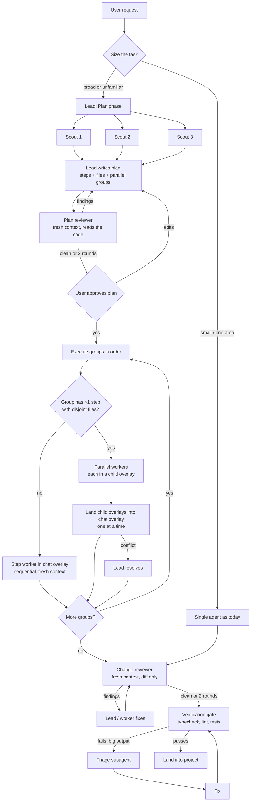

# Subagents for coding tasks: research and a plan for Rovik

A subagent is a second agent run that the main agent ("lead") starts with
a task, its own fresh context and its own tools. The subagent returns a
short result, and only that result enters the lead's context.

This document answers three questions:

1. How well do subagents work for coding, according to published evidence?
2. Where would they help Rovik most?
3. How should a run with subagents work?

**Short answer:** subagents help coding when they **read and judge**, and
they rarely help when several of them **write** the same code at once. Rovik
should start with read-only scouts and a fresh-context reviewer, then add
sequential step workers. Parallel writers should come last, and only for
plan steps whose file sets don't overlap.

The development plan, task by task, is in
[`subagents-plan.md`](subagents-plan.md).

---

## 1. What the evidence says

### Numbers

| Source                                                                    | Finding                                                                                                                                                                                                                                                                                                              | What it means for coding                                                                                                                                                                                               |
| ------------------------------------------------------------------------- | -------------------------------------------------------------------------------------------------------------------------------------------------------------------------------------------------------------------------------------------------------------------------------------------------------------------- | ---------------------------------------------------------------------------------------------------------------------------------------------------------------------------------------------------------------------- |
| Anthropic, _How we built our multi-agent research system_ (2025)          | A lead model with parallel subagents scored 90.2% higher than a single agent on Anthropic's internal research eval. It used about **15× the tokens of a chat** (a single agent uses about 4×). Token spend alone explained **80%** of the variance in BrowseComp scores. Parallelism cut research time by up to 90%. | The gain comes mostly from spending more tokens in parallel, isolated contexts. The authors say coding is a **worse fit** because it "has fewer truly parallelizable tasks" and agents coordinate poorly in real time. |
| Cognition, _Don't Build Multi-Agents_ (2025)                              | Parallel subagents that each see only part of the context make conflicting decisions. Their example is a Flappy Bird clone where one subagent's bird and another's background don't match in style. Two principles follow: share full traces, and remember that actions carry implicit decisions.                    | Parallel **writers** with partial context are fragile.                                                                                                                                                                 |
| Cognition, follow-up (2026), as reported secondhand                       | The original concerns still hold for swarms of parallel writers. Setups work when extra agents **add intelligence while writes stay single-threaded**. Devin's code-review agent deliberately does **not** share context with the coding agent.                                                                      | Read-only helpers and independent reviewers work. Parallel editing doesn't.                                                                                                                                            |
| Cemri et al., _Why Do Multi-Agent LLM Systems Fail?_ (NeurIPS 2025, MAST) | Across 7 frameworks and 1,600+ annotated traces, gains over single agents are often minimal. The paper names 14 failure modes in three groups: system design, inter-agent misalignment, and task verification.                                                                                                       | Most failures come from orchestration (roles, handoffs, missing checks), not from the model. Role-play pipelines are the riskiest design.                                                                              |
| _Dissecting the SWE-Bench Leaderboards_ (2025)                            | Neither single-agent nor multi-agent architectures are shown to score better. The authors judge most coding tasks a poor fit for multi-agent systems with current technology.                                                                                                                                        | Subagents are not a general accuracy boost on issue-fixing.                                                                                                                                                            |
| SWE-Dev (2025)                                                            | Simple strategies often give a better balance of performance and cost than workflow-heavy multi-agent systems.                                                                                                                                                                                                       | Spend the extra tokens only where they buy something.                                                                                                                                                                  |
| Chroma, _Context Rot_ (2025), as reported secondhand                      | All 18 models tested got less reliable as input length grew, even on simple tasks. Distractors similar to the target made it worse.                                                                                                                                                                                  | This supports **context isolation**: a long exploration kept out of the lead's context makes the lead more reliable.                                                                                                   |
| SWE Atlas (2026)                                                          | Claude models start at least one subagent in nearly every trial on codebase Q&A.                                                                                                                                                                                                                                     | Today the main use of subagents is **exploring and answering questions about code**, not writing code in parallel.                                                                                                     |

### What subagents actually buy

Subagents offer four separate benefits. Each one costs something.

| Benefit                                                       | When it pays                                                               | Cost                                                                                                                  |
| ------------------------------------------------------------- | -------------------------------------------------------------------------- | --------------------------------------------------------------------------------------------------------------------- |
| **Context isolation**: 50 file reads become a 1-page report   | Broad exploration, log and test-failure triage, reading docs and web pages | The lead loses details the report left out. The task brief has to be precise.                                         |
| **Parallelism**: less wall-clock time                         | Independent questions about separate parts of the code                     | Tokens add up. In Rovik, heavy commands share CPU slots (1 by default), so parallel **builds and tests** gain little. |
| **Independence**: a fresh view without the author's reasoning | Code review, test writing, checking a plan                                 | One more model pass for each review                                                                                   |
| **Model routing**: cheap model for cheap work                 | Searching, summarizing, classifying                                        | A weaker model can overlook what matters                                                                              |

The main costs are tokens (several times more), context lost at handoffs,
coordination failures (MAST), and merge conflicts between writers.

### Rules that follow from the evidence

1. **One writer at a time on any given file.** Writers can run in parallel
   only on file sets known in advance not to overlap.
2. **Subagents return conclusions, not raw data.** Each result is a short,
   structured report with `path:line` references.
3. **Write each brief as if it were a ticket.** It states the goal, the
   scope, what is out of scope, the output format and a budget. Vague briefs
   caused the duplicated work and coverage gaps in Anthropic's system.
4. **Scale effort to the task.** A simple task uses 0 subagents. A focused
   question uses 1–2 subagents with about 10 tool calls each. A broad
   investigation uses 3–5. Never use dozens.
5. **The environment verifies the result, not another agent's opinion.**
   Rovik's verification gate already does this; subagents must not replace
   it.
6. **No nesting.** Subagents cannot start subagents (depth 1).

---

## 2. Rovik's starting point

Rovik already has most of the pieces a subagent system needs:

| Existing piece                                | Where                                                      | Role in a subagent design                                                                                                                       |
| --------------------------------------------- | ---------------------------------------------------------- | ----------------------------------------------------------------------------------------------------------------------------------------------- |
| Parallel read-only tool calls (up to 8)       | `agent_run/parallel.rs` (`PARALLEL_TOOLS`, `MAX_PARALLEL`) | The same mechanism can run read-only subagents side by side.                                                                                    |
| Per-chat overlays, three-way merge on landing | `overlay/`, `overlay/land.rs`, `merge.rs`                  | A writing subagent gets a **child overlay** that lands into the parent chat's overlay. Conflicts are detected rather than silently overwritten. |
| Plan mode with structured plans               | `agent_run/plan.rs` (`submit_plan`, steps that name files) | The plan's steps, and the files each step names, decide what can run in parallel.                                                               |
| Verification gate                             | `agent_run/verify.rs` (`MAX_VERIFY_ROUNDS = 3`)            | Runs the project's checks to verify the combined result.                                                                                        |
| AI reviewer with fallback models              | `agent_run/review.rs`                                      | Already a second model with its own prompt. It judges single **actions**; it doesn't review the whole change.                                   |
| Heavy-work queue                              | `workload/` (1 CPU slot by default)                        | Limits parallel builds. Parallel writers wait here, so they gain less than you'd expect.                                                        |
| Repo map, outlines, `callers`, `neighbours`   | `repo_map/`, `outline/`                                    | Make scouts cheap and precise.                                                                                                                  |
| CLM context mode, `@context/TASK.md`          | `clm/`                                                     | Another way to fight context growth. Subagents complement it: exploration never enters the context in the first place.                          |
| A manual reviewer prompt                      | `PROMPTS.md`                                               | The user already runs fresh-context reviewers by hand, with an area, rules and an output format. This is use case B below, done manually.       |

---

## 3. Use cases for Rovik, ranked

### Tier 1: build first (high value, low risk)

**A. Scout (read-only exploration).**

- **What it does:** answers one question about the code, such as "Where
  and how is landing triggered, and who calls it?" or "Which settings pages
  read `Permissions`?" It returns a short report: the answer, the relevant
  `path:line` references, and anything that's still unclear.
- **Tools:** `read`, `list_dir`, `search_code`, `outline`, `callers`,
  `neighbours`, `diagnostics`, and optionally `web_search` and `browse_url`.
  It has no `write`, no `bash` and no `ask_user`.
- **Model:** a cheap, fast model (a new "Subagent model" setting).
- **Used in:** Plan mode (several scouts in parallel before writing the
  plan) and Agent mode (before a change that touches unfamiliar code).
- **Why first:** the evidence shows this pattern works best. It is the
  main use in SWE Atlas, and isolating context is its whole benefit. It
  carries no risk of conflicting writes. It also fits `PARALLEL_TOOLS`
  without changes to the overlay.

**B. Change reviewer (fresh context, adversarial).**

- **What it does:** after the agent finishes and **before** the
  verification gate and landing, it reviews the chat's full diff against
  the user's request and the plan. It reports bugs, missed call sites,
  unhandled edge cases and plan steps that weren't done. Each finding has
  `path:line`, a severity and a concrete failure scenario, in the format
  `PROMPTS.md` already uses.
- **Independence:** it does **not** see the lead's reasoning or history,
  only the request, the plan, the diff and read-only tools. This is the
  pattern Cognition reports works.
- **Output:** the lead must fix confirmed high and medium findings, or
  explain why it doesn't. Allow at most 1–2 review rounds, then hand over
  to the verification gate.
- **Difference from `review.rs`:** that reviewer decides whether one
  action may run. This one judges the whole change.
- **Plan reviewer (Plan mode):** the same idea, applied to a plan before
  the user sees it. Code checks run first: the files a step names must
  exist, and steps in a parallel group must not share files. Then a
  read-only reviewer reads the code and looks for the problems a plan
  causes later:
  - callers and dependents the plan doesn't update;
  - names of functions, types or settings that don't exist;
  - steps in the wrong order;
  - scope missing from the request, or added beyond it;
  - registration points (such as `lib.rs` or `commands.ts`) that several
    steps of one group would all edit.

  At most 2 rounds. The agent answers each finding by number (fixed, or
  not a problem and why), and the second round checks those answers
  against the revision: it says which earlier findings are resolved and
  adds only new findings that are high or about what the revision
  changed. Anything still open is listed at the end of the plan for the
  user.

**C. Failure triage.**

- **What it does:** when a check fails with a large output (a test run, a
  `cargo build` with many errors, a CI log), a subagent reads the output
  and the failing code. It returns the root cause, the files to fix and
  the smallest next step.
- **Why:** raw failure output is a major cause of context growth. Today
  `verify.rs` trims it to `FAILURE_OUTPUT_CHARS = 8000` and loses detail.
  A triage subagent can read the whole output and still return only a
  short result.
- **When to use it:** only when the output is over a size threshold or
  the same check has failed twice.

### Tier 2: next (good value, needs more infrastructure)

**D. Sequential step worker (fresh context per plan step).**

- **What it does:** runs an approved plan with 6 or more steps one step at
  a time. Each step goes to a fresh worker. The worker gets the plan, its
  step, a short summary of the earlier steps and the current diff, and it
  works in the **same** chat overlay. The lead keeps only the plan, the
  summaries and the results.
- **Why:** long implementations lose reliability as context grows. A fresh
  context for each step keeps every worker's context small, and because the
  steps run one after another, two workers never write at the same time.
- **Risk:** a step depends on earlier ones it can't see. Reduce this by
  giving the worker the current diff of files its step names, plus the
  "Decisions" section of the plan.

**E. Independent test writer.**

- **What it does:** writes tests from the **specification** (the request,
  the plan and the public interfaces), not from the implementation.
- **Why:** when the implementer writes its own tests, those tests check
  what the code does, not what it should do. An independent writer finds
  spec mismatches.
- **How it runs:** it works on test files only, in parallel with the
  implementation or after it.

### Tier 3: only with clear conditions

**F. Parallel implementers.**

- **When:** only when plan steps declare file sets that don't overlap
  (for example, a Rust backend command and a separate settings page).
- **How it runs:** each worker gets a child overlay. Results land into the
  chat overlay one at a time through `overlay/land.rs`, and a conflict goes
  back to the lead.
- **Expected gain:** modest. With one heavy CPU slot, builds and tests
  still run one at a time.

**G. Best-of-N.**

- **What it does:** solves a hard bug N times in separate overlays and
  keeps the variant that passes checks and review.
- **When:** only on explicit user request, because it multiplies cost.

### Avoid

- **Role-play pipelines** (PM → architect → coder → tester personas
  handing off documents). This is the design MAST found most prone to
  failure.
- **Parallel writers on shared files**, or writers without a plan that
  splits files between them.
- **Letting subagents ask the user questions.** Only the lead talks to
  the user, which keeps the 3-question limit per run meaningful.
- **Subagents for small tasks.** A one-file fix should never start one.

---

## 4. Execution flow

### Overall flow



### Step by step

1. **Size the task.** The lead first decides whether delegating is worth
   it. A rule of thumb: delegate when the answer needs more than about 15
   reads, spans 2 or more unrelated parts of the code, or the plan has 6
   or more steps. Otherwise it works alone, as today. The system prompt
   states this rule, and the router never starts subagents for a short
   question.
2. **Explore (parallel, read-only).** The lead sends 1–4 scouts with
   separate questions. Each scout has a budget of about 15–25 tool calls
   and returns a report of at most about 1,500 tokens. Scouts run
   concurrently, like parallel read-only tool calls.
3. **Plan.** The lead writes the plan with `submit_plan`. Each step already
   names its files. A new optional "Group" line marks steps that can run
   together, and the plan checker accepts a group only if its steps' file
   lists don't overlap. Before the plan is saved, the plan reviewer checks
   it against the code, for at most 2 rounds. The user approves or edits
   the plan, as today.
4. **Execute.** Groups run in order.
   - A one-step group runs on the lead, or on a fresh step worker when the
     plan is long.
   - A multi-step group with disjoint files runs as parallel workers in
     child overlays. Their results land into the chat overlay one at a
     time, and any conflict goes to the lead.
   - Heavy commands from all workers share the `workload` queue. The UI
     shows each worker as a collapsible block in the chat.
5. **Review.** A change reviewer reads the full diff with a fresh context.
   The lead fixes the confirmed findings. There are at most 2 rounds.
6. **Verify.** The existing gate runs the project's checks. When a failure
   has large output, a triage subagent reads it and the lead (or a worker)
   fixes the cause. The limit stays at 3 rounds (`MAX_VERIFY_ROUNDS`).
7. **Land.** The chat overlay lands into the project, as today.

### The subagent contract

Every subagent gets the same kind of brief and returns the same kind of
result.

**Brief** (the lead writes it, through the `task` tool):

```json
{
  "kind": "scout | worker | testWriter | workers",
  "goal": "The one question or task, written like a ticket",
  "context": "Optional: what the lead already knows, what's out of scope",
  "paths": ["src-tauri/src/overlay/", "src/lib/overlay.ts"],
  "max_tool_calls": 10,
  "continue": "Optional: a finished subagent's handle, for a follow-up",
  "step": 3,
  "group": "pages"
}
```

`step` is for a worker (the plan step it carries out) and `group` for
`workers` (a plan group, one worker per step). The harness, not the brief,
sets each kind's tools and budget: `max_tool_calls` can only lower it.
The reviewer, triage and the plan reviewer are started by the harness,
not through `task`.

**Result** (returned as the tool's output). Each kind has its own `## `
sections (`subagent.rs` `KindSpec`); a report must have the first ones
(`required`), and the rest are optional:

| Kind          | Sections (required first)                                                                                                                                                          |
| ------------- | ---------------------------------------------------------------------------------------------------------------------------------------------------------------------------------- |
| scout         | `Answer`; `Evidence`, `Open questions`, `Web sources`                                                                                                                              |
| worker        | `Summary`; `Changed files`, `Open questions`                                                                                                                                       |
| test writer   | `Summary`; `Test files`, `Assumptions`                                                                                                                                             |
| triage        | `Root cause`, `Files to fix`, `Next step`, `Confidence`                                                                                                                            |
| reviewer      | `Findings`: a numbered list (`change_review.rs`), or None.                                                                                                                         |
| plan reviewer | `Findings`, the same list, with `Step N` for a location.                                                                                                                           |
| acceptance    | `Verdicts`; `Evidence`, `Unmet` (Autopilot's, `acceptance.rs`)                                                                                                                     |
| planner       | `Plan`, `Criteria`: one of them, as the brief asks: the whole plan under `Plan`, or the criteria alone (Thorough's, `planning.rs`)                                                 |
| judge         | `Choice`, `Criteria`: one of them, as the brief asks: a choice among plans (then `Why`, and `Plan` when it merged or revised one), or the merged criteria (Thorough's, `judge.rs`) |
| breaker       | `Summary`; `Test files`, `Assumptions` (Thorough's, `breaker.rs`)                                                                                                                  |

There's no `## Status` section: the harness decides the status.

- **done:** the report follows the format.
- **blocked:** a non-empty `## Blocked` section (not "none" or "no"),
  which alone is enough, whatever else is missing.
- **partial:** the budget ran out (or it looped), and its report is what
  it found.
- **unformatted:** still out of format after one repair turn.
- **failed:** every model failed.
- **stopped:** the user stopped it.

**Rules:**

- **Tools:** each kind gets a fixed tool set. Scouts, reviewers and triage
  are read-only. Workers get `write`, plus `bash` within the chat's
  permissions.
- **Permissions and approvals:** these come from the parent chat.
  Approvals appear in the parent chat's UI.
- **Questions:** subagents never call `ask_user`. When something is
  unclear, a subagent reports it as "blocked", and the lead asks the user.
- **Nesting:** none. A subagent can't start another subagent.
- **Stopping:** Stop on the parent chat stops all of its subagents.
- **Recording:** everything a subagent does is stored, so the user can
  open and inspect it. Only the result enters the lead's context.

---

## 5. Implementation sketch

This is the order to build it in, matching the tiers above.

1. **`agent_run/subagent.rs`** (new): the brief and result types, the
   tool set for each kind, the budgets, and a function that starts a
   child `Run`. The child run gets its own message list, the parent's root
   or overlay, a fixed tool set and a model profile.
2. **A `task` tool** in `tools.rs`, offered to the lead in Agent and Plan
   modes. It is available only when subagents are enabled, and never to
   subagents themselves. Add read-only kinds to `PARALLEL_TOOLS` handling
   so that several scouts can run concurrently, with their own limit
   (default 3).
3. **Settings** (`aiSettings.ts`, `ModelProfile`): a subagent model and
   fallbacks (like the reviewer model), concurrent subagents (default 3),
   subagents per run (default 8), and an on/off switch for each kind.
4. **Storage and UI:** subagent messages are stored under the parent tool
   call. `ToolCallBlock` shows them as a collapsible block that shows the
   brief, a live status and the result.
5. **Change reviewer:** a hook in `run.rs` at the end of a run that wrote
   files, before `verify.rs`. Its prompt is based on the reviewer prompt
   in `PROMPTS.md`.
6. **Failure triage:** a hook in `verify.rs` that takes over when the
   failure output is longer than `FAILURE_OUTPUT_CHARS`.
7. **Step workers and the plan "Group" field:** a `plan.rs` checker for
   groups whose files don't overlap. For parallel groups, child overlays
   are created through `overlay/chats.rs` and landed through
   `overlay/land.rs`.
8. **Tests:** extend `e2e_tests.rs` with a scripted model. The tests
   should cover: briefs reach the child run; a read-only kind can't write;
   Stop cancels children; results stay short; parallel workers with
   overlapping files are refused; child overlays land and report conflicts.

---

## 6. How to know it works

Turn subagents on behind a setting and compare the same tasks with and
without them. Use 20–40 real tasks taken from this repository's history
(for example, merged pull requests and their issues).

| Metric                                                         | Source                                    | Goal                                                                                                  |
| -------------------------------------------------------------- | ----------------------------------------- | ----------------------------------------------------------------------------------------------------- |
| Task success: checks pass and no high-severity review findings | Verification records, plus a manual check | Not worse; better on broad tasks                                                                      |
| Total tokens and cost per task                                 | `ROVIK_API_LOG`                           | Scouts and review: ≤ 2× the single agent. Stop any feature that costs more without a measurable gain. |
| Peak context of the lead                                       | Context meter                             | Clearly lower on broad tasks                                                                          |
| Wall-clock time                                                | Run timestamps                            | Lower for exploration-heavy tasks                                                                     |
| User interventions: rejected edits, conflicts, re-runs         | Chat database                             | Lower                                                                                                 |

Keep a kind only if it improves success or the lead's context without
pushing cost past its budget. Based on the evidence above, expect scouts,
the change reviewer and triage to pass this test. Parallel implementers
probably won't, except on clearly separate work.

---

## Sources

- Anthropic: [How we built our multi-agent research system](https://www.anthropic.com/engineering/multi-agent-research-system)
- Cognition: [Don't Build Multi-Agents](https://cognition.ai/blog/dont-build-multi-agents)
  and the follow-up [Multi-agents working](https://cognition.ai/blog/multi-agents-working)
  (the follow-up was read through secondary summaries only)
- LangChain: [How and when to build multi-agent systems](https://blog.langchain.com/how-and-when-to-build-multi-agent-systems)
- Cemri et al.: [Why Do Multi-Agent LLM Systems Fail?](https://arxiv.org/abs/2503.13657) (NeurIPS 2025)
- [Dissecting the SWE-Bench Leaderboards](https://arxiv.org/pdf/2506.17208)
- [SWE-Dev](https://arxiv.org/pdf/2505.16975)
- [SWE Atlas](https://arxiv.org/pdf/2605.08366)
- Chroma's _Context Rot_ report, through secondary coverage:
  [ZenML summary](https://www.zenml.io/llmops-database/context-rot-evaluating-llm-performance-degradation-with-increasing-input-tokens)
